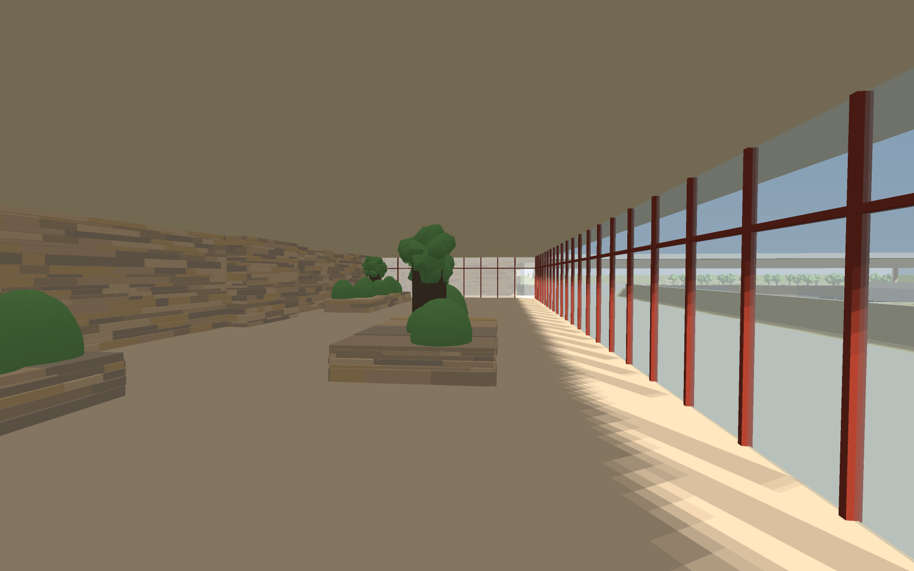

# brownfield-compute

**A data center a town would vote for.**

Data centers are being built at retired coal plants, because those sites still have what a data
center needs: a big grid connection, water rights, rail, industrial zoning. Many of those towns
are shrinking. And many data centers draw the same complaints wherever they go: water drawn for
cooling, strain on the grid and on power bills, a constant hum, diesel generators, few jobs, and
heat dumped into the air.

This project asks one question and answers it with public data and real numbers:

> When a data center comes to a retired coal plant in a shrinking town, how should it be designed
> so that the town comes out ahead?

Every answer is compared with a conventional data center on the same site; the difference is the
result. Each step ships as a short finished report with its figures and an honest list of what we
don't know.

## The design so far


The campus is one building:

- **A stone data hall**, about 120 by 130 m, which holds the computers. Its coolers stand in rows
  on the roof behind a 3 m stone parapet, with planted strips between the rows. From the ground
  you see stone walls and towers, not machinery.
- **A public winter garden** on the side facing the town, kept warm all winter by the data
  center's waste heat. It draws on Fallingwater, the Frank Lloyd Wright house in the same western
  Pennsylvania sandstone country:
  - concrete terraces reaching out over pools that step down through a waterfall;
  - coursed sandstone;
  - long bands of glass.

  Its two glass rooms have about 540 m² of floor between them. A stone tower climbs the hall's
  face where the warm water comes in.
- **Trees kept back.** No tree stands within 10 m of anything built, so roots stay clear of the
  foundations. Indoor plants grow in raised stone planters.

<p>


</p>

Built and rendered in CortenForge (`cargo run --release -- garden` in `forge/`).

What the numbers say so far (in progress; [plan](docs/PLAN.md)):
- **Heat.** The garden needs 36–64 MWh of heat in a typical Homer City year, kept at 12–18 °C.
  That figure ignores the sun, so it is an upper bound. It is under 0.01% of one 100 MW module's
  heat: the garden is there for the town, not to get rid of heat. Its floors need water at
  23–31 °C, and the data center's warm water leaves the chips at about 50 °C.
- **The terraces.** The lowest terrace reaches 5.5 m past its last support. At 600 mm deep it
  would sag 44 mm over the years, against the 23 mm limit in the concrete code (ACI 318); at
  900 mm it sags 20 mm. Fallingwater's own terraces were short of steel. They had sagged by up to
  about 7 inches by the mid-1990s and had to be strengthened
  ([Fallingwater's preservation history](https://fallingwater.org/preservation-history/)).
- **Noise.** A first check puts the coolers on the roof under the 40 dB(A) night guideline at
  every distance from the building. It assumes low-noise fans and uses pass 2d's sound model; it
  isn't in the project's code yet. The roof hides the coolers from homes on the ground. Homes
  higher up, looking down on the roof, would get less shielding.
- **Not known yet:**
  - what a stone hall and the garden cost to build and to run, against a plain box;
  - their carbon;
  - who would pay.

The idea behind the stonework ([D7](docs/PLAN.md)) is detail no one could afford to lay by hand,
placed by machines that masons oversee and can repair. Whether that comes out cheaper isn't shown
yet.

## Passes

1. **Site screen.** Every US coal plant retired or set to retire, from EIA-860M, scored on what a
   host site needs (grid connection, flood risk, climate) and on what the town needs (population
   trend, income). Checked on known cases: sites real developers already picked (TVA's Bull Run
   for a stellarator fusion plant, Homer City for a data center campus) must rank high, or the
   screen is wrong.
2. **The good-neighbour data center** on one case-study site, against a conventional design:
   power, water, noise at the nearest homes, waste heat, backup power, jobs, taxes
   ([scorecard](docs/SCORECARD.md)).
3. **The first neighbourhood module**: a heat network to homes and a greenhouse, the first house,
   built and checked in [CortenForge](https://crates.io/crates/cortenforge); then the campus
   itself (above).
4. **The economic base**: the employers a data center can't be (hospital, research,
   manufacturing on cheap power), and what housing costs.
5. **Fusion-ready**: a 350 MWe stellarator plant (Type One Energy's Infinity Two class) on the
   site, and what changes. A site option, never something the plan depends on.

**Status**
- **Pass 1 done**, [the site screen](docs/pass1/README.md): 205 sites, both known cases pass, 18
  in the top quarter on both axes.
- **Pass 2 done**, [Homer City](docs/pass2/README.md): the good-neighbour data center, with
  - its [costs](docs/pass2/cost.md) and [firmer inputs](docs/pass2/firm-up.md);
  - [the wall in front of its coolers](docs/pass2/wall.md). Brick walls between the rows of
    coolers, laid by a robot, take ~12 dB off where a berm takes ~1, for about the cost of
    precast. The design above moves the coolers onto the roof instead.
  - What people raised in the public record, against the scorecard:
    [docs/hearing-record.md](docs/hearing-record.md).
  - The issue they raised most, [the gas plant's discharge to Blacklick Creek](docs/pass2/creek.md),
    checked against the state's temperature rules.
- **Pass 3 done**, [the first neighbourhood module](docs/pass3/README.md): the first house in
  CortenForge, heated straight off the data center's warm water. It pays only for dense housing
  beside the campus. In progress: the campus and winter garden above.
- **Pass 4 in progress**, [the economic base](docs/pass4/README.md):
  - About 120 newcomer households would rent near the campus (85–220), not 1,000.
  - The campus's property tax, about $96 million a year at build-out, is several times what their
    housing gap costs. Most of it is school tax, which can't pay for housing.

Decisions and next steps: [docs/PLAN.md](docs/PLAN.md). Sources: [docs/RESEARCH.md](docs/RESEARCH.md).

## Why

The long view is a town built around shared infrastructure, planned and simulated up front and
then built quickly in repeated modules: housing people can afford, a hospital, research, food
grown on the data center's heat, on land that had lost its reason to exist. It is also a testbed
on Earth for the systems a self-sufficient settlement needs (see
[mothership](https://github.com/YoungMoolahBaby/mothership)). Large planned projects mostly fail
on cost, demand and politics rather than engineering, so this project starts with the parts that
can be checked.

## Run

```sh
uv sync
uv run brownfield sites     # pass 1: the site screen (downloads and caches ~35 MB, ~15 min the first time)
uv run brownfield rank      # pass 1: rank on both axes, draw docs/pass1/*.png
uv run brownfield check     # parameters, and the known cases against the screen
uv run pytest
```

Python (uv) for the screen, economics and GIS; Rust with CortenForge under `forge/` from pass 3.

## License

Apache-2.0.
