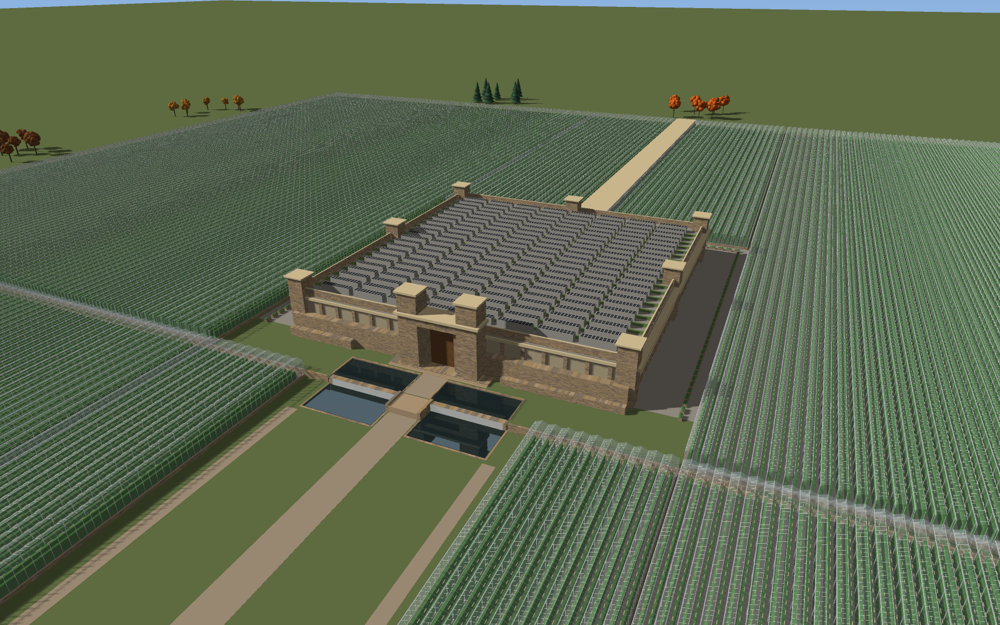
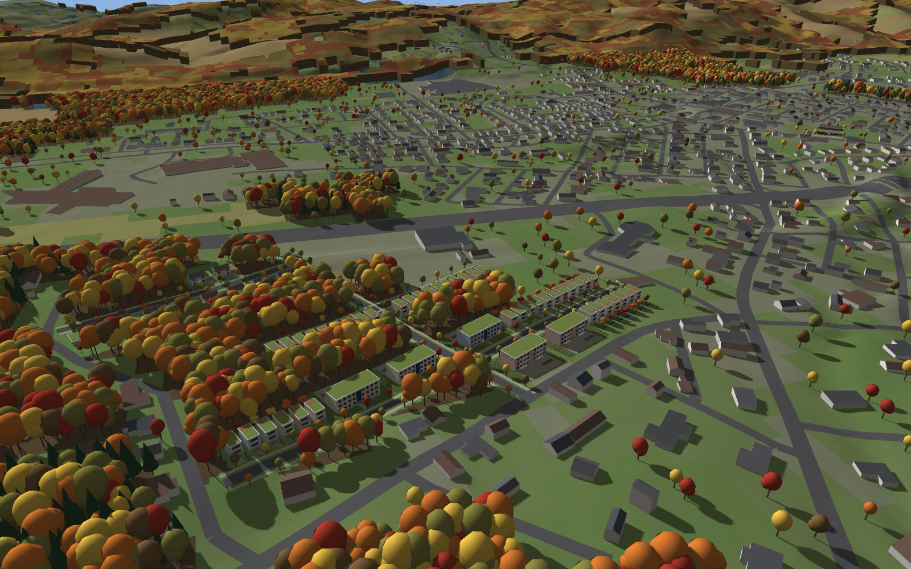

# brownfield-compute

**A data center a town would vote for.**

Data centers are being built at retired coal plants, because those sites still have what a data
center needs: a big grid connection, water rights, rail, industrial zoning. Many of those towns
are shrinking. And many data centers draw the same complaints wherever they go: water drawn for
cooling, strain on the grid and on power bills, a constant hum, diesel generators, few jobs, and
heat dumped into the air.

This project asks one question and answers it with public data and real numbers:

> When a data center comes to a retired coal plant in a shrinking town, how should it be designed
> so that the town comes out ahead?

Every answer is compared with a conventional data center on the same site; the difference is the
result. Each step ships as a short finished report with its figures and an honest list of what we
don't know.

## Who it's for

This is independent public analysis. It isn't affiliated with any developer, utility or government.

1. **Host communities first.** These are the townships, boroughs and counties where a data center
   is proposed.
   - They're asked to approve it, and few can afford their own study of what it will do to their
     water, their nights, their roads and their housing.
   - Nor can they easily work out what to ask for in return.
2. **A method any town can reuse.**
   - Score the proposed data center against the conventional design on the same site, from public
     data, with the uncertainty stated.
   - Then split the asks into what the design should do and what the benefits agreement should pay
     for.
   - Pass 1 found 205 retired coal sites where it could apply.
3. **A standard developers can be held to.**
   - Developers are welcome to meet it. Pennsylvania's GRID requirements give them reason to:
     local approval before state permits, a yearly public water report, and the state's sales tax
     exemption tied to meeting them.
   - It isn't written for them, and its findings are published whether or not they favour a data
     center.

**For the towns round Homer City:** [a brief](docs/township-brief.md) on what Center Township, Black
Lick Township and Homer City Borough can ask of AWS's campus: of its design, and in the benefits
agreement. It covers what each ask costs, who pays, and the questions to put to AWS.

**How people behave around it:** a companion study,
[new-melting-pot](https://github.com/YoungMoolahBaby/new-melting-pot), takes the questions about
people rather than buildings: whether newcomers mix with the towns, who runs the shared places,
who owns the heat loop, the construction surge, and whether a benefits agreement holds
([its answers](https://github.com/YoungMoolahBaby/new-melting-pot/tree/main/docs/answers)). Only
its findings from real cases are used here, never its simulations.

## The design so far



The campus:

- **A stone data hall**, about 120 by 130 m, which holds the computers. Its coolers stand in rows
  on the roof behind a 3 m stone parapet, with planted strips between the rows. From the ground
  you see stone walls and towers, not machinery.
- **Its front, facing the town, is a monument to the machines inside, whose heat warms the glass round it.**
  - Two stone pylons stand on a stepped base. Between them is a pair of bronze doors 10 m wide
    and 14 m high.
  - Before them, two warm basins steam on cold days. They spill over a ledge into two lower pools,
    either side of a stair down to the square.
  - The tradition is the great waterworks and pumping stations, such as Philadelphia's Fairmount
    Water Works, not a temple.
- **A public winter garden on the community center**, the neighbourhood's shared building, facing
  the square. It is kept warm all winter by the data center's waste heat. It draws on
  Fallingwater, the Frank Lloyd Wright house in the same western Pennsylvania sandstone country:
  - concrete terraces reaching out over pools that step down through a waterfall;
  - coursed sandstone;
  - long bands of glass.

  Its two glass rooms have about 540 m² of floor between them. A stone tower rises from its back
  wall where the warm water comes in.
- **Food houses round the hall, as its moat** (D16). About 38.5 ha (95 acres) of glasshouses
  stand in a ring round the hall and grow tomatoes through the winter.
  - They're heated straight off the data center's 50 °C water, with grow lights where the winter
    sun falls short ([pass 3d](docs/pass3/food.md)).
  - A fire and service road runs between the hall and the glass. The hall's trucks come through a
    covered crossing at its back.
  - On the town side, the warm basins' court runs on as an open mall between the glass to the
    square, with the food court at its mouth.
  - Public vehicles stay 320 m from the hall.
- **Homes in rings round the centre** (D16):
  - small flats in three-storey walk-ups nearest the square;
  - townhouses over their own garage-workshops next;
  - larger houses furthest out.
  Every home stays under the WHO's 40 dB(A) night guideline at its windows.
- **A community center open 24 hours**, paid for by memberships like a gym's, with leagues and
  ice rental. The square, the mall, the garden and the walks stay free to everyone.
- **An arboretum of native Pennsylvania trees:** oaks, sugar maple, black cherry, tulip poplar,
  sycamore, hemlock and white pine. Each species stands back from every foundation by its own
  root reach (UK house-building rules: up to 1.25 times a tree's mature height for oaks). Indoor
  plants grow in raised stone planters.

<p>


</p>

Built and rendered in CortenForge (`cargo run --release -- garden` in `forge/`).

What the numbers say so far (in progress; [plan](docs/PLAN.md)):
- **Heat.** The garden needs 36–64 MWh of heat in a typical Homer City year, kept at 12–18 °C.
  That figure ignores the sun, so it is an upper bound. It is under 0.01% of one 100 MW module's
  heat: the garden is there for the town, not to get rid of heat. Its floors need water at
  23–31 °C, and the data center's warm water leaves the chips at about 50 °C.
- **The terraces.** The lowest terrace reaches 5.5 m past its last support. At 600 mm deep it
  would sag 44 mm over the years, against the 23 mm limit in the concrete code (ACI 318); at
  900 mm it sags 20 mm. Fallingwater's own terraces were short of steel. They had sagged by up to
  about 7 inches by the mid-1990s and had to be strengthened
  ([Fallingwater's preservation history](https://fallingwater.org/preservation-history/)).
- **Noise.** With low-noise fans, the coolers on the roof stay under the 40 dB(A) night
  guideline at every distance from the building (`brownfield garden`, pass 2d's sound model).
  That is down to the fans, not the roof. With the same fans, pass 2d's walled cells on the
  ground are quieter at the distances where homes are. The roof was chosen for the building: one
  roofed hall, no walls standing in the open. Homes higher up, looking down on the roof, would
  get less shielding.
- **The warm basins.** Held at 20 °C, they take 4.6 GWh of heat a year and evaporate about
  3,700 m³ of water, about nine families' home use, and more in summer, when the sun warms them.
  The hall itself evaporates none. At 30 °C they would take twice the heat and 2.5 times the
  water, so they are kept at 20 °C, which still steams in a Pennsylvania winter.
- **Not known yet:**
  - what a stone hall, its front and the garden cost to build and to run, against a plain box;
  - their carbon;
  - who would pay.

The idea behind the stonework ([D7](docs/PLAN.md)) is detail no one could afford to lay by hand,
placed by machines that masons oversee and can repair. Whether that comes out cheaper isn't shown
yet.

## Passes

1. **Site screen.** Every US coal plant retired or set to retire, from EIA-860M, scored on what a
   host site needs (grid connection, flood risk, climate) and on what the town needs (population
   trend, income). Checked on known cases: sites real developers already picked (TVA's Bull Run
   for a stellarator fusion plant, Homer City for a data center campus) must rank high, or the
   screen is wrong.
2. **The good-neighbour data center** on one case-study site, against a conventional design:
   power, water, noise at the nearest homes, waste heat, backup power, jobs, taxes
   ([scorecard](docs/SCORECARD.md)). As the design now stands, against the modern designs its
   case is the creeks and quiet nights, not heat: at campus scale the glass the market can take
   uses under 1% of the heat. Most of what the towns get comes whichever design is built; what
   the good-neighbour deal adds is the benefits agreement.
3. **The first neighbourhood module**: a heat network to homes and a greenhouse, the first house,
   built and checked in [CortenForge](https://crates.io/crates/cortenforge); then the campus
   itself (above).
4. **The economic base**: the employers a data center can't be (hospital, research,
   manufacturing on cheap power), and what housing costs.
5. **Fusion-ready**: a 350 MWe stellarator plant (Type One Energy's Infinity Two class) on the
   site, and what changes. A site option, never something the plan depends on.

**Status**
- **Pass 1 done**, [the site screen](docs/pass1/README.md): 205 sites, both known cases pass, 18
  in the top quarter on both axes.
- **Pass 2 done**, [Homer City](docs/pass2/README.md): the good-neighbour data center, with
  - its [costs](docs/pass2/cost.md) and [firmer inputs](docs/pass2/firm-up.md);
  - [the wall in front of its coolers](docs/pass2/wall.md). Brick walls between the rows of
    coolers, laid by a robot, take ~12 dB off where a berm takes ~1, for about the cost of
    precast. The design above moves the coolers onto the roof instead.
  - What people raised in the public record, against the scorecard:
    [docs/hearing-record.md](docs/hearing-record.md).
  - The issue they raised most, [the gas plant's discharge to Blacklick Creek](docs/pass2/creek.md),
    checked against the state's temperature rules.
  - [The water budget](docs/pass2/water.md), from Two Lick Creek Reservoir through the plant to the
    creeks.
    - **"In line with history":** HCR's claim means the same intake, 37.6 million gallons a day
      at its pumps' capacity. The coal plant never drew more than 21 million gallons a day in a
      month.
    - **The data centers as filed:** the station's water balance gives them 1,400 gallons a
      minute, 400 of it returned. That is little enough that the halls must be cooled mostly dry.
    - **The gas plant:** its own condensers draw ~21 million gallons a day, and the reservoir
      stays above half. At the intake's full capacity it would fall to 7% in the 1952 drought.
    - **Cooling towers at the data halls** would need more than the intake can draw. Fed from the
      reservoir, they would empty it in the droughts of 1952 and 1991.
  - [The air](docs/pass2/air.md): the gas plant's permit against what the coal plant emitted, and
    what each design adds.
    - **Per unit of power** the gas plant is far cleaner: 99.95% less SO2 and 98.5% less NOx.
    - **In total,** being 2.5 times the size, it can emit 45% more greenhouse gases than the coal
      plant's busiest recent year.
    - **The design's lever is the diesel:** routine tests of Tier 2 generators would add up to 55%
      to the gas plant's NOx for the halls. Tier 4 adds 6%, and batteries nothing.
- **Pass 3 done**, [the first neighbourhood module](docs/pass3/README.md): the first house in
  CortenForge, heated straight off the data center's warm water. It pays only for dense housing
  beside the campus. In progress: the campus and winter garden above, and
  [winter food](docs/pass3/food.md):
  - One module's spare heat carries ~43 ha of lit tomato glasshouses: ~29,500 t a year and ~480
    jobs.
  - With the town network, a third of the module's heat is put to use instead of a tenth.
  - The grow lights add 11% to the module's electricity.
  - The limit is the market, not the heat: that's more tomatoes than the Pittsburgh metro eats.
  - [The neighbourhood](docs/pass3/village.md): 242 homes in rings for pass 4's newcomers (D16).
    - 121 flats in 11 walk-ups nearest the centre, from studios to 3-beds, in the mix now built
      to rent.
    - 98 townhouses over their own garage-workshops, then 23 four-bedroom houses.
    - Every home is under 40 dB(A) at night with ordinary fans. The flats' floors beat the
      code's sound rating.
    - Around the square: a vegan food court, a community center with an ice rink, courts and a
      makerspace, and a heated grass field.
    - Native-planted gardens and green roofs instead of lawns, and big trees on greens between the
      rows, kept clear of the foundations.
    - All of it, with snow-free heated walks and the hall's warm basins, takes 16.8 GWh of the
      module's heat a year.
    - The flats and townhouses heat off the loop; the houses, further out, on their own heat pumps.
      On the real land (D18) the homes join the towns, 1-5 km off, and every one heats itself.
    - The flats leave a $20M gap at market rents. An AWS household can afford a townhouse; the
      county's median household is $82k short.
    - Running the centre costs $3.2M a year: about $32 a month from 7,200 members, between
      Planet Fitness's $15 and the local Y's $47.50.
    - Sewage, not heat, limits growth past ~1,350 homes.
  - [The site plan](docs/pass3/site.md): every piece of the campus a module that can be moved.
    - Rules every layout must pass: homes past the noise setback and on the town side, no public
      vehicles near the hall, trucks screened at the entrance.
    - Roads and walks routed round the buildings; an optimizer proposes layouts, which are then
      edited by hand.
    - Each layout is priced by what it costs a year: walking time at US DOT's value, trucks at
      ATRI's cost, pipes and crossings paid off.
    - What matters most, by that research: no truck road crosses a main walk, then visitors' and
      residents' walks. Truck distance matters least.
    - The chosen layout (D16):
      - the hall inside the greenhouse's moat, its great doors, the basins, the mall and the
        square on one axis;
      - the winter garden on the community center, looking at the flats;
      - the car park against the center's door, and the field beside the car park;
      - trucks kept to the service side, crossing no walk.
    - It was the optimizer's find, cheaper than the hand layout in all 29 cases across the
      inputs' ranges.
  - [What a real application needs](docs/pass3/checklist.md): Pennsylvania's and Indiana County's
    lists, item by item, against this plan.
  - [The real land](docs/pass3/land.md) (D17): AWS's six sites mapped on public data, fitted from
    the county's posted master plan.
    - Half the ground round the plant is clear to build on. Old coal mines lie under the other half
      in places, and there are 1,400 active gas wells.
    - [The conference of communities](docs/pass3/conference.md) (D17-D18): the newcomers join the
      towns already there (3,794 people) by the towns' size, so each grows about 15%.
      - Each town's homes are laid out at its edge on the real ground and drawn in 3D.
      - Homer City and Black Lick get clubhouses; Graceton and Coral play at the shared arena; the
        members play each other.

      
- **Pass 4 in progress**, [the economic base](docs/pass4/README.md):
  - About 120 newcomer households would rent near the campus (85–220), not 1,000.
  - The campus's property tax, about $96 million a year at build-out, is several times what their
    housing gap costs. Most of it is school tax, which can't pay for housing.
  - [The construction workforce](docs/pass4/workforce.md), 2026-2036: a peak of ~3,300 on site in
    mid-2029, after the gas plant's crews leave.
    - Indiana's vacant rentals can house most crews from away, though not in the worst years.
    - Homer City and the townships beside the site have no spare rentals, so the benefits
      agreement should steer crews to Indiana and run park-and-ride buses.

Decisions and next steps: [docs/PLAN.md](docs/PLAN.md). Sources: [docs/RESEARCH.md](docs/RESEARCH.md).

## Why

The long view is a town built around shared infrastructure, planned and simulated up front and
then built quickly in repeated modules: housing people can afford, a hospital, research, food
grown on the data center's heat, on land that had lost its reason to exist. It is also a testbed
on Earth for the systems a self-sufficient settlement needs (see
[mothership](https://github.com/YoungMoolahBaby/mothership)). Large planned projects mostly fail
on cost, demand and politics rather than engineering, so this project starts with the parts that
can be checked.

## Run

```sh
uv sync
uv run brownfield sites     # pass 1: the site screen (downloads and caches ~35 MB, ~15 min the first time)
uv run brownfield rank      # pass 1: rank on both axes, draw docs/pass1/*.png
uv run brownfield check     # parameters, and the known cases against the screen
uv run pytest
```

Python (uv) for the screen, economics and GIS; Rust with CortenForge under `forge/` from pass 3.

## License

Apache-2.0.
