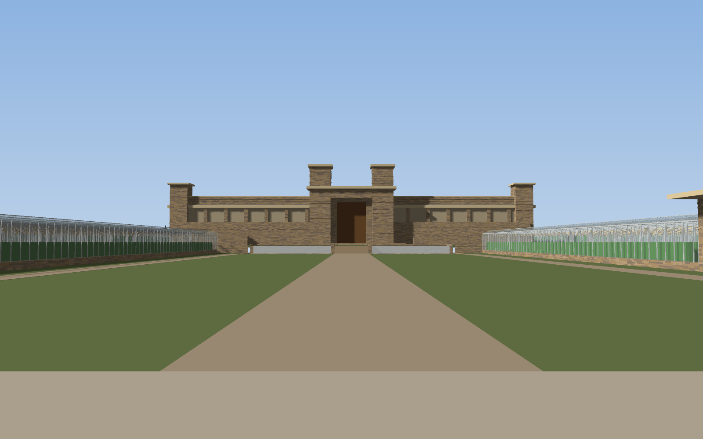
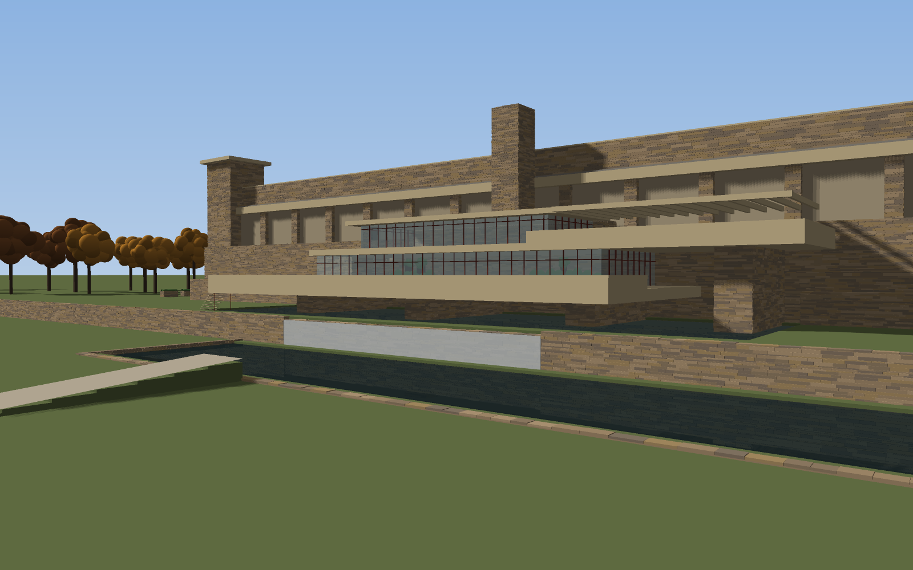

# brownfield-compute

**A data center a town would vote for.**

Data centers are being built at retired coal plants, because those sites still have what a data
center needs: a big grid connection, water rights, rail, industrial zoning. Many of those towns
are shrinking. And many data centers draw the same complaints wherever they go: water drawn for
cooling, strain on the grid and on power bills, a constant hum, diesel generators, few jobs, and
heat dumped into the air.

This project asks one question and answers it with public data and real numbers:

> When a data center comes to a retired coal plant in a shrinking town, how should it be designed
> so that the town comes out ahead?

Every answer is compared with a conventional data center on the same site; the difference is the
result. Each step ships as a short finished report with its figures and an honest list of what we
don't know.

## Who it's for

This is independent public analysis. It isn't affiliated with any developer, utility or government.

1. **Host communities first.** These are the townships, boroughs and counties where a data center
   is proposed.
   - They're asked to approve it, and few can afford their own study of what it will do to their
     water, their nights, their roads and their housing.
   - Nor can they easily work out what to ask for in return.
2. **A method any town can reuse.**
   - Score the proposed data center against the conventional design on the same site, from public
     data, with the uncertainty stated.
   - Then split the asks into what the design should do and what the benefits agreement should pay
     for.
   - Pass 1 found 205 retired coal sites where it could apply.
3. **A standard developers can be held to.**
   - Developers are welcome to meet it. Pennsylvania's GRID requirements give them reason to:
     local approval before state permits, a yearly public water report, and the state's sales tax
     exemption tied to meeting them.
   - It isn't written for them, and its findings are published whether or not they favour a data
     center.

**For the towns round Homer City:** [a brief](docs/township-brief.md) on what Center Township, Black
Lick Township and Homer City Borough can ask of AWS's campus: of its design, and in the benefits
agreement. It covers what each ask costs, who pays, and the questions to put to AWS.

**How people behave around it:** a companion study,
[new-melting-pot](https://github.com/YoungMoolahBaby/new-melting-pot), takes the questions about
people rather than buildings: whether newcomers mix with the towns, who runs the shared places,
who owns the heat loop, the construction surge, and whether a benefits agreement holds
([its answers](https://github.com/YoungMoolahBaby/new-melting-pot/tree/main/docs/answers)). Only
its findings from real cases are used here, never its simulations.

## What it has found so far

Each finding links to its report. [The index](docs/README.md) lists every report in reading order,
with the command and code that make each one.

- **Where.** The screen scores all 205 sites of US coal plants retired or set to retire; 18 are in
  the top quarter both for what a site needs and for what its town needs. Sites real developers
  chose, Homer City and TVA's Bull Run, rank high, as a check
  ([the site screen](docs/pass1/README.md)).
- **What the good-neighbour design changes at Homer City.** Against the modern designs, its case
  is the creeks and quiet nights, not heat: at campus scale the glass the market can take uses
  under 1% of the heat. Most of what the towns get comes whichever design is built; what the
  good-neighbour deal adds is the benefits agreement ([pass 2](docs/pass2/README.md),
  [the scorecard](docs/SCORECARD.md)).
- **Water.** Cooling towers at the data halls would need more than the intake can draw; fed from
  Two Lick Creek Reservoir, they would empty it in the droughts of 1952 and 1991. The water the data
  centers filed for is little enough that the halls must be cooled mostly dry
  ([the water budget](docs/pass2/water.md)).
- **Air.** The design's lever is the diesel: routine tests of Tier 2 generators would add up to 55%
  to the gas plant's NOx for the halls, Tier 4 6%, and batteries nothing
  ([the air](docs/pass2/air.md)).
- **Heat and food.** One module's spare heat carries ~43 ha of lit tomato glasshouses, ~29,500 t a
  year and ~480 jobs. The limit is the market, not the heat ([winter food](docs/pass3/food.md)).
- **Homes and taxes.** About 120 newcomer households would rent near the campus (85–220), not
  1,000. The campus's property tax, about $92 million a year at build-out, is several times their
  housing gap, but most of it is school tax, which can't pay for housing
  ([the economic base](docs/pass4/README.md)).
- **Building it.** About 3,300 are on site at the peak, in mid-2029. The towns beside the site have
  no spare rentals, so crews should be steered to Indiana
  ([the workforce](docs/pass4/workforce.md)).
- **Bidding it.** Issued as an open model, the walk-up's bid set carries 10 of the 34 fields a
  window or door quote needs. From the PDFs, a bidder counts 114 tags by eye that the data lists.
  A look in 3D found the stair and 12 fire doors missing from the model
  ([the bid set as data](docs/pass3/bidset.md)).

## The design so far


- **A stone data hall,** about 120 by 130 m. Its coolers stand in rows on the roof behind a 3 m
  stone parapet, so from the ground you see stone walls and towers, not machinery.
- **Its front faces the town:** two stone pylons, bronze doors 10 m wide and 14 m high, and warm
  basins that steam on cold days. The tradition is the great waterworks, such as Philadelphia's
  Fairmount Water Works, not a temple.
- **A public winter garden** on the community center, kept warm all winter by the data center's
  waste heat. It draws on Fallingwater, in the same western Pennsylvania sandstone country.
- **Food houses round the hall, as its moat** (D16): about 38.5 ha (95 acres) of glasshouses,
  heated straight off the data center's 50 °C water ([pass 3d](docs/pass3/food.md)).
- **Homes in rings round the centre** (D16): walk-up flats nearest the square, then townhouses over
  garage-workshops, then larger houses. Every home stays under the WHO's 40 dB(A) night guideline.
- **A community center open 24 hours,** paid for by memberships, and an arboretum of native
  Pennsylvania trees. The square, the mall, the garden and the walks stay free to everyone.

<p>


</p>

Built and rendered in CortenForge (`cargo run --release -- garden` in `forge/`). The garden's
numbers, on its heat, its terraces, the rooftop coolers' noise and the warm basins, are in
[the index](docs/README.md#the-campus-and-winter-garden).

## Where things are

| | |
|---|---|
| [`docs/`](docs/README.md) | the reports, a folder for each pass, with an index |
| `src/brownfield/` | the Python, a module for each study, run as `uv run brownfield <command>` |
| `forge/` | the Rust that builds and checks the buildings in CortenForge |
| `params/` | every number the model uses, with its range, confidence and source |
| `data/` | small derived tables, each naming its source (downloads go to `data/raw/`, not kept) |
| `tests/` | the checks: known cases, closed forms and hand calculations |
| `tools/` | the 3D viewer for the bid set, and a second IFC reader |
| [`docs/PLAN.md`](docs/PLAN.md) | the working log: decisions (D-numbers), status, what's next |
| `CLAUDE.md` | the rules the AI agent working on this repository follows |

## Why

The long view is a town built around shared infrastructure, planned and simulated up front and
then built quickly in repeated modules: housing people can afford, a hospital, research, food
grown on the data center's heat, on land that had lost its reason to exist. It is also a testbed
on Earth for the systems a self-sufficient settlement needs (see
[mothership](https://github.com/YoungMoolahBaby/mothership)). Large planned projects mostly fail
on cost, demand and politics rather than engineering, so this project starts with the parts that
can be checked.

## Run

```sh
uv sync
uv run brownfield sites     # pass 1: the site screen (downloads and caches ~35 MB, ~15 min the first time)
uv run brownfield rank      # pass 1: rank on both axes, draw docs/pass1/*.png
uv run brownfield check     # parameters, and the known cases against the screen
uv run pytest
```

Python (uv) for the screen, economics and GIS; Rust with CortenForge under `forge/` from pass 3.
Every report's command is in [the index](docs/README.md#how-each-report-is-made).

## License

Apache-2.0.
