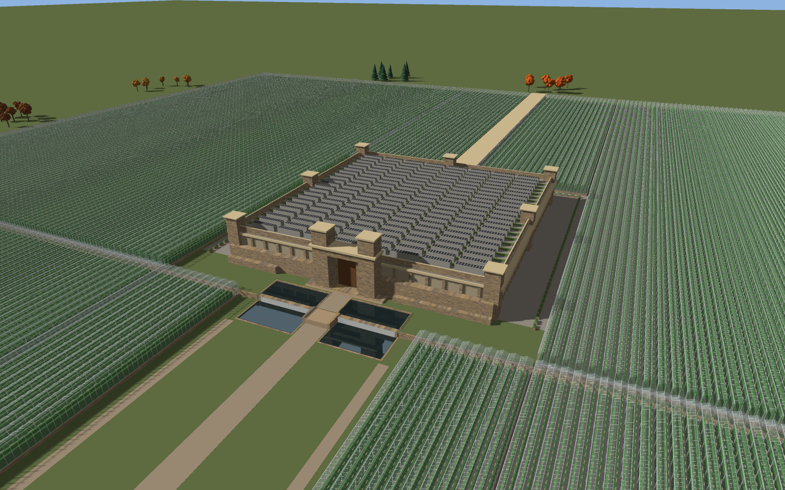

# The reports

The work goes in passes: a round of work on one question, ending in a short report with its
figures and a "what we don't know" section. Every design is compared with a conventional one on
the same site, and every number comes from a run or a cited source.

**New here?** The [brief for the towns](township-brief.md) is the shortest way in. Otherwise read
the sections below in order. Each line gives a report's finding in a sentence.

## 1. Where: the site screen (pass 1)

- **[Which retired coal sites could host one](pass1/README.md).**
  - Every US coal plant retired or set to retire, scored on what a host site needs (grid
    connection, flood risk, climate) and on what the town needs (population trend, income).
  - Of 205 sites, 18 are in the top quarter on both axes.
  - Both known cases, sites real developers chose (Homer City, TVA's Bull Run), rank high.

## 2. The data center at Homer City (pass 2)

- **[The good-neighbour data center against a conventional one](pass2/README.md).** Against the
  modern designs, its case is the creeks and quiet nights, not heat: at campus scale the glass the
  market can take uses under 1% of the heat.
  - Most of what the towns get comes whichever design is built.
  - What the good-neighbour deal adds is the benefits agreement.
- **[What it costs, who pays and who gains](pass2/cost.md).**
- **[Firmer inputs](pass2/firm-up.md):** the inputs that move the results most, firmed up.
- **[The wall in front of the coolers](pass2/wall.md).**
  - Brick walls between the rows of coolers, laid by a robot, take ~12 dB off where a berm takes
    ~1, for about the cost of precast.
  - The campus design (pass 3) moves the coolers onto the roof instead.
- **[The gas plant's discharge to Blacklick Creek](pass2/creek.md):** the issue raised most in
  the public record, checked against the state's temperature rules.
- **[The water budget](pass2/water.md),** from Two Lick Creek Reservoir through the plant to the
  creeks.
  - "In line with history" means the same intake: 37.6 million gallons a day at its pumps'
    capacity. The coal plant never drew more than 21 million gallons a day in a month.
  - Cooling towers at the data halls, fed from the reservoir, would empty it in the droughts of
    1952 and 1991.
- **[The air](pass2/air.md):** the gas plant's permit against what the coal plant emitted.
  - **The design's lever is the diesel:** routine tests of Tier 2 generators would add up to 55%
    to the gas plant's NOx for the halls.
  - Tier 4 generators add 6%, and batteries nothing.
- **[What people said in the public record](hearing-record.md),** against the scorecard.
- **[The scorecard](SCORECARD.md):** the measures every design is scored on.

## 3. The neighbourhood and the campus (pass 3)

- **[The first house, the walk-up, and a block on the warm loop](pass3/README.md).**
  - The first house, built in CortenForge, is heated straight off the data center's warm water.
  - That pays only for dense housing beside the campus.
  - The same pass builds a 12-flat walk-up in wood, light steel and block, and compares their
    carbon and cost.
- **The campus and winter garden.** This has no report of its own yet; its numbers come from
  `brownfield garden`. See [below](#the-campus-and-winter-garden).
- **[Winter food](pass3/food.md).**
  - One module's spare heat carries ~43 ha of lit tomato glasshouses: ~29,500 t a year and ~480
    jobs.
  - The limit is the market, not the heat.
- **[The neighbourhood](pass3/village.md):** 242 homes in rings round the square.
  - 121 flats, 98 townhouses over garage-workshops, and 23 houses.
  - Every home is under 40 dB(A) at night.
  - Sewage, not heat, limits growth past ~1,350 homes.
- **[The site plan](pass3/site.md):** every piece of the campus a module that can be moved.
  - Each layout is scored by what it costs a year.
  - The chosen layout was the optimizer's find, cheaper than the hand layout in all 29 cases
    across the inputs' ranges.
- **[The real land](pass3/land.md):** AWS's six sites, mapped on public data.
  - Half the ground round the plant is clear to build on.
  - Old coal mines lie under the other half in places, and there are 1,400 active gas wells.
- **[The conference of communities](pass3/conference.md):** the newcomers join the towns already
  there (3,794 people) by the towns' size, so each grows about 15%.
- **[What a real application needs](pass3/checklist.md):** Pennsylvania's and Indiana County's
  lists, item by item, against this plan.
- **[The bid set as data](pass3/bidset.md):** the walk-up issued as an open model (IFC), checked
  against a list of what a quote needs, and as PDFs only.
  - The model carries 10 of the 34 fields a window or door quote needs.
  - From the PDFs, a bidder counts 114 tags by eye that the data lists.
  - A look in 3D found the stair and 12 fire doors missing from the model. They were then modelled
    and checked against the code.

## 4. The economic base (pass 4)

- **[Who moves in, a flat's economics, the campus's property tax](pass4/README.md).**
  - About 120 newcomer households would rent near the campus (85–220), not 1,000.
  - The campus's property tax, about $92 million a year at build-out, is several times what their
    housing gap costs.
  - Most of it is school tax, which can't pay for housing.
- **[The construction workforce, 2026-2036](pass4/workforce.md).**
  - The peak is ~3,300 on site in mid-2029.
  - The towns beside the site have no spare rentals, so the benefits agreement should steer crews
    to Indiana and run park-and-ride buses.
- **[Where the tax goes: the schools, the hospital and emergency services](pass4/services.md).**
  - The school tax splits between Homer-Center and River Valley, ~$33 million a year each.
  - The schools have room for the newcomers' ~117 children.
  - What the campus adds is demand on fire and EMS.

## 5. Fusion-ready (pass 5, not started)

A 350 MWe stellarator plant on the site, and what changes. It is a site option, never something
the plan depends on.

## For the towns

- **[What Center Township, Black Lick Township and Homer City Borough can ask for](township-brief.md):**
  - what to ask of AWS's campus, in its design and in the benefits agreement;
  - what each ask costs and who pays;
  - the questions to put to AWS.

## The campus and winter garden

The campus:

- **A stone data hall**, about 120 by 130 m, which holds the computers. Its coolers stand in rows
  on the roof behind a 3 m stone parapet, with planted strips between the rows. From the ground
  you see stone walls and towers, not machinery.
- **Its front, facing the town, is a monument to the machines inside, whose heat warms the glass round it.**
  - Two stone pylons stand on a stepped base. Between them is a pair of bronze doors 10 m wide
    and 14 m high.
  - Before them, two warm basins steam on cold days. They spill over a ledge into two lower pools,
    either side of a stair down to the square.
  - The tradition is the great waterworks and pumping stations, such as Philadelphia's Fairmount
    Water Works, not a temple.
- **A public winter garden on the community center**, the neighbourhood's shared building, facing
  the square. It is kept warm all winter by the data center's waste heat. It draws on
  Fallingwater, the Frank Lloyd Wright house in the same western Pennsylvania sandstone country:
  - concrete terraces reaching out over pools that step down through a waterfall;
  - coursed sandstone;
  - long bands of glass.

  Its two glass rooms have about 540 m² of floor between them. A stone tower rises from its back
  wall where the warm water comes in.
- **Food houses round the hall, as its moat** (D16). About 38.5 ha (95 acres) of glasshouses
  stand in a ring round the hall and grow tomatoes through the winter.
  - They're heated straight off the data center's 50 °C water, with grow lights where the winter
    sun falls short ([pass 3d](pass3/food.md)).
  - A fire and service road runs between the hall and the glass. The hall's trucks come through a
    covered crossing at its back.
  - On the town side, the warm basins' court runs on as an open mall between the glass to the
    square, with the food court at its mouth.
  - Public vehicles stay 320 m from the hall.
- **Homes in rings round the centre** (D16):
  - small flats in three-storey walk-ups nearest the square;
  - townhouses over their own garage-workshops next;
  - larger houses furthest out.
  Every home stays under the WHO's 40 dB(A) night guideline at its windows.
- **A community center open 24 hours**, paid for by memberships like a gym's, with leagues and
  ice rental. The square, the mall, the garden and the walks stay free to everyone.
- **An arboretum of native Pennsylvania trees:** oaks, sugar maple, black cherry, tulip poplar,
  sycamore, hemlock and white pine. Each species stands back from every foundation by its own
  root reach (UK house-building rules: up to 1.25 times a tree's mature height for oaks). Indoor
  plants grow in raised stone planters.

Its numbers come from `brownfield garden` (pass 3c), after `cargo run --release -- garden` in
`forge/`. The work is in progress; see the [plan](PLAN.md).

- **Heat.** The garden needs 36–64 MWh of heat in a typical Homer City year, kept at 12–18 °C.
  That figure ignores the sun, so it is an upper bound. It is under 0.01% of one 100 MW module's
  heat: the garden is there for the town, not to get rid of heat. Its floors need water at
  23–31 °C, and the data center's warm water leaves the chips at about 50 °C.
- **The terraces.** The lowest terrace reaches 5.5 m past its last support. At 600 mm deep it
  would sag 44 mm over the years, against the 23 mm limit in the concrete code (ACI 318); at
  900 mm it sags 20 mm. Fallingwater's own terraces were short of steel. They had sagged by up to
  about 7 inches by the mid-1990s and had to be strengthened
  ([Fallingwater's preservation history](https://fallingwater.org/preservation-history/)).
- **Noise.** With low-noise fans, the coolers on the roof stay under the 40 dB(A) night
  guideline at every distance from the building (`brownfield garden`, pass 2d's sound model).
  That is down to the fans, not the roof. With the same fans, pass 2d's walled cells on the
  ground are quieter at the distances where homes are. The roof was chosen for the building: one
  roofed hall, no walls standing in the open. Homes higher up, looking down on the roof, would
  get less shielding.
- **The warm basins.** Held at 20 °C, they take 4.6 GWh of heat a year and evaporate about
  3,700 m³ of water, about nine families' home use, and more in summer, when the sun warms them.
  The hall itself evaporates none. At 30 °C they would take twice the heat and 2.5 times the
  water, so they are kept at 20 °C, which still steams in a Pennsylvania winter.
- **Not known yet:**
  - what a stone hall, its front and the garden cost to build and to run, against a plain box;
  - their carbon;
  - who would pay.

The idea behind the stonework ([D7](PLAN.md)) is detail no one could afford to lay by hand,
placed by machines that masons oversee and can repair. Whether that comes out cheaper isn't shown
yet.

## Working files

These are for anyone working on the project, not the place to start reading:
- **[PLAN.md](PLAN.md):** the working log, long by design. It holds each pass's status, every
  decision (D1, D2 ...), what each step did and what's next.
- **[RESEARCH.md](RESEARCH.md):** every source, with the numbers taken from it and its limits.
- **[SCORECARD.md](SCORECARD.md):** the measures every design is scored on.
- **[CORTENFORGE.md](CORTENFORGE.md):** what the CortenForge crates lack or do badly for this
  project, and what was built instead.

## Words used here

- **Pass:** a round of work on one question, ending in a report. Lettered steps within one, such
  as pass 3f, are its later reports.
- **D-numbers** (D7, D27): decisions, each recorded in the [plan](PLAN.md).
- **Module:** one 100 MW unit of the data center, as pass 2 models it (`brownfield module`).
- **Good-neighbour design:** the design here, built so the town comes out ahead. It is always set
  against a **conventional design** on the same site.
- **Known cases:** checks against something already known, such as sites real developers chose, a
  closed-form answer, or a hand calculation. They are run before a model is trusted
  (`brownfield check`, the tests).
- **forge:** the Rust code that builds and checks the buildings in
  [CortenForge](https://crates.io/crates/cortenforge).
- **params:** `params/*.yaml`. Every number the model uses is there, with its range, confidence and
  source; a placeholder is marked as one.

## How each report is made

Run from the repository root after `uv sync`. Commands marked forge run in `forge/` first. The
code is in `src/brownfield/`.

| Report | Command | Code |
|---|---|---|
| [The site screen](pass1/README.md) | `brownfield sites`, `rank` | `screen.py`, `rank.py` |
| [Pass 2 at Homer City](pass2/README.md) | `brownfield module` | `module.py` |
| [Costs](pass2/cost.md), [firmer inputs](pass2/firm-up.md) | `brownfield cost`, `homes`, `sensitivity` | `cost.py`, `homes.py` |
| [The wall](pass2/wall.md) | `brownfield wall`, then forge `wall`, then `brownfield wall` again | `wall.py`, `wallstruct.py` |
| [Blacklick Creek](pass2/creek.md) | `brownfield creek` | `creek.py` |
| [The water budget](pass2/water.md) | `brownfield water` | `water.py` |
| [The air](pass2/air.md) | `brownfield air` | `air.py` |
| [The scorecard](SCORECARD.md) | `brownfield scorecard` | `scorecard.py` |
| [The house, the walk-up, three structures](pass3/README.md) | forge `house`, `apartment`, `framing`, `build`; `brownfield house`, `block`, `frame`, `steel`, `masonry`, `build`, `compare`, `costcarbon` | `house.py`, `block.py`, `frame.py`, `steel.py`, `masonry.py`, `build.py`, `compare.py`, `costcarbon.py` |
| [The campus and winter garden](#the-campus-and-winter-garden) | forge `garden`; `brownfield garden` | `garden.py` |
| [Winter food](pass3/food.md) | `brownfield food` | `food.py` |
| [The neighbourhood](pass3/village.md), [the application checklist](pass3/checklist.md) | `brownfield village` | `village.py`, `rings.py`, `center.py` |
| [The site plan](pass3/site.md) | `brownfield site` | `site.py` |
| [The real land](pass3/land.md) | `brownfield land` | `land.py` |
| [The conference of communities](pass3/conference.md) | `brownfield conference`, then forge `conference` | `conference.py`, `neighbourhood.py` |
| [The bid set as data](pass3/bidset.md) | forge `apartment-json`; `brownfield bidset`, `addendum`, `pdfset`, `viewer` | `bidset.py`, `stair.py`, `addendum.py`, `pdfset.py`, `viewer.py`; forge `stair.rs` |
| [The economic base](pass4/README.md) | `brownfield economy` | `econ.py`, `acs.py` |
| [The workforce](pass4/workforce.md) | `brownfield workforce` | `workforce.py` |
| [Where the tax goes](pass4/services.md) | `brownfield services` | `services.py` |

`brownfield check` checks the parameters and the known cases. `uv run pytest` runs the tests. Each
report gives its own run order.
