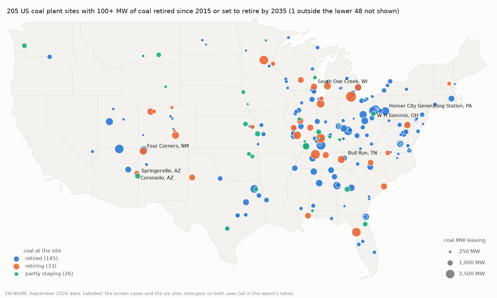
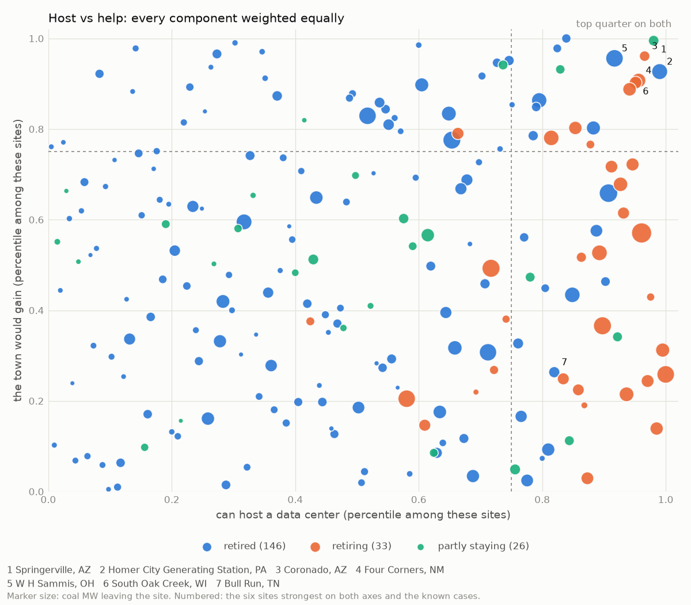

# Pass 1: the site screen

Which retired and retiring US coal plant sites could host a data center, and where would the town
gain most? Run 2026-11-15: `uv run brownfield sites` (downloads and caches, ~15 min the first
time), then `uv run brownfield rank`. Every number below comes from that run.

## The list

EIA-860M (September 2026 data) lists **205 US coal plant sites with at least 100 MW of coal
retired since 2015 or set to retire by 2035: 154.8 GW of coal in all.** 146 have retired all of
it, 33 have the rest set to retire, and at 26 some coal stays.

## Two axes, kept apart

Each site gets a percentile (0 worst, 1 best among these 205) on seven components. The two axes
are their plain means; nothing is weighted more than anything else yet.

| Axis | Component | Measured as | Source |
|---|---|---|---|
| Can host | grid | coal MW leaving the site (log) | EIA-860M |
| | flood | share of a 1 km square around the plant in the FEMA 1% floodplain | FEMA NFHL |
| | heat | hours a year above 30 °C, when dry coolers alone fall short | PVGIS typical year |
| | fresh | years since the last coal retirement (0 if still retiring) | EIA-860M |
| Would help | shrinking | county population change, Census 2010 to July 2025 | Census estimates |
| | income | county median household income against the US ($81,604) | SAIPE 2024 |
| | heat use | heating degree days, base 18 °C: waste heat the town could use | PVGIS typical year |

## The check: sites developers already chose

Before the first full run we set the bar: the retired coal sites real developers have picked
must land in the top half on *can host*. Both do:

- **Homer City, PA** (gas-powered data center campus, announced 2025): 3rd of 205 (99th
  percentile). It is also in the top quarter on *would help* (93rd): Indiana County lost 7% of its
  people since 2010, and its income is 0.76 of the US.
- **Bull Run, TN** (TVA's letter of intent for a stellarator fusion plant): 38th of 205 (82nd
  percentile). On *would help* it sits at the 26th percentile: Anderson County grew 9%, and its
  income is 0.89 of the US. A developer picks a site for what the site has, not for the town's
  need, which is why the two axes are kept apart.

This checks only that the screen isn't wrong about what a site offers. Two cases can't validate
the weights.

## The shortlist: top quarter on both axes

18 sites, sorted by host + help:

| # | Site | Status | Coal MW leaving | Retired / retiring | County pop. 2010-25 | Income vs US | Heating °C-days | Hours > 30 °C | Floodplain share | Host | Help |
|---|---|---|---|---|---|---|---|---|---|---|---|
| 1 | Springerville, AZ | partly staying | 850 | by 2032, part stays | -10% | 0.54 | 2,821 | 53 | 0% | 0.84 | 0.85 |
| 2 | Homer City Generating Station, PA | retired | 2,012 | 2024 | -7% | 0.76 | 2,954 | 82 | 0% | 0.86 | 0.78 |
| 3 | Coronado, AZ | retiring | 822 | by 2032 | -10% | 0.54 | 2,539 | 116 | 0% | 0.80 | 0.81 |
| 4 | Four Corners, NM | retiring | 1,636 | by 2031 | -7% | 0.80 | 3,006 | 331 | 0% | 0.78 | 0.76 |
| 5 | W H Sammis, OH | retired | 2,456 | 2023 | -9% | 0.74 | 2,979 | 26 | 40% | 0.73 | 0.81 |
| 6 | South Oak Creek, WI | retiring | 1,240 | by 2027 | -2% | 0.81 | 3,755 | 6 | 32% | 0.78 | 0.76 |
| 7 | Dunkirk Generating Plant, NY | retired | 627 | 2022 | -8% | 0.74 | 3,629 | 0 | unmapped | 0.67 | 0.86 |
| 8 | Craig (CO), CO | retiring | 1,428 | by 2029 | -5% | 0.91 | 4,826 | 83 | unmapped | 0.76 | 0.75 |
| 9 | Dan E Karn, MI | retired | 544 | 2023 | -5% | 0.79 | 3,890 | 96 | 13% | 0.66 | 0.83 |
| 10 | Cardinal, OH | partly staying | 650 | by 2028, part stays | -9% | 0.74 | 2,836 | 87 | 36% | 0.67 | 0.80 |
| 11 | St Clair, MI | retired | 1,547 | 2022 | -2% | 0.88 | 3,763 | 55 | 33% | 0.71 | 0.70 |
| 12 | San Juan, NM | retired | 1,848 | 2022 | -7% | 0.80 | 2,786 | 613 | 0% | 0.64 | 0.73 |
| 13 | Belle River, MI | retiring | 1,395 | by 2028 | -2% | 0.88 | 3,763 | 55 | 67% | 0.68 | 0.70 |
| 14 | Michigan City, IN | retiring | 540 | by 2028 | -0% | 0.83 | 3,342 | 59 | 27% | 0.69 | 0.67 |
| 15 | Somerset Operating Co LLC, NY | retired | 655 | 2020 | -3% | 0.86 | 3,581 | 0 | 30% | 0.64 | 0.72 |
| 16 | Baldwin Energy Complex, IL | retiring | 1,894 | by 2027 | -11% | 0.82 | 2,418 | 283 | 40% | 0.66 | 0.69 |
| 17 | E D Edwards, IL | retired | 780 | 2022 | -4% | 0.84 | 2,984 | 152 | 23% | 0.64 | 0.70 |
| 18 | AES Warrior Run Cogeneration Facility, MD | retired | 229 | 2024 | -11% | 0.77 | 2,426 | 216 | 0% | 0.61 | 0.73 |

The full ranked list of 205, with every component, is `out/pass1/ranked.csv` after a run.

## What we don't know yet

- **Interconnection rights.** The coal MW leaving a site stand in for the grid connection left
  behind. In PJM, a retired unit's capacity interconnection rights end one year after it shuts
  down unless a replacement request is filed (RESEARCH.md). That matters for generating on site
  (gas at Homer City, fusion at Bull Run). A data center that only draws power connects as load,
  where the lines and substation the plant leaves matter instead, and their spare capacity isn't
  in any public table we have. The median retired site here retired 7 years ago.
- **Tribal land.** Four Corners sits on the Navajo Nation, and the county incomes at
  Springerville, Coronado, Four Corners and San Juan include tribal lands that aren't the plant's
  town. What happens on or near tribal land is for those nations to decide; the screen can't
  say anything about it, and county income there doesn't describe the plant's town.
- **Water in the desert.** The Arizona and New Mexico sites rank well partly because they sit
  high and cool (Springerville is ~53 hours a year above 30 °C). Water is the sharpest complaint
  there; pass 2 has to show a design that uses next to none.
- **Coal ash.** Most sites have ash ponds or landfills under the federal coal ash rule; cleanup
  status and cost aren't in the screen.
- **Who owns the land now**, and whether it's already sold or redeveloped (Homer City is).
- **Fiber and water supply.** Neither is scored yet.
- **The town, not the county.** Population and income are county-level; a plant's town can
  shrink inside a growing county. Connecticut replaced its counties in 2022, so Bridgeport has no
  population trend (it counts as the median).
- **One point per plant.** EIA gives one coordinate per plant; the flood share is for a 1 km
  square around it, while sites run to thousands of acres (Homer City ~3,200). FEMA has no
  digital map at 8 sites (counted as the median).
- **Weights.** Every component counts equally, a stated choice. The tables show each component
  so the list can be re-weighted, and the screen's thresholds (since 2015, by 2035, 100 MW)
  are judgement calls with ranges in `params/screen.yaml`.
