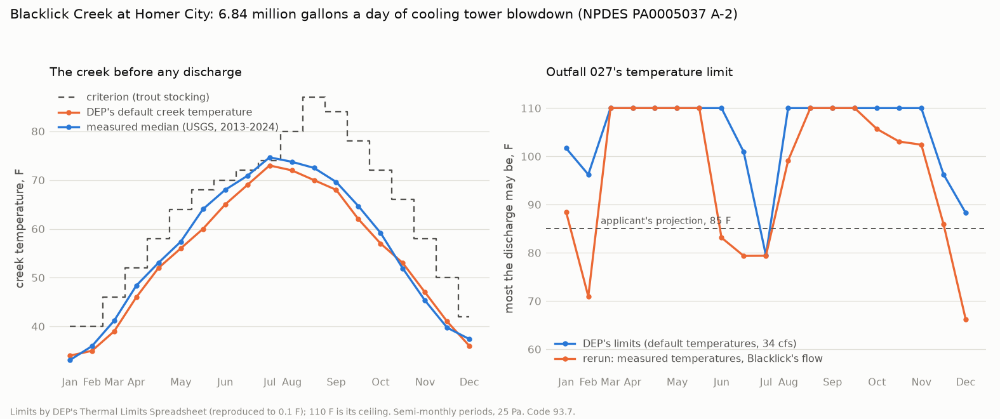

# Pass 2e: the creek

The discharge to the creek was what people raised most at the October hearing
([hearing record](../hearing-record.md)). This checks it from public numbers.

**The permit.** The gas plant's cooling towers would send up to 6.84 million gallons a day of
blowdown into Blacklick Creek (NPDES permit PA0005037, amendment A-2, Outfall 027).
- **Where:** about 75 ft above where Two Lick Creek joins it. Both creeks are designated
  trout-stocking water there.
- **Interim limit:** 110 F until 2026-12-01.
- **Final limits:** set period by period, but the permit expires 2026-12-31. The renewal, applied
  for on 2026-05-01, will set the limits that actually govern.

This is the gas plant's discharge, not the data centers'. The campus is one place to the people
downstream, so it belongs on the scorecard.

Run: `uv run brownfield creek`. Inputs: [params/creek.yaml](../../params/creek.yaml) and
[data/tls_tables.csv](../../data/tls_tables.csv) (the criteria and DEP's spreadsheet tables).

## What it says

- **DEP's calculation reproduces exactly.** Its draft limits come from its Thermal Limits
  Spreadsheet, whose formulas are public. With DEP's printed inputs all 19 limits reproduce to
  0.1 F. So does the first draft, which DEP replaced after finding it had used the warm-water
  defaults. The questions are about two inputs, not the arithmetic.
- **Input 1: DEP used default creek temperatures, though the creek has been measured.**
  - USGS has recorded daily water temperature at Josephine, half a mile upstream, since 2013.
    DEP's own spreadsheet instructions say the defaults "should only be used if no information on
    stream temperature is available".
  - The measured medians run 1-4 F warmer than the defaults from May to September. July's, 74.7 F,
    is already above the 74 F criterion.
  - With the measured temperatures the limits change in both directions:
    - Lower: February 85.4 F (DEP: 96.2), late June 82.8 (100.9), December 77.5 (88.3).
    - Higher: January, late November and July (81.1 against 79.5). In July the creek is already
      over its criterion, and DEP's method then allows 1 F over the creek's own temperature.
- **Input 2: DEP's design flow counts Two Lick Creek, but the outfall is above it.** DEP used 34
  cfs: Blacklick's 23 plus 11 cfs the plant must keep flowing in Two Lick Creek. The applicant's
  own mixing study puts the outfall 75 ft *upstream* of the confluence; its flow memo says
  "directly downstream". With Blacklick's own flow (23.1 cfs from the gauge), the winter limits
  fall 15-20 F: January 82.0, February 78.3, late November 81.5, December 73.5.
- **With both inputs corrected, the applicant's own projection is over the limit in four
  periods.** The applicant projects the blowdown at 85 F at most (84.4 F on a 90 F day, 85.6 F on
  a 105 F day). The rerun limits:

  | Period | February | early June | late June | July | December |
  |---|---|---|---|---|---|
  | Limit, both inputs corrected | 71.0 F | 83.1 F | 79.4 F | 79.4 F | 66.2 F |

  DEP's own July limit, 79.5 F, is already below the 85 F projection. The permit record doesn't
  say how the plant would meet these limits: less flow, sending blowdown to its other outfall on
  Two Lick Creek, or cooling it.
- **The 2 F-an-hour rule isn't addressed.** Pennsylvania lets a heated discharge change a creek by
  at most 2 F in any hour. At DEP's design flow, an 85 F discharge switched on at once would warm
  the creek by 2.0-7.2 F in 11 of the 19 periods (most from September to February). Meeting the
  rule means ramping the flow up and down over hours. Neither DEP nor the applicant shows how.
- **Over the real record, the creek would often be warmer than the method intends.** The
  2013-2024 record has 3,842 days with flow and temperature. We mixed the discharge at 85 F into
  each day's actual flow, and compared the result with the target DEP's method sets: the
  criterion, or that day's creek plus 1 F when the creek is already above it.

  | Stream flow counted | Days over the target | July days over |
  |---|---|---|
  | Blacklick + 11 cfs (DEP's basis) | 10% | 27% (90 of 333) |
  | Blacklick only | 11% | 34% (113 of 333) |

  The worst single day, 6 January 2018 (a low flow on a 32 F creek), warms it 14-19 F. With no discharge at
  all, the creek is already above its criterion on 18% of days, including 195 of 333 July days.
  This creek has little room in summer.
- **One drawing is much hotter.** A vendor drawing in the application labels the "cooling tower
  blowdown" sample point at 122 F operating and 135 F design. That may be the hot side of the
  loop rather than the discharge, which the 110 F ceiling would bar anyway. It is unresolved in
  the record.

## For the scorecard

- **Heat to the creek, in degrees:** this is the measure residents asked for, and it's now
  computed.
- **The good neighbour sends none of its own.** Its dry coolers use no water. A conventional
  100 MW module's own cooling towers would blow down about 0.26 million gallons a day (pass 2's
  model) on top of the gas plant's 6.84.
- **Conditions an agreement or the renewal could ask for** (each checkable):
  - limits computed from the measured creek temperatures;
  - a design flow from Blacklick alone, unless mixing with Two Lick is shown;
  - temperature measured continuously at the outfall and downstream, and published (the draft
    asks for one reading a week);
  - start-up and shut-down ramps that keep within 2 F an hour.

## Checks

- **DEP's second draft:** all 19 temperature limits reproduce to 0.1 F, and so do its printed
  design and downstream flows (January 108.80 and 119.38 cfs; July 57.80 and 68.38).
- **DEP's first draft:** its limits reproduce with the warm-water default creek temperatures,
  the error DEP corrected.
- **The low-flow statistic**, our log-Pearson III fit against USGS's published values (Open-File
  Report 2011-1070):

  | Gauge | Years | Ours | USGS |
  |---|---|---|---|
  | Blacklick Creek at Josephine | 1952-2008 | 26.2 cfs | 26.6 cfs |
  | Two Lick Creek at Graceton, regulated | 1969-2008 | 39.1 cfs | 39.0 cfs |
  | Two Lick Creek at Graceton, before its dams | 1952-1968 | 11.4 cfs | 11.3 cfs |

- **Mixing:** heat is conserved in the mixing balance (tests).

## What we don't know

- **The hearing and the decision.** The 2026-10-14 hearing transcript, DEP's responses to
  comments, the final decision on A-2, and the renewal's draft permit.
- **The 11 cfs.** The consent order behind it hasn't been found: where it is measured, and whether
  that point is the low dam just below the plant's other outfall.
- **The real blowdown.** How hot and how much, hour by hour, and where it is drawn from (the
  122 F drawing). The numbers here are the applicant's projections.
- **Near the outfall.** Full mixing is the far-field answer. Near the diffuser, before it mixes,
  the plume is hotter. The applicant's study finds complete mixing within 150-200 ft at low flow.
  That near zone is what Trout Unlimited's "dead zone" worry is about, and it isn't modelled here.
- **Hourly changes.** USGS publishes daily values, so the 2 F-an-hour rule can't be checked
  against the record.
- **Two Lick Creek's temperature.** It isn't measured (no USGS record since 1988).
- **DEP's temperature guidance itself** wasn't found online. The "creek plus 1 F" target is the
  spreadsheet's rule; the Code sets maximums.
- **Recent data.** USGS values after July 2024 are provisional and left out. They include
  91 F days in July 2026.
- **A drying creek.** Blacklick's low flow has been falling: Q7-10 26.6 cfs over 1952-2008, 23.1
  over 1952-2025, 19.3 over 1995-2025. With 19.3 the winter limits fall further (January ~75 F).

## Sources

- **DEP's permit documents.** All on DEP's
  [Homer City Generation Redevelopment page](https://www.pa.gov/agencies/dep/dep-regions/northwest-regional-office/homer-city-generation-redevelopment):
  - the second-draft permit and fact sheet for PA0005037 A-2 (2026), and DEP's 2018 renewal fact
    sheet addendum;
  - the NPDES and WQM amendment applications (February 2026), including the applicant's mixing
    study, its flow memo and the vendor drawing.
- **DEP's spreadsheet:** the Thermal Limits Spreadsheet v1.0 (April 2024) and its instructions.
- **Pennsylvania Code:**
  - 25 Pa. Code 93.7 Table 3 (temperature criteria);
  - 25 Pa. Code 96.6 (heated discharges, the 2 F an hour rule);
  - 25 Pa. Code 93.9t (both creeks trout stocking).
- **Pennsylvania Bulletin:** 56 Pa.B. 3741, 4163 and 6043 (2026).
- **USGS:**
  - Water Data daily values: 03042000 (Blacklick Creek at Josephine; flow since 1952, water
    temperature since 2013) and 03042500 (Two Lick Creek at Graceton).
  - Stuckey and Roland, Open-File Report 2011-1070 (low-flow statistics).
