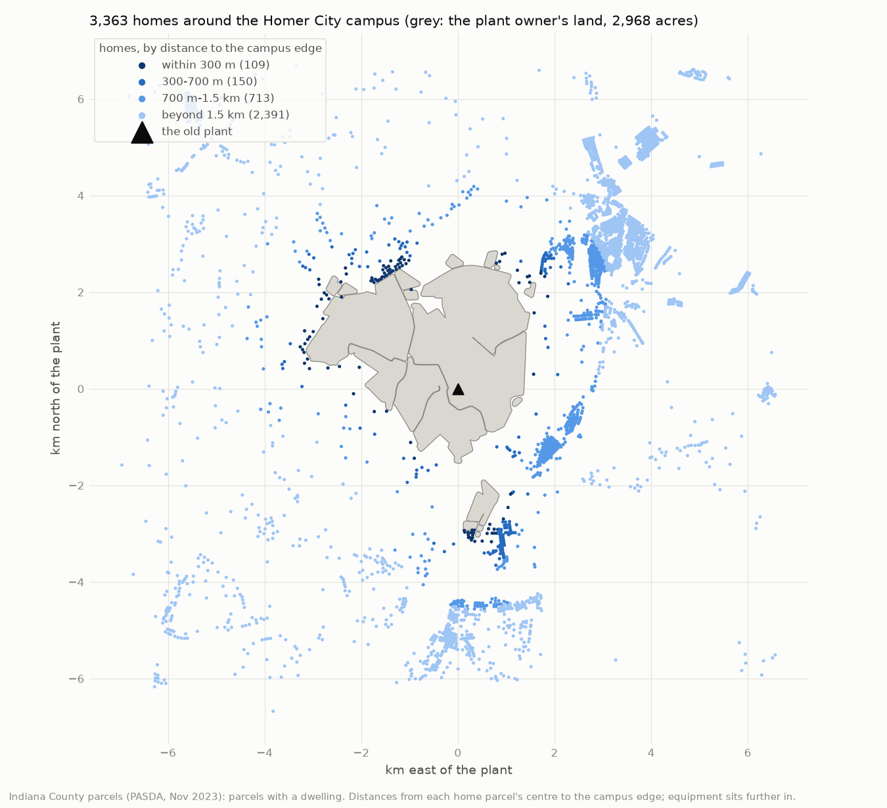

# Pass 2c: firming it up

Jon, 2026-11-15: "firm up pass 2 first". Three things: which inputs matter most, the real
distances to homes, and public sources for the inputs at the top. Every number below comes from
`uv run brownfield sensitivity`, `uv run brownfield homes` and `uv run brownfield cost`.

## Which inputs move the answers

One input at a time from the low to the high end of its range, the rest at their central
values; the six biggest swings per result (full list: `out/pass2/sensitivity.md` after a run):

**Good neighbour vs AI towers, 20-year value**: central -17.2 million USD

| Input | Range | At low end | At high end | Swing | Confidence |
|---|---|---|---|---|---|
| `pass2.noise.dry_oversize` | 1-3 | -1.4 | -32.9 | 31.5 | placeholder |
| `pass2.good_neighbour.liquid_supply_c` | 32-45 | -34.4 | -10.5 | 24.0 | medium |
| `cost.water.usd_per_kgal` | 2-7.8 | -25.2 | -4.9 | 20.3 | medium |
| `pass2.fans.dry_kw_per_kw` | 0.02-0.05 | -7.9 | -26.4 | 18.5 | placeholder |
| `pass2.fans.tower_kw_per_kw` | 0.015-0.04 | -24.4 | -6.3 | 18.0 | medium |
| `cost.cooling.dry_usd_kw` | 80-250 | -9.8 | -27.7 | 17.8 | placeholder |

**Operator vs the old design, 20-year value**: central +198.0 million USD

| Input | Range | At low end | At high end | Swing | Confidence |
|---|---|---|---|---|---|
| `pass2.conventional.chiller_cop` | 4-8 | +259.5 | +167.2 | 92.2 | placeholder |
| `cost.money.discount` | 0.04-0.1 | +238.0 | +170.2 | 67.8 | placeholder |
| `pass2.module.load_factor` | 0.6-0.95 | +166.9 | +221.3 | 54.5 | placeholder |
| `pass2.backup.battery_minutes` | 5-60 | +206.6 | +159.0 | 47.7 | placeholder |
| `cost.energy.elec_usd_mwh` | 84-125 | +185.2 | +232.8 | 47.6 | medium |
| `cost.backup.diesel_usd_kw` | 350-700 | +172.0 | +217.5 | 45.5 | medium |

**Heat network alone, 20-year value**: central -158.7 million USD

| Input | Range | At low end | At high end | Swing | Confidence |
|---|---|---|---|---|---|
| `pass2.town.homes` | 2000-14000 | -98.9 | -290.2 | 191.3 | medium |
| `cost.heat.hp_eur_mw` | 0.8-1.95 | -130.1 | -212.3 | 82.2 | low |
| `cost.heat.connection_usd_home` | 2500-12000 | -138.7 | -186.2 | 47.5 | low |
| `cost.heat.network_eur_per_mwh_yr` | 150-655 | -137.2 | -180.7 | 43.6 | low |
| `cost.energy.heat_discount` | 0-0.4 | -144.5 | -172.9 | 28.4 | placeholder |
| `cost.money.eur_usd` | 1.05-1.25 | -144.6 | -172.8 | 28.2 | placeholder |

- **Good neighbour vs the AI hall with towers:** the biggest swing is how far the dry coolers are
  oversized, which is a choice about noise, not an unknown (at 1x the premium nearly disappears,
  -$1.4 million, and the module is louder, 118 vs 114 dB(A)); then the coolant temperature the
  chips take, the price of water, fan power and the dry coolers' price.
- **The operator against the old design:** driven by the old chillers' efficiency, the discount
  rate and load; it stays positive at every single-input extreme.
- **The heat network:** driven by how many homes it serves, and more homes make it worse: at
  Pennsylvania gas prices every existing home connected loses money. That points at new homes
  built for low-temperature heat (pass 3).

## Sourced since pass 2b

| Input | Was | Now | Source |
|---|---|---|---|
| Water price | $5 per 1,000 gal (judgement) | $4.30 ($2-7.80) | York Water (PA) industrial tariff, Aug 2025: $4.338 per 1,000 gal above 2 million gal a month |
| Tower fans + pumps | 0.025 kW/kW (judgement) | 0.025 kW/kW, fans checked | ASHRAE 90.1 Table 6.8.1-7: towers >= 40.2 gpm/hp, so fans <= 0.0127 kW per kW of heat at rating |
| Coolant temperature | W32-W45 (ASHRAE) | 40 C central, 45 C a real option | GB200 NVL72 maximum inlet 45 C, return 65 C (QCT); NVIDIA promotes 45 C; Uptime: most operators run colder |
| Coolant temperature rise | 6-15 K | 6-20 K | the same rack: up to 20 K (45 in, 65 out) |

Still not public, and still placeholders: dry cooler fan power and price per kW, chiller plant
price, 15-minute battery price, fuel cells, the cost of converting forced-air homes to hot-water
heat. Vendor quotes would settle the first four.

## The homes around the campus

Campus (the plant owner's land within 6 km of the plant): 2,968 acres; 3,363 homes around it.

| Distance from the campus edge | Homes |
|---|---|
| within 300 m | 109 |
| within 500 m | 190 |
| within 700 m | 259 |
| within 1,000 m | 422 |
| within 1,500 m | 972 |
| within 2,000 m | 1,598 |
| within 3,000 m | 2,518 |

Nearest homes: 18, 19, 20, 21, 21 m from the edge.

The campus here is the plant owner's land within 6 km of the plant (Indiana County parcels, Nov
2023), less strips narrower than 100 m (a rail spur or conveyor corridor ran south to Homer City
borough and made its homes look like neighbours; it was dropped). AWS's six sites are inside it.
Homes are parcels with a dwelling. Distances run to the campus edge, so they are the shortest a
sound path could be.

What it means for noise: a conventional module's cooling towers reach 40 dB(A) at night ~700 m
away in open ground, and 259 homes lie within 700 m of the campus edge; the good-neighbour module
reaches it ~220 m from its cooler yard behind a berm (corrected in [pass 2d](wall.md); first given
here as ~120 m), or 34-80 m with walls between the rows of coolers, and the nearest homes are
~20 m from the edge. So where the equipment stands matters as much as what it is: a setback from every home
plus the sound power budget (pass 2 README) is what an agreement can check.

## What changed in the results

With the sourced inputs (`uv run brownfield cost`, before and after): the good neighbour's premium
over the AI hall with towers grows from ~$15 to ~$17 million per module over 20 years (cheaper
water makes saving it worth less; ahead in 12% of draws instead of 18%); the operator against the
old design +$198 million (was +$201); the heat network -$159 million (unchanged); both together
+$39 million, positive in 51% of draws. The conclusions stand.
