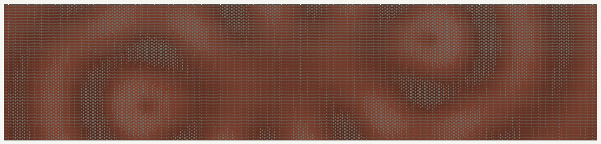
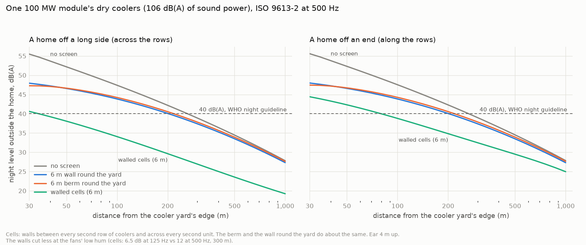
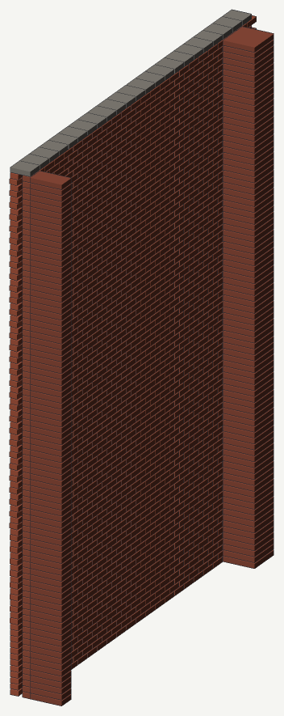
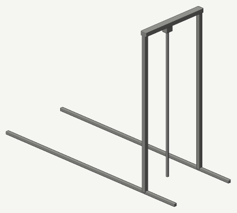

# Pass 2d: the wall in front of the coolers

Pass 2 put the good-neighbour module's dry coolers behind an earth berm and gave the berm a flat
10 dB. This pass sizes the screen properly, from the coolers' real layout and ISO 9613-2's barrier
method. It then designs a brick wall that does better, builds it brick by brick in CortenForge,
has a robot lay it in sim-core, and prices it against a berm and precast concrete (decision D7 in
[PLAN.md](../PLAN.md)). Run: `uv run brownfield wall`, then `cargo run --release -- wall` in
`forge/`, then `uv run brownfield wall` again. Inputs: [params/wall.yaml](../../params/wall.yaml).
Every figure here is per 100 MW module.

## What it says

- **Pass 2's berm was worth about 1 dB at 300 m, not 10.** One module needs 175 dry coolers,
  spaced by the maker's rules into a yard of about 109 x 116 m with the fans 2.9 m up. A screen
  only shields the fans close behind it. A 6 m berm round the yard therefore takes 2.7 dB off at
  120 m and 1.1 dB at 300 m. Night levels fall to 40 dB(A) (WHO) about 220 m from the yard's
  edge, against about 260 m with no screen. Pass 2's "~120 m" is corrected
  ([README](README.md)). A 6 m brick or precast wall in the berm's place does about the same.
- **Walls between the rows work: about 12 dB at 300 m.** A wall between every second row of
  coolers puts a screen 1.5 m from every fan. Homes facing across the rows hear 40 dB(A) from
  34 m out, not 220 m. A berm can't stand there; it needs about 26 m of ground. The yard becomes
  a set of walled **cells**: walls between every second row, and across every second cooler
  along the rows.
  - Homes off the ends get 6.5 dB at 300 m, reaching 40 dB(A) beyond 80 m.
  - The coolers still breathe. With walls above the fans, the makers treat the yard as a "well"
    and allow at most 2.03 m/s of air coming down into it. Every cell gets 1.75 m/s.
- **Brick costs about what precast costs, and the robot pays for the pattern.**

  | Option, per module | Installed cost | P10 / P90 | A1-A3 carbon | Land |
  |---|---|---|---|---|
  | 6 m earth berm round the yard | $2.25M | $1.23M / $2.64M | 142 t | 1.47 ha |
  | 6 m precast wall round the yard | $1.40M | $1.17M / $1.46M | 345 t | 0.03 ha |
  | precast cells | $6.04M | $5.01M / $6.27M | 1,483 t | 0.12 ha |
  | brick cells, plain, laid by hand | $5.83M | $5.61M / $7.53M | 1,705 t | 0.12 ha |
  | brick cells, patterned, laid by hand | $6.60M | $6.24M / $8.85M | 1,705 t | 0.12 ha |
  | **brick cells, patterned, laid by robot** | **$5.43M** | **$4.99M / $6.49M** | **1,705 t** | **0.12 ha** |

  In 2,000 Monte Carlo draws, with the design held fixed:
  - **The pattern by hand:** it costs a median $0.84M more than plain brick.
  - **The patterned wall by robot:** it beats the hand-laid patterned wall in 98% of draws and
    plain brick by hand in 88%.
  - **Against precast cells:** it's a coin flip, cheaper in 51%.

  So the pattern costs a robot nothing, and the wall costs about the same as the plain
  value-engineered choice. The berm is cheap only when its earth is moved anyway: at mass-grading
  prices it comes to about $0.7M.
- **The walls cost more than pass 2 assumed.** Pass 2b counted $1M for the berm; the robot-laid
  cells cost $5.4M. Rerun with them ([cost.md](cost.md), 2026-11-16), the good-neighbour premium
  over an AI hall with cooling towers grows from ~$17M to ~$22M per module over 20 years (ahead in
  6% of draws). The operator still comes out +$194M against the old design.
- **The walls help least against the hum.** At 300 m the cells take 12 dB off at 500 Hz, 6.5 dB
  at 125 Hz and 4 dB at 63 Hz. Fan hum sits at the low end. One speaker at the pipeline hearing
  raised exactly this: sound people feel but dB(A) misses ([hearing record](../hearing-record.md)).

## The wall

- **Its make-up.** Two wythes of modular brick with a 2 in. grouted collar joint between them.
  The panels span sideways between reinforced brick piers (16 x 24 in., 14 ft apart). Each pier
  sits on a 24 in. drilled concrete shaft, and a grade beam to the 36 in. frost line carries the
  panels. This is BIA Technical Note 45A's pier-and-panel noise wall, designed to TMS 402-16
  allowable stress under ASCE 7-16 wind.
- **The wind it's designed for.** The body of the wall takes 16.5 psf (allowable stress level).
  The first two wall-heights from each corner take 26.2 psf.
- **The bars and shafts:**
  - Panels: #4 bars every 48 in. (every 40 in. at the ends).
  - Piers: 2 #7 bars each face, steel at 28.0 ksi of its 32, masonry at 720 psi of its 1,125
    (3 #7 at the ends).
  - Shafts: 10.6 ft deep, 12.8 ft at the ends, in poor ground (300 psf/ft).
- **Quantities per module:** 1.98 million bricks, 454 m3 of mortar, 709 m3 of grout, 1,083 m3
  of concrete and 82 t of bars, in 11,864 m2 of wall.
- **The face.** Each face brick is turned up to 13° about its own vertical axis, by an angle read
  from a pattern. This is the method Gramazio Kohler used on the Gantenbein winery (2006), where
  a robot glued 20,000 bricks. Here the wall is laid in mortar, so a mason can repair it with
  standard units. The pattern is a ripple, like rain on still water; any image can be laid
  instead.
- **CortenForge built six bays (25.6 m) brick by brick** (`forge/src/wall.rs`):
  - 11,132 face bricks, 73.3 per m2 (BIA's figure for modular brick: 73.81).
  - No two bricks overlap.
  - Every head joint is 4.0-16.4 mm, mortar-fillable.
  - Every brick bears at least 74% of its bed on the course below (mean 86%).
  - Corners stand up to 21 mm proud of the face.

- **A robot lays it** (`forge/src/wall_robot.rs`). A four-axis gantry straddling the wall carries
  each brick from a hopper, turns it while it travels, lowers it to 2 mm above its mortar bed and
  lets go, all on servos in sim-core. It laid 111 face bricks twice. Each brick took 1.84 s of
  motion with the pattern and 1.84 s plain: the wrist's turn fits inside the carry. Every brick
  settled within 0.01 mm of where it was let go. That shows the path and the release work. It
  doesn't measure a real robot's accuracy, which its maker states (ETH's mobile robot: within
  7 mm).

## Checks

- **Barrier acoustics:** ISO 9613-2's barrier term against Kurze and Anderson's closed form
  (1971), within 0.7 dB from Fresnel number 0.1 to 3, below ISO's cap.
- **Wall section:** BIA TN 45A design example 1 reproduced exactly (k 0.198, steel 29.3 ksi,
  masonry 744 psi). Example 3 (a pier) within 1%.
- **Moment capacity:** CMHA TEK 14-19B's 35,686 lb-in/ft reproduced within 0.003%.
- **ASCE 7-16 wind:** Caltrans' worked example (13.9 psf, 11,910 lb) and MECA's (26.6 psf, Kh
  0.849) both reproduced.
- **Shaft depths:** TEK 14-15B's depths (w = 20 psf, 10 ft wall) fall between our formula with
  and without the one-third wind increase on soil. We use the deeper one.
- **Brick count:** 73.81 per m2, as BIA's 2025 EPD gives.
- **Pass 2's cooler sound power:** reproduced within 0.4 dB by the makers' data (Kelvion's unit
  sound power, EVAPCO's kW per fan).
- **Brick wall cost, bottom-up:** $46 per sq ft. FHWA's brick barrier average is $55 (2022 $,
  range $32-70).
- **Berm cost, bottom-up:** $76 per sq ft of face at $30/cy, or $23 at mass-grading prices.
  FHWA's average is $12. Our berm is priced as earth moved for this purpose. FHWA's figure is
  states' estimates; why theirs runs lower isn't known.

## What we don't know

- **Wind.** The site's ASCE 7-16 wind speed wasn't read from the ASCE Hazard Tool. 115 mph is an
  upper bound, and the force coefficients come from a remembered table checked against three
  published values.
- **Soil.** Shaft depths assume poor ground; the site is spoil and fill.
- **Airflow in a walled yard.** The makers' well rule is a minimum. Hot air coming back round
  into the fans in a crosswind, and plumes in still air, are for the cooler maker to check.
  EVAPCO asks to be consulted for more than four units.
- **Sound bouncing inside the cells.** Brick reflects. Reflections between the cell walls aren't
  modelled and could take a few dB back. ISO 9613-2's own stated accuracy is about ±3 dB, and the
  method here uses one band (500 Hz).
- **Robots.** Robot rates and costs are thin:
  - SAM's 200-400 bricks an hour and $650,000 price date from 2015, and SAM is no longer on its
    maker's site.
  - Monumental sells per brick and hasn't published a price.
  - No one has published how fast a mason lays bricks each at its own angle. We guessed 60% of
    plain speed (a 1991 Pennsylvania study found layout-heavy work up to 40% slower). A timed
    mock-up by a local mason would settle it.
  - Robots have laid in mortar (SAM, Monumental), but not turned bricks. Gantenbein's were
    glued.
- **Carbon.** BIA's 2025 brick EPD is higher per tonne than its 2020 one, although BIA says
  emissions fell; not reconciled. The precast and mortar carbon figures are placeholders.
- **Upkeep isn't priced.** That covers repointing brick, mowing a berm, and panel joints on
  precast.
- **Bricks made on site from the plant's coal ash are not an option yet:**
  - The ash is being moved into the on-site disposal area, not set aside (PA DEP letters,
    2025-26).
  - It is probably mixed with dry scrubber residue, of unknown chemistry.
  - India's fly ash brick standard has no freeze-thaw test.
  - The one US fly ash brick maker at scale (CalStar) stopped in 2015.

  Compressed earth blocks have thin freeze-thaw evidence for a climate like Indiana County's. The
  moulds can wait until a sample of the ash has been tested.
- **Whether anyone wants it to look like this.** No public comment found so far mentions how the
  campus would look, though the meetings about the data centers themselves aren't public as text
  ([hearing record](../hearing-record.md)). The wall has to earn its place on noise. Its looks are
  a bonus, and the pattern is the town's to choose.
