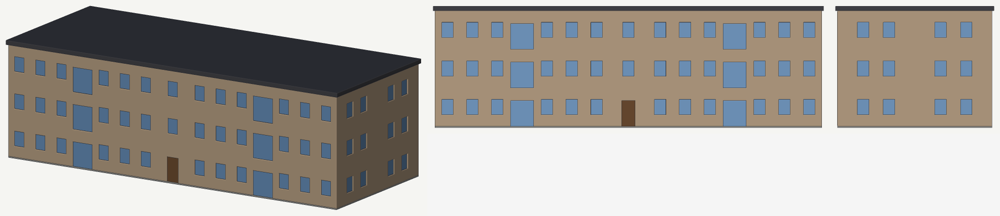

# Pass 3: the first neighbourhood module

The question: can new homes built for the data center's warm water turn the heat network from a
loss (pass 2b: -$159 million on existing homes) into a win? Existing homes need converting and
heat pumps to lift ~50 C water to 75 C for old radiators. A new house with a radiant floor might
take the warm water directly.

Four steps: (1) the first house in CortenForge, (2) its heat and radiant floor on the data
center's water, (3) a 12-flat walk-up in CortenForge and every flat's heat (pass 3b), (4) a block
of new homes on that loop, priced against each home heating itself.

**The answer: only for big blocks of apartments right beside the campus, and against gas only
just.** A new home's floor can run on the data center's water directly (no heat pump), but
efficient new homes have small heating bills, and flats sharing walls need under half a house's
heat per square metre. So the pipes have to be short and shared by many. Against gas, ~1,000
apartments within 0.5 km of the campus or 2,000 within 1.5 km come out a few hundred dollars
cheaper per dwelling over 20 years (at most ~$0.9 thousand, ~4%). Against a heat pump (an
all-electric neighbourhood), 500 within 1 km or 1,000 within 1.5 km, by up to ~$2.7 thousand
(~12%). Detached houses on the loop never pay; townhouses only break even.

## 1. The first house, in CortenForge

The 24 x 40 ft example from D1: one storey, 8 ft walls of 2x6 framing (~178 mm), a 6:12 gable
roof with 12 in. overhangs, a slab; 8 windows 3 x 4 ft, a 6 ft sliding patio door, two entry
doors (14% glazing). Built from cf-design solids (`forge/src/house.rs`), meshed and drawn:

`cargo run --release -- check` (in `forge/`) measures the solids with CortenForge's
`mass_properties` against their exact dimensions before the areas are used: interior 200.899 vs
200.867 m3 (+0.02%), walls with eleven openings 13.718 vs 13.699 m3 (+0.14%), slab +0.08%. On the
way it found a CortenForge pitfall: a cutter nearly flush with the faces it cuts makes
`mass_properties` count empty space (the walls read +18.7% at 50 mm cells until every cutter
overshot by a metre). Logged in `docs/CORTENFORGE.md`.

`cargo run --release -- house` writes the envelope (`out/pass3/house.json`) the heat model reads.

## 2. Its heat, and a radiant floor on the data center's water

`uv run brownfield house`: Pennsylvania code insulation (2018 IECC, zone 5), code airtightness,
ASHRAE 62.2 ventilation without heat recovery, over the plant's typical year:

The house: 7.32 x 12.19 m outside (82.4 m2 of floor), 12.6 m2 of glazing, 3.7 m2 of doors (CortenForge model, forge `house`).

| Heat loss | W/K | Share |
|---|---|---|
| walls | 26.8 | 19% |
| windows | 21.5 | 15% |
| doors | 4.2 | 3% |
| ceiling | 13.2 | 9% |
| slab edge | 40.5 | 28% |
| infiltration | 10.1 | 7% |
| ventilation | 27.9 | 19% |
| **total UA** | **144.3** | |

| Result | Value |
|---|---|
| Design load (at the design temperature) | 5.3 kW |
| Biggest hour in the typical year | 4.3 kW |
| Balance point (heat needed below) | 15.8 C |
| Space heat a year | 8.7 MWh |
| Hot water a year | 3.0 MWh |
| Floor output needed at design | 64 W/m2 |
| Floor surface at design (limit 29 C) | 26.0 C |
| Water the floor needs at design, supply / return | 33.7 / 27.7 C |
| The data center's liquid loop: supply / return | 40 / 50 C |

- **The floor needs cooler water than the data center sends out.** At the design hour (-16.8 C)
  the floor gives 64 W/m2 at a 26 C surface, on ~34 C water. The data center's liquid loop
  leaves the chips at ~50 C. So new homes can heat straight off the loop: **no heat pump for
  space heat**, which was the heat network's biggest cost on existing homes. Hot water (55-60 C)
  still needs a small booster per home.
- **It holds at the worst corner.** Every input against it at once (a leaky code-minimum house,
  the coldest design temperature, a weak floor system, no gains): 6.8 kW, 83 W/m2, a 27.6 C
  floor, 43.5 C water, still under the 50 C return. So the neighbourhood is fed from the loop's
  return side.
- **A better house needs much less.** With heat recovery ventilation, 2021 IECC walls and
  ceiling and 1.5 ACH50: 4.0 kW at design, 31 C water, 5.8 MWh of space heat a year (8.7 at code).
- **Where the heat goes:** the slab edge (28%), walls (19%) and ventilation (19%) lead; the
  windows are 15%.

## 3. A 12-flat walk-up, in CortenForge (pass 3b)

The kind of building step 4 needs: three storeys, 100 x 40 ft, a central stair, four flats a
floor of 45 x 20 ft (~78 m2 inside), so every flat is a corner flat with a long facade and an end
wall. Floors 10 ft apart; 7 in. exterior walls, 10 in. party walls, 12 in. floor systems, a flat
roof. Each flat has six 3 x 4 ft windows and a 6 ft patio door on the long facade and two windows
on the end wall (`forge/src/apartment.rs`; `cargo run --release -- apartment`):

`check` measures it before the areas are used: the exterior walls, with 114 openings, 109.598 vs
109.262 m3 (+0.31% at 50 mm cells; +0.09% at 25 mm, which takes 7 minutes), the floor systems
197.350 vs 197.202 m3 (+0.08%). The drawn meshes enclose 109.187 and 197.182 m3 (-0.07%,
-0.01%). Its street frontage, 100 ft for 12 flats (2.54 m each), is now step 4's apartment
frontage.

Meshing it found CortenForge's biggest practical problem so far: the default `Solid::mesh` (a
uniform grid) took **63 minutes**; its parallel adaptive mesher takes ~3.4, but the `cortenforge`
crate leaves that one switched off (`docs/CORTENFORGE.md`). `forge` now uses the adaptive mesher
everywhere (the house: 3.5 s).

`uv run brownfield house` gives every flat's heat. Party walls and the floors between flats lose
nothing; only the facades, the roof (top floor) and the slab edge (ground floor) do:

| Flat | Floor m2 | UA W/K | Design kW | Space heat MWh/yr | Floor W/m2 | Water needed C |
|---|---|---|---|---|---|---|
| ground floor (each of 4) | 77.7 | 96.2 | 3.54 | 4.74 | 46 | 30.6 |
| middle floor (each of 4) | 77.7 | 75.6 | 2.78 | 3.11 | 36 | 29.0 |
| top floor (each of 4) | 77.7 | 87.9 | 3.24 | 4.08 | 42 | 29.9 |
| **average flat** | 77.7 | 86.6 | 3.19 | 3.98 | 41 | 29.8 |

(The four flats on a floor are mirror images and come out the same; `out/pass3/flats.md` lists
all 12.)

- **A flat needs under half the house's heat**: 3.98 MWh a year against 8.7, 3.2 kW at design
  against 5.3. **Known case:** per square metre the average flat uses 0.49 of the house, and
  the US housing survey (EIA RECS 2020, Tables CE3.1, HC10.14, HC10.15) gives 0.49 for apartments
  in buildings of 5+ units against detached homes (9.1 vs 44.0 million Btu of space heat a
  household; 828 heated sq ft per apartment vs 1,951 per single-family home). Agreement this
  close is partly luck: RECS is national, across all climates and building ages (2-4 unit
  buildings, mostly old, come out 1.21).
- **Every flat runs on ~30 C water**, further below the data center's 50 C return than the house
  (33.7 C). The middle floor is easiest; the ground floor is hardest, because its heated slab's
  edge (20.6 W/K) loses more than the top floor's roof (12.3 W/K).

## 4. A block of new homes on the loop

`uv run brownfield block`. Per dwelling over 20 years, in today's dollars (7%), cooling included
in all three so they compare like for like: **A** the loop (radiant floor, a connection, a booster
heat pump for hot water, an air conditioner because a radiant slab can't cool, and a share of the
street network, the main from the campus and the exchanger there; the data center's heat free);
**B** a ducted cold-climate heat pump (heats and cools) and a heat pump water heater; **C** a gas
furnace, gas water heater, gas line and an air conditioner. Houses and townhouses have the first
house's heat (8.7 MWh space, 3 MWh hot water a year); apartments the walk-up's average flat (3.98
MWh space). Base case: 200 homes on a 1.5 km main.

| Per dwelling, 20 years, USD | Detached | Townhouse | Apartment |
|---|---|---|---|
| A, the loop: up front | 36,106 | 29,606 | 26,545 |
|   of it, the street network | 10,000 | 3,500 | 1,270 |
|   of it, the main from the campus | 8,250 | 8,250 | 8,250 |
|   of it, the exchanger at the data center | 1,062 | 1,062 | 637 |
| A: running a year | 457 | 359 | 310 |
| **A, the loop: 20-year cost** | 40,943 | 33,410 | 29,833 |
| B, heat pump: up front | 18,164 | 18,164 | 18,164 |
| B: running a year | 817 | 817 | 468 |
| **B, heat pump: 20-year cost** | 26,816 | 26,816 | 23,123 |
| C, gas: up front | 14,570 | 14,570 | 14,570 |
| C: running a year | 886 | 886 | 642 |
| **C, gas: 20-year cost** | 23,956 | 23,956 | 21,371 |
| **The loop minus the cheaper of B and C** | 16,987 | 9,454 | 8,462 |
| Street price per metre at which the loop ties | -233 | -665 | -2,375 |

| Monte Carlo (2,000 draws) | Detached | Townhouse | Apartment |
|---|---|---|---|
| The loop minus the cheaper alternative, P10 / P50 / P90 | +12,540 / +20,291 / +31,236 | +4,561 / +10,716 / +20,369 | +4,089 / +9,704 / +19,054 |
| The loop cheapest in | 0% | 0% | 0% |

Street network at $500/m; 200 homes on a 1.5 km main; frontage per dwelling 20 / 7 / 2.54 m.

What it takes (negative = the loop is cheapest):

| Apartments: homes on the block | main 0.25 km | main 0.5 km | main 1 km | main 1.5 km | main 3 km |
|---|---|---|---|---|---|
| 100 | +2,088 | +5,275 | +11,649 | +18,023 | +37,145 |
| 200 | +495 | +2,088 | +5,275 | +8,462 | +18,023 |
| 500 | **-461** | +176 | +1,451 | +2,726 | +6,550 |
| 1,000 | **-780** | **-461** | +176 | +813 | +2,726 |
| 2,000 | **-939** | **-780** | **-461** | **-143** | +813 |

1,000 apartments on a 0.5 km main, every other input varying (2,000 draws): the loop minus the cheaper alternative P10 / P50 / P90 -1,781 / +1,120 / +3,952 USD per dwelling; the loop cheapest in 32%.

Against the heat pump only (an all-electric neighbourhood, no gas):

| Apartments: homes on the block | main 0.25 km | main 0.5 km | main 1 km | main 1.5 km | main 3 km |
|---|---|---|---|---|---|
| 100 | +336 | +3,523 | +9,897 | +16,271 | +35,393 |
| 200 | **-1,258** | +336 | +3,523 | +6,710 | +16,271 |
| 500 | **-2,214** | **-1,576** | **-302** | +973 | +4,798 |
| 1,000 | **-2,532** | **-2,214** | **-1,576** | **-939** | +973 |
| 2,000 | **-2,692** | **-2,532** | **-2,214** | **-1,895** | **-939** |

1,000 apartments on a 0.5 km main against the heat pump, every other input varying: P10 / P50 / P90 -5,809 / -1,580 / +2,858 USD per dwelling; the loop cheaper in 66%.

- **In the base case the loop loses at every density**, and gas is cheapest. Home-side
  equipment roughly cancels (radiant floor + connection + booster + air conditioner ~ $17
  thousand vs ~ $18 thousand for a heat pump that heats and cools); the loop saves only a few
  hundred dollars a year, because an efficient new home's heat bill is small, and a flat's
  smaller still. So the pipes decide, and the biggest share is the main from the campus (~$8
  thousand per home here). Even free street pipes wouldn't save it (the break-even street price
  is negative).
- **Real flats made the case weaker.** With the house's heat standing in for a flat (the first
  run of this step), apartments won against gas from ~500 within 1 km, and 1,000 on a 0.5 km
  main were cheapest in 65% of draws. A real flat needs less than half that heat, so the loop has
  less to save: now ~1,000 within 0.5 km, at most ~$0.9 thousand (~4%), and 32%.
- **Against a heat pump it holds up better.** If the new neighbourhood is all-electric (no gas
  line), the loop wins from 500 apartments within 1 km or 1,000 within 1.5 km, by up to ~$2.7
  thousand per dwelling (~12%), and 1,000 on a 0.5 km main come out cheaper in two draws of
  three. Townhouses only break even against gas at ~1,000 homes on a 0.5 km main; detached
  houses never.
- **What it means for the town**: the warm loop is a reason to put big, dense, all-electric
  housing right against the campus, where it costs residents about the same as the
  alternatives or a little less. It isn't a money-maker, nor a way to heat the existing town
  (pass 2b: -$159 million) or a subdivision of detached homes; existing homes are better served
  by heat pumps.

## What we don't know yet

- **Small-pipe and main prices** are placeholders (no per-metre figure for new-build twin pipe
  found); they decide the answer, so they are the first thing to price properly.
- **Equipment prices are a house's** in every option: a ducted heat pump ($16 thousand), a
  furnace, an air conditioner. Flats often use smaller ductless units or a shared plant, which
  would cut B and C and weaken the loop's case further; to price.
- The upper floors' radiant floors sit on wood framing (a poured topping or panels), priced here
  like a slab on grade; their K_H may differ.
- The walk-up's stair core (~7% of its perimeter, its share of the roof and slab) isn't charged
  to any flat.
- Cooling: a radiant slab can't cool, so the loop carries an air conditioner the heat pump
  doesn't need; chilled-ceiling or fan-coil designs could change that.
- The data center's side: the cooler water coming back from the homes saves it a little, not
  counted; nor is any price the data center might charge for heat.
- The heated slab's F-factor and the floor system's K_H are placeholders (ASHRAE 90.1 Appendix A
  and EN 1264-2 system tests would settle them); they set the slab loss and the water
  temperature.
- Hot water use per home (3 MWh a year) is a placeholder.
- Solar gains are folded into one average; a real plan orients the glazing.
