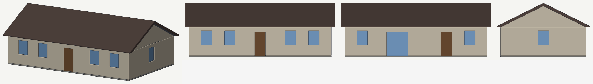

# Pass 3: the first neighbourhood module

The question: can new homes built for the data center's warm water turn the heat network from a
loss (pass 2b: -$159 million on existing homes) into a win? Existing homes need converting and
heat pumps to lift ~50 C water to 75 C for old radiators. A new house with a radiant floor might
take the warm water directly.

Three steps: (1) the first house in CortenForge, (2) its heat and radiant floor on the data
center's water, (3) a block of new homes on that loop, priced against each home heating itself.

**The answer: only for dense housing right beside the campus.** A new home's floor can run on the
data center's water directly (no heat pump), but efficient new homes have small heating bills, so
the pipes have to be short and shared: 500+ apartments within ~1 km of the campus, or 1,000+
within 1.5 km, come out ~$1-3 thousand cheaper per dwelling over 20 years than a heat pump or gas.
Detached houses on the loop never do; townhouses only break even.

## 1. The first house, in CortenForge

The 24 x 40 ft example from D1: one storey, 8 ft walls of 2x6 framing (~178 mm), a 6:12 gable
roof with 12 in. overhangs, a slab; 8 windows 3 x 4 ft, a 6 ft sliding patio door, two entry
doors (14% glazing). Built from cf-design solids (`forge/src/house.rs`), meshed and drawn:

`cargo run --release -- check` (in `forge/`) measures the solids with CortenForge's
`mass_properties` against their exact dimensions before the areas are used: interior 200.899 vs
200.867 m3 (+0.02%), walls with eleven openings 13.718 vs 13.699 m3 (+0.14%), slab +0.08%. On the
way it found a CortenForge pitfall: a cutter nearly flush with the faces it cuts makes
`mass_properties` count empty space (the walls read +18.7% at 50 mm cells until every cutter
overshot by a metre). Logged in `docs/CORTENFORGE.md`.

`cargo run --release -- house` writes the envelope (`out/pass3/house.json`) the heat model reads.

## 2. Its heat, and a radiant floor on the data center's water

`uv run brownfield house`: Pennsylvania code insulation (2018 IECC, zone 5), code airtightness,
ASHRAE 62.2 ventilation without heat recovery, over the plant's typical year:

The house: 7.32 x 12.19 m outside (82.4 m2 of floor), 12.6 m2 of glazing, 3.7 m2 of doors (CortenForge model, forge `house`).

| Heat loss | W/K | Share |
|---|---|---|
| walls | 26.8 | 19% |
| windows | 21.5 | 15% |
| doors | 4.2 | 3% |
| ceiling | 13.2 | 9% |
| slab edge | 40.5 | 28% |
| infiltration | 10.1 | 7% |
| ventilation | 27.9 | 19% |
| **total UA** | **144.3** | |

| Result | Value |
|---|---|
| Design load (at the design temperature) | 5.3 kW |
| Biggest hour in the typical year | 4.3 kW |
| Balance point (heat needed below) | 15.8 C |
| Space heat a year | 8.7 MWh |
| Hot water a year | 3.0 MWh |
| Floor output needed at design | 64 W/m2 |
| Floor surface at design (limit 29 C) | 26.0 C |
| Water the floor needs at design, supply / return | 33.7 / 27.7 C |
| The data center's liquid loop: supply / return | 40 / 50 C |

- **The floor needs cooler water than the data center sends out.** At the design hour (-16.8 C)
  the floor gives 64 W/m2 at a 26 C surface, on ~34 C water. The data center's liquid loop
  leaves the chips at ~50 C. So new homes can heat straight off the loop: **no heat pump for
  space heat**, which was the heat network's biggest cost on existing homes. Hot water (55-60 C)
  still needs a small booster per home.
- **It holds at the worst corner.** Every input against it at once (a leaky code-minimum house,
  the coldest design temperature, a weak floor system, no gains): 6.8 kW, 83 W/m2, a 27.6 C
  floor, 43.5 C water, still under the 50 C return. So the neighbourhood is fed from the loop's
  return side.
- **A better house needs much less.** With heat recovery ventilation, 2021 IECC walls and
  ceiling and 1.5 ACH50: 4.0 kW at design, 31 C water, 5.8 MWh of space heat a year (8.7 at code).
- **Where the heat goes:** the slab edge (28%), walls (19%) and ventilation (19%) lead; the
  windows are 15%.

## 3. A block of new homes on the loop

`uv run brownfield block`. Per dwelling over 20 years, in today's dollars (7%), cooling included
in all three so they compare like for like: **A** the loop (radiant floor, a connection, a booster
heat pump for hot water, an air conditioner because a radiant slab can't cool, and a share of the
street network, the main from the campus and the exchanger there; the data center's heat free);
**B** a ducted cold-climate heat pump (heats and cools) and a heat pump water heater; **C** a gas
furnace, gas water heater, gas line and an air conditioner. Every dwelling has the first house's
heat (8.7 MWh space, 3 MWh hot water a year). Base case: 200 homes on a 1.5 km main.

| Per dwelling, 20 years, USD | Detached | Townhouse | Apartment |
|---|---|---|---|
| A, the loop: up front | 36,106 | 29,606 | 27,106 |
|   of it, the street network | 10,000 | 3,500 | 1,000 |
|   of it, the main from the campus | 8,250 | 8,250 | 8,250 |
|   of it, the exchanger at the data center | 1,062 | 1,062 | 1,062 |
| A: running a year | 457 | 359 | 322 |
| **A, the loop: 20-year cost** | 40,943 | 33,410 | 30,513 |
| B, heat pump: up front | 18,164 | 18,164 | 18,164 |
| B: running a year | 817 | 817 | 817 |
| **B, heat pump: 20-year cost** | 26,816 | 26,816 | 26,816 |
| C, gas: up front | 14,570 | 14,570 | 14,570 |
| C: running a year | 886 | 886 | 886 |
| **C, gas: 20-year cost** | 23,956 | 23,956 | 23,956 |
| **The loop minus the cheaper of B and C** | 16,987 | 9,454 | 6,557 |
| Street price per metre at which the loop ties | -233 | -665 | -2,329 |

| Monte Carlo (2,000 draws) | Detached | Townhouse | Apartment |
|---|---|---|---|
| The loop minus the cheaper alternative, P10 / P50 / P90 | +12,540 / +20,291 / +31,236 | +4,561 / +10,716 / +20,369 | +1,749 / +7,575 / +17,121 |
| The loop cheapest in | 0% | 0% | 3% |

Street network at $500/m; 200 homes on a 1.5 km main; frontage per dwelling 20 / 7 / 2 m.

What it takes (negative = the loop is cheapest):

| Apartments: homes on the block | main 0.25 km | main 0.5 km | main 1 km | main 1.5 km | main 3 km |
|---|---|---|---|---|---|
| 100 | +183 | +3,370 | +9,744 | +16,118 | +35,240 |
| 200 | **-1,410** | +183 | +3,370 | +6,557 | +16,118 |
| 500 | **-2,366** | **-1,729** | **-454** | +821 | +4,645 |
| 1,000 | **-2,685** | **-2,366** | **-1,729** | **-1,092** | +821 |
| 2,000 | **-2,844** | **-2,685** | **-2,366** | **-2,048** | **-1,092** |

1,000 apartments on a 0.5 km main, every other input varying (2,000 draws): the loop minus the cheaper alternative P10 / P50 / P90 -4,136 / -982 / +2,079 USD per dwelling; the loop cheapest in 65%.

- **In the base case the loop loses at every density**, and gas is cheapest. Home-side
  equipment roughly cancels (radiant floor + connection + booster + air conditioner ~ $17
  thousand vs ~ $18 thousand for a heat pump that heats and cools); the loop saves only ~$400 a
  year, because an efficient new home's heat bill is small. So the pipes decide, and the biggest
  share is the main from the campus (~$8 thousand per home here). Even free street pipes wouldn't
  save it (the break-even street price is negative).
- **What it takes: density, size and nearness together.** Apartments win from ~500 units within
  1 km of the campus or ~1,000 within 1.5 km, by up to ~$2.8 thousand per dwelling (~10%).
  Townhouses only break even at ~1,000 homes on a 0.5 km main; detached houses never.
- **It is robust for the dense case, not certain**: 1,000 apartments on a 0.5 km main, every other
  input varying, the loop is cheapest in about two draws of three.
- **What it means for the town**: the warm loop is a reason to build dense, affordable housing
  right next to the campus, not a way to heat the existing town (pass 2b: -$159 million) or a
  subdivision of detached homes. Existing homes are better served by heat pumps.

## What we don't know yet

- **Small-pipe and main prices** are placeholders (no per-metre figure for new-build twin pipe
  found); they decide the answer, so they are the first thing to price properly.
- Apartments here use the detached house's heat per dwelling; real apartments need less (shared
  walls), which shrinks every option's running cost and slightly weakens the loop's case.
- Cooling: a radiant slab can't cool, so the loop carries an air conditioner the heat pump
  doesn't need; chilled-ceiling or fan-coil designs could change that.
- The data center's side: the cooler water coming back from the homes saves it a little, not
  counted; nor is any price the data center might charge for heat.
- The heated slab's F-factor and the floor system's K_H are placeholders (ASHRAE 90.1 Appendix A
  and EN 1264-2 system tests would settle them); they set the slab loss and the water
  temperature.
- Hot water use per home (3 MWh a year) is a placeholder.
- Solar gains are folded into one average; a real plan orients the glazing.
