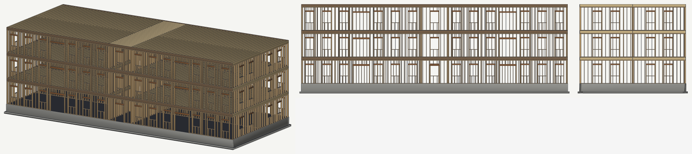
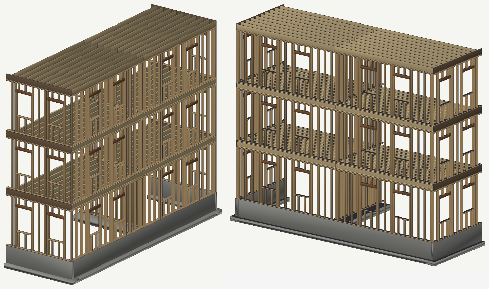
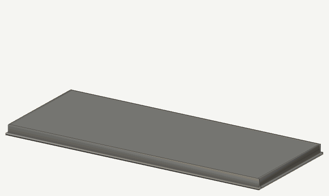
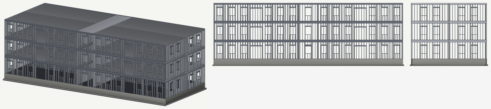
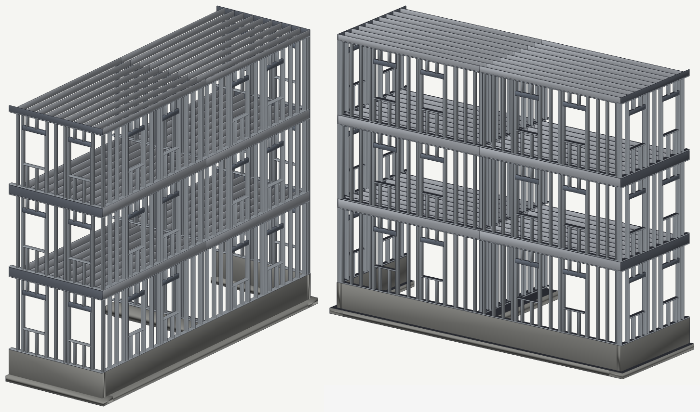
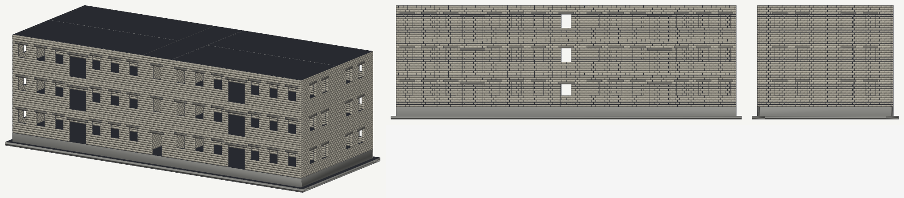
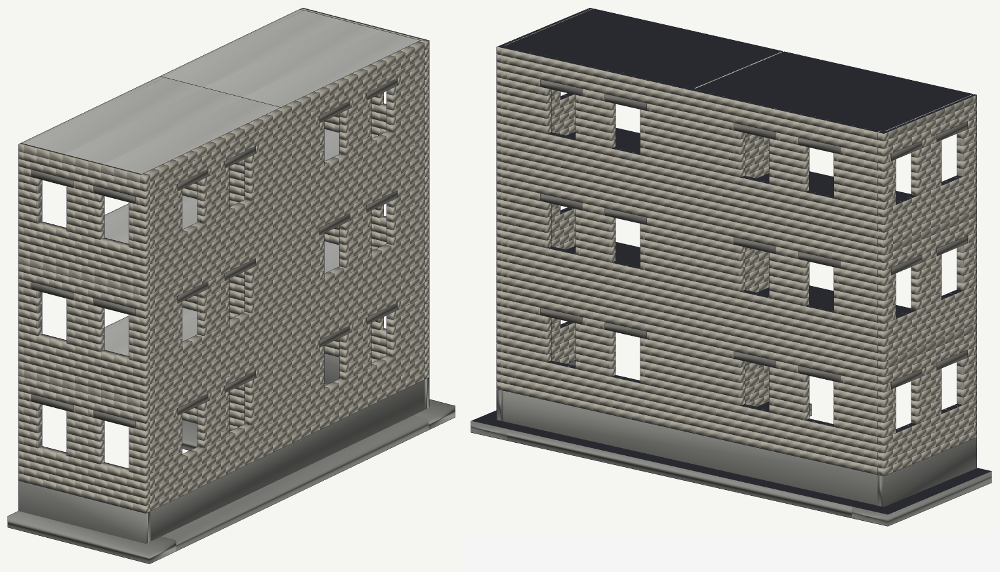
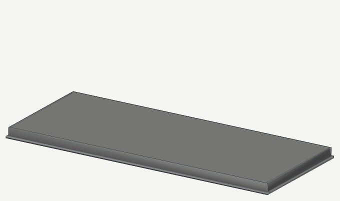
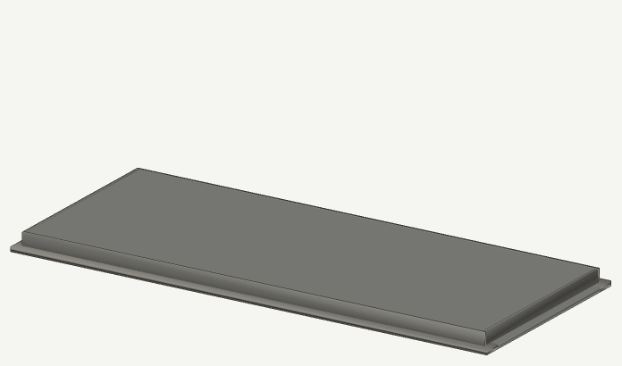

# Pass 3: the first neighbourhood module

The question: can new homes built for the data center's warm water turn the heat network from a
loss (pass 2b: -$159 million on existing homes) into a win? Existing homes need converting and
heat pumps to lift ~50 C water to 75 C for old radiators. A new house with a radiant floor might
take the warm water directly.

Seven steps: (1) the first house in CortenForge, (2) its heat and radiant floor on the data
center's water, (3) a 12-flat walk-up in CortenForge and every flat's heat (pass 3b), (4) a block
of new homes on that loop, priced against each home heating itself, (5) the walk-up framed in
wood, member by member, sized to the codes, (6) built in order in CortenForge's physics engine:
every wall panel tilted up, every joist set down, (7) the same walk-up in light steel and in
concrete block with precast floors, sized, built and compared, (8) the three structures' embodied
carbon and cost (pass 3b).

**The answer: only for big blocks of apartments right beside the campus, and against gas only
just.** A new home's floor can run on the data center's water directly (no heat pump), but
efficient new homes have small heating bills, and flats sharing walls need under half a house's
heat per square metre. So the pipes have to be short and shared by many. Against gas, ~1,000
apartments within 0.5 km of the campus or 2,000 within 1.5 km come out a few hundred dollars
cheaper per dwelling over 20 years (at most ~$0.9 thousand, ~4%). Against a heat pump (an
all-electric neighbourhood), 500 within 1 km or 1,000 within 1.5 km, by up to ~$2.7 thousand
(~12%). Detached houses on the loop never pay; townhouses only break even.

The same walk-up issued as a bid set, an open model (IFC) with its drawings and a checklist of
what a quote needs, against the same set as PDFs only: [pass 3f, the bid set as data](bidset.md).

Its plumbing, heating, cooling, ventilation, electrical work and sprinklers designed in full before
bidding (Addenda 2-10), and set against the usual US walk-up priced from free sources: [pass 3g,
the walk-up's systems](systems.md). The engineering adds about $2,200 a flat. The systems this
design chose cost $20,000-32,000 a flat more over 20 years than each usual walk-up, and more in
every one of 4,000 draws. They buy quiet, fresh air and warm floors, not savings: choice by
choice, the quiet costs $4-38 a month a flat, the ducted bedroom air $45 and the warm floors $89.
The walk-up the towns would build keeps the quiet and the air on heat pumps, off the data
center's water, for $121 a month a flat over the usual walk-up.

## 1. The first house, in CortenForge

The 24 x 40 ft example from D1: one storey, 8 ft walls of 2x6 framing (~178 mm), a 6:12 gable
roof with 12 in. overhangs, a slab; 8 windows 3 x 4 ft, a 6 ft sliding patio door, two entry
doors (14% glazing). Built from cf-design solids (`forge/src/house.rs`), meshed and drawn:

`cargo run --release -- check` (in `forge/`) measures the solids with CortenForge's
`mass_properties` against their exact dimensions before the areas are used: interior 200.899 vs
200.867 m3 (+0.02%), walls with eleven openings 13.718 vs 13.699 m3 (+0.14%), slab +0.08%. On the
way it found a CortenForge pitfall: a cutter nearly flush with the faces it cuts makes
`mass_properties` count empty space (the walls read +18.7% at 50 mm cells until every cutter
overshot by a metre). Logged in `docs/CORTENFORGE.md`.

`cargo run --release -- house` writes the envelope (`out/pass3/house.json`) the heat model reads.

## 2. Its heat, and a radiant floor on the data center's water

`uv run brownfield house`: Pennsylvania code insulation (2018 IECC, zone 5), code airtightness,
ASHRAE 62.2 ventilation without heat recovery, over the plant's typical year:

The house: 7.32 x 12.19 m outside (82.4 m2 of floor), 12.6 m2 of glazing, 3.7 m2 of doors (CortenForge model, forge `house`).

| Heat loss | W/K | Share |
|---|---|---|
| walls | 26.8 | 19% |
| windows | 21.5 | 15% |
| doors | 4.2 | 3% |
| ceiling | 13.2 | 9% |
| slab edge | 40.5 | 28% |
| infiltration | 10.1 | 7% |
| ventilation | 27.9 | 19% |
| **total UA** | **144.3** | |

| Result | Value |
|---|---|
| Design load (at the design temperature) | 5.3 kW |
| Biggest hour in the typical year | 4.3 kW |
| Balance point (heat needed below) | 15.8 C |
| Space heat a year | 8.7 MWh |
| Hot water a year | 3.0 MWh |
| Floor output needed at design | 64 W/m2 |
| Floor surface at design (limit 29 C) | 26.0 C |
| Water the floor needs at design, supply / return | 33.7 / 27.7 C |
| The data center's liquid loop: supply / return | 40 / 50 C |

- **The floor needs cooler water than the data center sends out.** At the design hour (-16.8 C)
  the floor gives 64 W/m2 at a 26 C surface, on ~34 C water. The data center's liquid loop
  leaves the chips at ~50 C. So new homes can heat straight off the loop: **no heat pump for
  space heat**, which was the heat network's biggest cost on existing homes. Hot water (55-60 C)
  still needs a small booster per home.
- **It holds at the worst corner.** Every input against it at once (a leaky code-minimum house,
  the coldest design temperature, a weak floor system, no gains): 6.8 kW, 83 W/m2, a 27.6 C
  floor, 43.5 C water, still under the 50 C return. So the neighbourhood is fed from the loop's
  return side.
- **A better house needs much less.** With heat recovery ventilation, 2021 IECC walls and
  ceiling and 1.5 ACH50: 4.0 kW at design, 31 C water, 5.8 MWh of space heat a year (8.7 at code).
- **Where the heat goes:** the slab edge (28%), walls (19%) and ventilation (19%) lead; the
  windows are 15%.

## 3. A 12-flat walk-up, in CortenForge (pass 3b)

The kind of building step 4 needs: three storeys, 100 x 40 ft, a central stair, four flats a
floor of 45 x 20 ft (~78 m2 inside), so every flat is a corner flat with a long facade and an end
wall. Floors 10 ft apart; 7 in. exterior walls, 10 in. party walls, 12 in. floor systems, a flat
roof. Each flat has six 3 x 4 ft windows and a 6 ft patio door on the long facade and two windows
on the end wall (`forge/src/apartment.rs`; `cargo run --release -- apartment`):

`check` measures it before the areas are used: the exterior walls, with 114 openings, 109.598 vs
109.262 m3 (+0.31% at 50 mm cells; +0.09% at 25 mm, which takes 7 minutes), the floor systems
197.350 vs 197.202 m3 (+0.08%). The drawn meshes enclose 109.187 and 197.182 m3 (-0.07%,
-0.01%). Its street frontage, 100 ft for 12 flats (2.54 m each), is now step 4's apartment
frontage.

Meshing it found CortenForge's biggest practical problem so far: the default `Solid::mesh` (a
uniform grid) took **63 minutes**; its parallel adaptive mesher takes ~3.4, but the `cortenforge`
crate leaves that one switched off (`docs/CORTENFORGE.md`). `forge` now uses the adaptive mesher
everywhere (the house: 3.5 s).

`uv run brownfield house` gives every flat's heat. Party walls and the floors between flats lose
nothing; only the facades, the roof (top floor) and the slab edge (ground floor) do:

| Flat | Floor m2 | UA W/K | Design kW | Space heat MWh/yr | Floor W/m2 | Water needed C |
|---|---|---|---|---|---|---|
| ground floor (each of 4) | 77.7 | 96.2 | 3.54 | 4.74 | 46 | 30.6 |
| middle floor (each of 4) | 77.7 | 75.6 | 2.78 | 3.11 | 36 | 29.0 |
| top floor (each of 4) | 77.7 | 87.9 | 3.24 | 4.08 | 42 | 29.9 |
| **average flat** | 77.7 | 86.6 | 3.19 | 3.98 | 41 | 29.8 |

(The four flats on a floor are mirror images and come out the same; `out/pass3/flats.md` lists
all 12.)

- **A flat needs under half the house's heat**: 3.98 MWh a year against 8.7, 3.2 kW at design
  against 5.3. **Known case:** per square metre the average flat uses 0.49 of the house, and
  the US housing survey (EIA RECS 2020, Tables CE3.1, HC10.14, HC10.15) gives 0.49 for apartments
  in buildings of 5+ units against detached homes (9.1 vs 44.0 million Btu of space heat a
  household; 828 heated sq ft per apartment vs 1,951 per single-family home). Agreement this
  close is partly luck: RECS is national, across all climates and building ages (2-4 unit
  buildings, mostly old, come out 1.21).
- **Every flat runs on ~30 C water**, further below the data center's 50 C return than the house
  (33.7 C). The middle floor is easiest; the ground floor is hardest, because its heated slab's
  edge (20.6 W/K) loses more than the top floor's roof (12.3 W/K).

## 4. A block of new homes on the loop

`uv run brownfield block`. Per dwelling over 20 years, in today's dollars (7%), cooling included
in all three so they compare like for like: **A** the loop (radiant floor, a connection, a booster
heat pump for hot water, an air conditioner because a radiant slab can't cool, and a share of the
street network, the main from the campus and the exchanger there; the data center's heat free);
**B** a ducted cold-climate heat pump (heats and cools) and a heat pump water heater; **C** a gas
furnace, gas water heater, gas line and an air conditioner. Houses and townhouses have the first
house's heat (8.7 MWh space, 3 MWh hot water a year); apartments the walk-up's average flat (3.98
MWh space). Base case: 200 homes on a 1.5 km main.

| Per dwelling, 20 years, USD | Detached | Townhouse | Apartment |
|---|---|---|---|
| A, the loop: up front | 36,106 | 29,606 | 26,545 |
|   of it, the street network | 10,000 | 3,500 | 1,270 |
|   of it, the main from the campus | 8,250 | 8,250 | 8,250 |
|   of it, the exchanger at the data center | 1,062 | 1,062 | 637 |
| A: running a year | 457 | 359 | 310 |
| **A, the loop: 20-year cost** | 40,943 | 33,410 | 29,833 |
| B, heat pump: up front | 18,164 | 18,164 | 18,164 |
| B: running a year | 817 | 817 | 468 |
| **B, heat pump: 20-year cost** | 26,816 | 26,816 | 23,123 |
| C, gas: up front | 14,570 | 14,570 | 14,570 |
| C: running a year | 886 | 886 | 642 |
| **C, gas: 20-year cost** | 23,956 | 23,956 | 21,371 |
| **The loop minus the cheaper of B and C** | 16,987 | 9,454 | 8,462 |
| Street price per metre at which the loop ties | -233 | -665 | -2,375 |

| Monte Carlo (2,000 draws) | Detached | Townhouse | Apartment |
|---|---|---|---|
| The loop minus the cheaper alternative, P10 / P50 / P90 | +12,540 / +20,291 / +31,236 | +4,561 / +10,716 / +20,369 | +4,089 / +9,704 / +19,054 |
| The loop cheapest in | 0% | 0% | 0% |

Street network at $500/m; 200 homes on a 1.5 km main; frontage per dwelling 20 / 7 / 2.54 m.

What it takes (negative = the loop is cheapest):

| Apartments: homes on the block | main 0.25 km | main 0.5 km | main 1 km | main 1.5 km | main 3 km |
|---|---|---|---|---|---|
| 100 | +2,088 | +5,275 | +11,649 | +18,023 | +37,145 |
| 200 | +495 | +2,088 | +5,275 | +8,462 | +18,023 |
| 500 | **-461** | +176 | +1,451 | +2,726 | +6,550 |
| 1,000 | **-780** | **-461** | +176 | +813 | +2,726 |
| 2,000 | **-939** | **-780** | **-461** | **-143** | +813 |

1,000 apartments on a 0.5 km main, every other input varying (2,000 draws): the loop minus the cheaper alternative P10 / P50 / P90 -1,781 / +1,120 / +3,952 USD per dwelling; the loop cheapest in 32%.

Against the heat pump only (an all-electric neighbourhood, no gas):

| Apartments: homes on the block | main 0.25 km | main 0.5 km | main 1 km | main 1.5 km | main 3 km |
|---|---|---|---|---|---|
| 100 | +336 | +3,523 | +9,897 | +16,271 | +35,393 |
| 200 | **-1,258** | +336 | +3,523 | +6,710 | +16,271 |
| 500 | **-2,214** | **-1,576** | **-302** | +973 | +4,798 |
| 1,000 | **-2,532** | **-2,214** | **-1,576** | **-939** | +973 |
| 2,000 | **-2,692** | **-2,532** | **-2,214** | **-1,895** | **-939** |

1,000 apartments on a 0.5 km main against the heat pump, every other input varying: P10 / P50 / P90 -5,809 / -1,580 / +2,858 USD per dwelling; the loop cheaper in 66%.

- **In the base case the loop loses at every density**, and gas is cheapest. Home-side
  equipment roughly cancels (radiant floor + connection + booster + air conditioner ~ $17
  thousand vs ~ $18 thousand for a heat pump that heats and cools); the loop saves only a few
  hundred dollars a year, because an efficient new home's heat bill is small, and a flat's
  smaller still. So the pipes decide, and the biggest share is the main from the campus (~$8
  thousand per home here). Even free street pipes wouldn't save it (the break-even street price
  is negative).
- **Real flats made the case weaker.** With the house's heat standing in for a flat (the first
  run of this step), apartments won against gas from ~500 within 1 km, and 1,000 on a 0.5 km
  main were cheapest in 65% of draws. A real flat needs less than half that heat, so the loop has
  less to save: now ~1,000 within 0.5 km, at most ~$0.9 thousand (~4%), and 32%.
- **Against a heat pump it holds up better.** If the new neighbourhood is all-electric (no gas
  line), the loop wins from 500 apartments within 1 km or 1,000 within 1.5 km, by up to ~$2.7
  thousand per dwelling (~12%), and 1,000 on a 0.5 km main come out cheaper in two draws of
  three. Townhouses only break even against gas at ~1,000 homes on a 0.5 km main; detached
  houses never.
- **What it means for the town**: the warm loop is a reason to put big, dense, all-electric
  housing right against the campus, where it costs residents about the same as the
  alternatives or a little less. It isn't a money-maker, nor a way to heat the existing town
  (pass 2b: -$159 million) or a subdivision of detached homes; existing homes are better served
  by heat pumps.

## 5. The walk-up's wood frame (pass 3b)

Section 3's building is solid blocks: walls, floors and a roof that measure right but aren't
built of anything. This step frames it in light wood platform framing, the usual way to build a
3-storey walk-up, member by member. (Light steel and masonry with precast floors come next,
on the same plan.)

**Sizing** (`uv run brownfield frame`, `src/brownfield/frame.py`): allowable stress design by the
2018 NDS for sawn lumber, APA's published properties for I-joists (PRI-400, Form Z725E Table 7),
ASCE 7-16 load combinations and flat-roof snow, with Homer City's loads from Indiana County's
permit guidance (35 psf ground snow, 36 in. frost depth). The joists span front to back, 19 ft
from each facade to the spine wall between the front and back flats, so the facades and the spine
carry the floors.

The code first reproduces published span tables: SPF No.2 floor joists from the Southern Pine
council's tables to within 0.4 in. (2x10 at 30 psf live: 17'-2"; 2x12 at 40 psf: 17'-10"), and all
14 APA I-joists at 16 in. within 2% (against APA's nailed-floor spans; `out/pass3/frame.md`).

| Loads | psf |
|---|---|
| Floor dead (structure, ceiling, finishes, partitions) | 23.0 |
| + the radiant floor's gypsum topping (1.5 in., 115 lb/ft3) | 14.4 |
| Floor live (dwelling units) | 40 |
| Roof dead / snow (0.7 x 35 psf on a flat roof) | 15 / 24.5 |

| Member | Chosen | Highest check |
|---|---|---|
| Floor joists | 11-7/8 in. I-joists (PRI-60), 16 in. apart | 99% (live-load deflection, L/480) |
| Roof joists | SPF No.2 2x12, 16 in. | 79% (bending under snow) |
| Facade studs, all storeys | 2x6, 16 in. | 57% on the ground floor (the plate crushing); 2x6 at 24 in. would pass (85%) |
| Spine studs, each of two rows | 2x4 at 12 in. on the ground floor, 16 in. above | 81% / 62% / 21% |
| Headers, 3 ft windows / 3.5 ft door / 6 ft patio doors | 2-2x6 / 2-2x6 / 3-2x8 (3-2x6 under the roof) | up to 93% |
| Footings | facades 22 in. wide (IBC's prescriptive table: 18 in. for 3 floors), spine 35 in. | |

- **No sawn joist spans the flats.** 19 ft at L/480 needs I-joists (or floor trusses); the
  deepest sawn lumber, 2x12, stops short of 18 ft even at the code's L/360 (17'-10" in the
  tables at 40 psf). The gypsum topping that carries the radiant tubing on the upper floors is
  the heaviest single dead load (14.4 psf) and takes bending to 96%, but stiffness governs.
- **The ground-floor studs are limited by the plates, not by buckling**: the studs press into
  the bottom plate across the grain (Fc-perp 425 psi) harder than they come near buckling (35%
  axial). The spine's rows carry the most and need 2x4s at 12 in. on the ground floor.
- **At the worst corner** (every load at the top of its range, the softest soil) the floor
  joists step up to PRI-80 at the same depth, the roof to an I-joist, the patio headers to
  3-2x10, and the footings widen to 27 / 43 in.; the frame's shape holds.

**The frame in CortenForge** (`cargo run --release -- framing`, `forge/src/framing.rs`): from those
sizes, every member: plates, studs, king and jack studs, headers and cripples at each of the 114
openings, rough sills, rim boards, joists, roof joists, footings and stem walls. The walls are
framed in panels of up to 16 ft, the way they are built and raised (section 6), so each panel
has its own end studs and the cap plate laps the joints between panels.

| Members | Count | m3 |
|---|---|---|
| Studs (incl. kings, jacks, cripples) | 2,197 | 20.6 |
| Plates, cap plates, rough sills, headers (plies) | 768 | 9.1 |
| Floor joists (I-joists) / roof joists (2x12) | 280 / 170 | 11.2 / 10.2 |
| Rim boards | 6 | 1.5 |
| **Wood, all** | **3,421** | **52.6** (24,745 board feet of sawn lumber) |
| Concrete: footings, stem walls, slab | 11 | 68.8 |

Checks: no two of the 3,432 members overlap; CortenForge measures one member of each kind to
within -0.15% to +1.6% of its exact volume. Not framed yet: wall sheathing and subfloor panels,
the stair, the walls inside the flats, roof sheathing and the slope for drainage, and the
shear walls and hold-downs that resist wind.

## 6. The build, in sim-core (pass 3b)

The walk-up goes up the way a crew builds a platform frame, simulated in CortenForge's physics
engine (sim-core): `cargo run --release -- build` in `forge/` (`forge/src/sequence.rs`,
`forge/src/build.rs`; ~6.5 minutes), then `uv run brownfield build` for the tables and the
animation.

1. **Foundation**: footings, stem walls and slab are the fixed ground.
2. **Each storey's walls**, framed flat on the deck in 138 panels in all (up to 16 ft; the
   facades and end walls sheathed while flat), then **tilted up** about their bottom edge:
   sim-core raises every panel on a hinge with a position servo over 20 seconds. The servo's
   torque at the start of the lift is what the crew has to supply at the top plate.
3. **Cap plates**, then the **floor joists and rims** (the roof joists on the top storey), each
   released 10 mm above its seat as a free body, which has to settle where the drawings put it,
   resting on what is already built.

| Walls (every storey) | Panels a storey | Heaviest | Hardest lift at the top plate | Crew at 51 lbf each |
|---|---|---|---|---|
| Facades, sheathed | 16 | 236 kg | 260 lbf (160 before sheathing) | 6 (4 unsheathed) |
| End walls, sheathed | 6 | 243 kg | 267 lbf (167) | 6 (4) |
| Spine rows | 12 | 84 kg (ground floor, 2x4 at 12 in.) / 68 kg | 93 / 75 lbf | 2 |
| Stair walls | 12 | 68 kg | 75 lbf | 2 |

- **Every panel can be raised by hand**: a crew of 6 for the heaviest, a sheathed 16 ft end-wall
  panel (243 kg, 267 lbf), within the 6 that can get hands on one panel; none needs a wall jack.
  NIOSH's 51 lb is the limit in ideal conditions, and lifting a wall off the floor is far from
  ideal, so 6 is the minimum for those panels, not a comfortable crew. Raising the exterior
  walls before sheathing them takes 4.
- **The physics checks itself**: the servo's torque at the start of every lift matches statics
  (weight x the lever from the hinge) within 0.4%, and every panel ends within 0.005 degrees of
  upright.
- **Everything placed lands on something**: 46 cap plates and 142 floor (172 roof) members a
  storey settle within 0.11 mm of their seats, none off. **The check bites**: set the first
  floor's joists before the spine wall is up and 132 of 142 fall (the other 10 lie along end
  and stair walls, which hold them by themselves).

Not simulated: the nailing (members placed are treated as fixed), temporary bracing, wind on
the bare frame, the crane or forklift that brings the lumber up, and the time it all takes.

## 7. The same walk-up in light steel, and in block with precast floors (pass 3b)

Same plan, same loads, same bearing lines (the facades and the spine carry the floors), sized,
built in CortenForge and put up in sim-core like the wood frame:

- **Light (cold-formed) steel** (`uv run brownfield steel`, `src/brownfield/steel.py`): C-section
  studs and joists and U-section tracks from the Steel Framing Industry Association's technical
  guide (AISI S100-07 edition; its tables parsed into `src/brownfield/sfia.py`). The code first
  reproduces the guide's own joist span tables from its section properties: 16 cases (8 sections,
  L/360 and L/480) to within 0.5 in. Studs come from the guide's allowable loads under combined
  axial and lateral load (15 psf on the facades, the ASD wind), headers from its header tables.
- **Concrete block bearing walls and precast hollow-core floors** (`uv run brownfield masonry`,
  `src/brownfield/masonry.py`): 8 in. prestressed planks from a precaster's published load table
  (Oldcastle Infrastructure's Elematic hollow-core guide, 2019: 8 in. x 48 in., 54 psf); 8 in.
  block walls checked by TMS 402 allowable stress design, the formula first reproducing The
  Masonry Society's worked example (26,452 vs 26,429 lb/ft, +0.09%).

| | Wood platform frame | Light steel frame | Block walls + precast planks |
|---|---|---|---|
| Floors | 11-7/8 in. I-joists (PRI-60) at 16 in. | 12 in. C-joists (1200S250-54) at 16 in. | 8 in. hollow-core planks |
| Floor structure depth | 12.6 in. | 12.7 in. | 8.0 in. (no ceiling needed below) |
| Bearing walls | 2x6 studs at 16 in. (facades), two rows of 2x4 (spine) | 600S162-43 studs at 16 in. (ground-floor facades), 362S200-43 rows (spine) | 8 in. concrete block, partly grouted |
| Hardest-working member | floor joists 99% (stiffness) | floor joists 97% (bending) | ground-floor spine wall 60%; planks only 43% |
| Structure above the foundation | 24 t | 22 t | 475 t |
| Pieces placed | 3,432 | 3,190 | 13,614 |
| Footings, facades / spine | 22 / 35 in. wide | 22 / 35 in. | 45 / 70 in. |
| Foundation concrete | 69 m3 | 69 m3 | 94 m3 |
| Heaviest lift, and how | 243 kg wall panel: a crew of 6 | 218 kg wall panel: a crew of 5 | 1,915 kg plank: a crane (142 of them); 16 kg blocks by hand (~12,200) |
| Placed pieces land within | 0.11 mm | 0.11 mm | 0.02 mm (planks) |
| Out of order (the check bites) | 132 of 142 joists fall without the spine | the same | 44 of 44 planks fall without the spine |
| Combustible structure | yes | no | no |

 

- **Wood and light steel are near twins.** Same layout, the same floor depth (12.6 vs 12.7 in.),
  about the same weight (24 vs 22 t of structure), the same footings; the steel panels are a
  little lighter to raise (a crew of 5 instead of 6) and the structure doesn't burn.
- **Block and precast is twenty times heavier** (475 t against 24 t of structure): footings twice
  as wide on the code's presumptive 1,500 psf soil (a site investigation allowing more would
  shrink them), a third more foundation concrete, a crane for every one of the 142 planks (1.9 t
  each), and ~12,200 blocks laid by hand. In return the floors are 8 in. of concrete with no
  ceiling to hang below (4-5 in. less than the framed floors, before their ceilings), and nothing
  in the structure burns. The planks run at under half their capacity; the precaster's table
  starts at 8 in., and a thinner plank might do.
- **The block walls change the openings**: they move to the 8 in. coursing (windows from a 36 in.
  to a 40 in. sill, the same 48 in. tall), and every opening gets a precast lintel.
- **Every piece checks**: no overlaps in any of the three (CortenForge models of 3,432, 3,190
  and 13,614 pieces); every block, lintel and plank rests on what is below it (the worst block
  74% of its bed, over the grout gap between the plank ends on the spine); all placed pieces
  settle onto their seats in sim-core, and out of order they fall.

Not compared here: fire resistance ratings, sound between flats, wind and the walls that brace
against it, and the thicker exterior wall a block building needs for its insulation (cost and
carbon are section 8). The steel members are drawn as their sections' outlines, not as C-shapes.

## 8. Embodied carbon and cost of the three structures (pass 3b)

`uv run brownfield costcarbon` (`src/brownfield/costcarbon.py`), from the quantities in the three
CortenForge models: the structure (framing, or block, lintels and planks; sheathing and subfloor
for the framed systems), the ceilings the floors need underneath (rated gypsum under framed floors,
a skim and paint under planks; cost only), and the foundation. Left out because it's the same in
all three: the radiant floor's topping, finishes, windows, services. Left out though it differs:
the exterior walls' insulation and cladding.

**Carbon** is cradle to gate (A1-A3), from the industry averages of the Carbon Leadership Forum's
North American Material Baselines, as tabled in Washington's proposed embodied-carbon code: wood
framing 71-90 kg CO2e/m3, OSB 243, light steel framing 2,440 kg/t, normal-weight block 208 kg/m3 of
concrete, 3,000 psi ready-mix 261, rebar 854 kg/t. The planks are estimated from their concrete
and strand (PCI's precast EPD is members-only).

| Embodied carbon, A1-A3 | Wood frame | Light steel | Block + precast |
|---|---|---|---|
| Structure | 13.7 t (lumber, I-joists, rims, OSB) | 60.7 t (steel 54.6, OSB 6.1) | 72.1 t (planks 44.9, block 19.2, grout and rebar 5.7, lintels 2.3) |
| Foundation | 17.9 t | 17.9 t | 24.5 t |
| **Total** | **32 t** | **79 t** | **97 t** |
| Per flat | 2.6 t | 6.6 t | 8.1 t |
| Per m2 of floor area | 28 kg | 71 kg | 87 kg |
| Monte Carlo P10 / P90 | 30 / 33 t | 69 / 81 t | 99 / 109 t |

**Cost** is installed unit costs (material and labour) from public sources, mostly consumer-grade:
wood wall framing $4-12/sq ft of wall (HomeWyse 2025; CostFlow AI), floor framing $8-15/sq ft,
light steel 1.2-1.8 times wood (RSMeans 2024 for 4-storey multifamily, as quoted by a steel
supplier), grouted reinforced 8 in. block $15-30/sq ft of wall (Terrapin 2026: $18-24), hollow-core
$8-21.50/sq ft installed (latestcost.com). **Low confidence**: national figures, not Indiana County
bids.

| Installed cost | Wood frame | Light steel | Block + precast |
|---|---|---|---|
| Walls | $128k framing + $11k sheathing | $205k + $11k | $227k block + $16k lintels |
| Floors and roof | $128k framing + $54k rated ceilings | $205k + $54k | $166k planks + $11k ceilings |
| Foundation | $41k | $41k | $55k |
| **Total** | **$0.36M** | **$0.52M** | **$0.48M** |
| Per flat | $30k | $43k | $40k |
| Per sq ft of floor area | $30 | $43 | $40 |
| Monte Carlo P10 / P90 | $0.33-0.42M | $0.44-0.60M | $0.43-0.55M |

Known case: the wood frame's framing (walls, floors, roof, sheathing) comes to $24.8 per sq ft
of flat; NAHB's 2024 survey of single-family homes puts framing (with roof trusses and
sheathing) at $70,982 for 2,647 sq ft, $26.8.

- **Wood is the lowest-carbon structure by a wide margin**: 2.6 t a flat against 6.6 (steel) and
  8.1 (block and precast), lowest in every one of 4,000 draws; the ranges don't overlap. More than
  half of wood's total is its foundation. The wood also holds ~60 t of CO2 drawn from the air,
  reported beside the total, not netted: whether it stays out of the air depends on what becomes
  of the wood in the end.
- **Steel's carbon is the steel**: 22 t of galvanized framing at 2.4 t CO2e a tonne, 69% of its
  total. **Block and precast's is the concrete**: the planks (45 t) and the block (19 t), plus a
  third more foundation.
- **Wood is also the cheapest**, by about $10-13 thousand a flat for the structure: cheapest in 98%
  of draws. Block and precast ($40k a flat) comes in under light steel ($43k) at central prices.
  What would change the ranking: steel's cost multiple over wood and the framing prices (steel);
  the block wall and plank prices (block and precast; at the top of the wood framing range, block
  and precast is only ~$22k dearer in all).
- **For affordable flats at Homer City** the wood platform frame is the default on both counts.
  The other two buy something real for their premium: steel a structure that doesn't burn (~$13k
  and ~4 t CO2e a flat more), block and precast that plus thinner, heavier, quieter floors (~$10k
  and ~5.5 t a flat more).

Not counted: transport, construction and end of life (A4-C4), the ceilings' gypsum in the carbon
(no factor in the source table), fasteners and connectors, insurance (non-combustible structures
are often cheaper to insure), and how long each takes to build.

## What we don't know yet

- **Small-pipe and main prices** are placeholders (no per-metre figure for new-build twin pipe
  found); they decide the answer, so they are the first thing to price properly.
- **Equipment prices are a house's** in every option: a ducted heat pump ($16 thousand), a
  furnace, an air conditioner. Flats often use smaller ductless units or a shared plant, which
  would cut B and C and weaken the loop's case further; to price.
- The upper floors' radiant floors sit on wood framing (a poured topping or panels), priced here
  like a slab on grade; their K_H may differ.
- The walk-up's stair core (~7% of its perimeter, its share of the roof and slab) isn't charged
  to any flat.
- Cooling: a radiant slab can't cool, so the loop carries an air conditioner the heat pump
  doesn't need; chilled-ceiling or fan-coil designs could change that.
- The data center's side: the cooler water coming back from the homes saves it a little, not
  counted; nor is any price the data center might charge for heat.
- The heated slab's F-factor and the floor system's K_H are placeholders (ASHRAE 90.1 Appendix A
  and EN 1264-2 system tests would settle them); they set the slab loss and the water
  temperature.
- Hot water use per home (3 MWh a year) is a placeholder.
- Solar gains are folded into one average; a real plan orients the glazing.
- The frame: the wind pressure on the facades is a judgement (ASCE 7-16 components and
  cladding, not yet computed), as are the floor, roof and wall dead loads; the presumptive soil
  pressure and the snow factors Ce and Ct are from memory of the code tables, to confirm. The
  spine footing and the floors' long-term sag under the topping (NDS creep) aren't checked.
