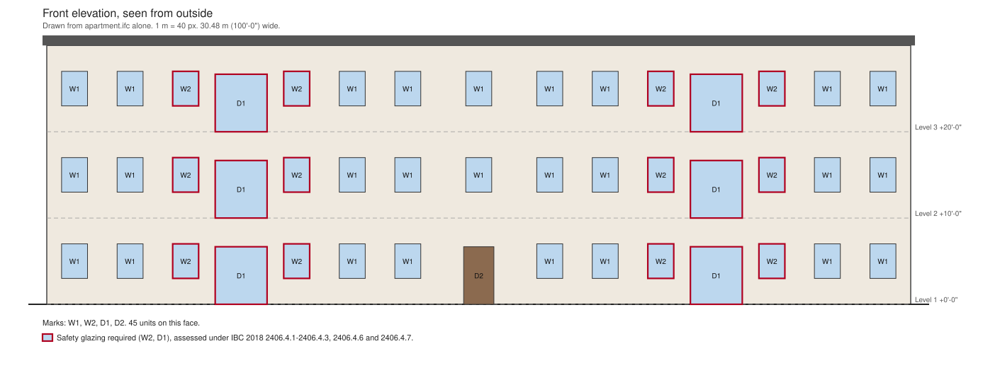
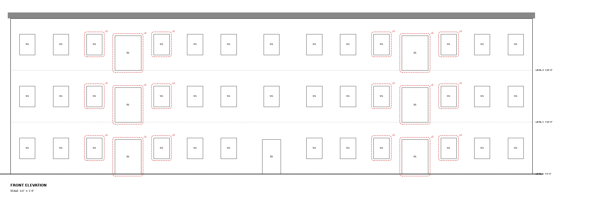

# Pass 3f: the bid set as data

A building goes out to bid as PDFs. Every subcontractor bidding it, and every supplier's rep
pricing for them, rebuilds the same building from those pictures before they can price it. A
window rep, for instance, redraws the elevations and the window schedule. The architect's model
holds all of it, but it doesn't leave the office. This pass (D27) issues pass 3b's 12-flat walk-up,
with the stair, halls and flats' doors it was missing (step 8), two ways and compares them:
- **as an open model** (IFC4), with a machine-checked list of what a bid set must carry
  (buildingSMART's IDS) and its drawings generated from the model;
- **as PDFs only**, the way a bid set is issued now.

It then runs a change through both, as an RFI and an addendum. It's a study, not construction
documents: those need a licensed architect's or engineer's stamp.

Run, in order:
- in `forge/`: `cargo run --release -- apartment-json`, then `cargo run --release -- apartment-json addendum-1 60`;
- once: `uv run brownfield bidset --setup-reader`;
- then `uv run brownfield bidset`, `uv run brownfield addendum` and `uv run brownfield pdfset --publish`.
  The last one rebuilds both IFCs and checks them with both readers, then writes the files in
  [bidset/](bidset/) and the figures here. It writes them only if every check passes.

The code is in `src/brownfield/bidset.py`, `stair.py`, `addendum.py` and `pdfset.py`, and the
stair in `forge/src/stair.rs`, with the numbers in `params/bidset.yaml`.

## What it says

- **The design model carries 10 of the 34 fields a quote needs.** These are:
  - the type mark, storey, exterior or not, unit width and height;
  - a U-factor within the code's limit, on the exterior units;
  - a fire rating and self-closing, on the doors into the stair;
  - the wall a unit is in, and that wall's construction.

  More on what's missing:
  - **It carries none of the fields about the product itself:** the rough opening, operation,
    frame material and colours, the glass (low-e, gas, tempered, obscure), SHGC, design pressure,
    screens, grilles, hardware finish, install type, or a specific spec section.
  - **The other 4 fields don't apply yet.** They are an escape window's clear-opening sizes, and
    no window is marked as one.
  - These are what Jon's list says a window quote needs. So a rep gets the sizes and has to ask
    or guess the rest.
- **The code decides things the model doesn't say.**
  - **Safety glazing (IBC 2018 2406.4):** it applies to 38 of the 126 openings.
    - **The 12 patio doors** (2406.4.1).
    - **The 24 windows beside them** (2406.4.2). Their edges are 23.1 in from a door's, inside
      the code's 24 in arc, and their sills are at 36 in, under 60. None of the section's four
      exceptions applies.
    - **The 2 back stair windows on levels 1 and 2**, which rise from the landings between the
      flights (2406.4.3 and 2406.4.6).

    Nothing in the model said so. Those 26 windows are their own type, W2, so a quote priced by
    type can't miss them.
  - **The one stair (IBC 2018 Table 1006.3.3(1)):** the walk-up fits the table, with 3 storeys,
    4 flats a storey and a common path of at most ~65-90 ft against 125. But the table's footnote
    allows one stair only if:
    - the building is sprinklered throughout;
    - every sleeping room has an escape window (section 1030): 16 upstairs at 2 bedrooms a flat,
      and 24 with the ground floor.

    Each escape window must clear 5.7 ft2, and 24 in high by 20 in wide in normal operation. A
    3'-0" x 4'-0" casement does that. A double-hung of that size opens about half its height,
    and a slider about half its width, so they likely don't. **Whether the building meets code
    turns on the window's operation, which the design model leaves out.**
  - **The stair as an exit (IBC 2018 1011, 1014, 1015, 1023, 716):** pass 3b's model had none.
    Seeing it in 3D showed the core empty, so step 8 modelled it.
    - **The stair:** each storey has 6 risers of 6 in to a landing at the back windows' sill,
      then 12 of 7 in. The treads are 11 in, the flights 52.75 in wide, and the handrails are on
      both sides.
    - **The rest of the core:** hall floors on levels 2 and 3, and the 12 doors from the hall
      into the flats.
    - **It passes all 17 checks against the code's limits,** measured from the geometry: risers,
      treads, headroom (the least is 101 in), landings, handrails, guards, and a clear 44 in in
      front of every door.
    - **The doors into the stair are 1-hour fire doors.** The stair is the one exit, so its walls
      are a 1-hour enclosure (1023.2) and the doors 1-hour assemblies, self-closing (Table
      716.1(2)). The 12 are their own type, D3. Before step 8 the door schedule listed 13 of the
      shell's 25 doors.
- **To bid from the PDFs, a bidder counts 114 tags by eye. From the data, nothing.**
  - **From the PDFs:** count the tags on 3 elevation sheets (45, 45 and 24), and tally them by type
    (W1 75, W2 26, D1 12, D2 1).
  - **The flat doors, D3, are on no sheet but the schedule.** They are inside, and the set has no
    floor plans, so a bidder can't count them against a drawing.
  - **From the data:** `schedule.csv` carries the counts, and `openings.csv` lists all 126 units.
- **To take in an addendum from the PDFs, a bidder finds 41 changed places on 3 sheets. The
  data lists them.** Addendum 1 narrows the patio doors and makes them tempered. On the revised
  sheets that means:
  - A-201 and A-202: 18 places each (6 doors and 12 windows);
  - A-601: 5 schedule cells. W2 stays, for the 2 stair windows, so its quantity and remarks
    change rather than its row going.

  The element diff names the same change by GlobalId: 36 windows and doors, 12 openings and 3
  types. Every place here is clouded, and the sheets have no plans, sections or specs, so 41 is a
  lower bound.
- **A change runs through the bid set the way a pull request runs through code review.** The RFI
  is the issue (a BCF topic on the 12 doors), the addendum is the change, and `brownfield
  addendum` is the CI step:
  - the diff shows exactly what changed;
  - both readers and the schema checks pass on the revision;
  - the code check reruns, and safety glazing falls from 38 openings to 14, because the windows
    are now 29.1 in from a door's edge (the 2 stair windows stay);
  - the schedule and drawings regenerate, with what moved listed.
- **The file holds.** Two independent readers agree on it:
  - IfcOpenShell, which wrote it;
  - That Open's web-ifc, a separate parser and geometry kernel.

  Every element is where forge's model has it, to 0.0003 mm, and a second export is byte-for-byte
  the same file.

## What a town could ask for

For the buildings a town pays for, through the benefits agreement here (the flats, the
clubhouses, the arena), the bid set would be issued with:
- the model as IFC;
- a check against an IDS like [this one](bidset/bidset.ids), with its results;
- each addendum as a revised model with an element diff, not only clouded PDFs.

None of that needs new software or law. It's contract language an owner can write, and it lets a
small local sub price the job without first redrawing it. It goes into the township brief once the
rep test (below) is in. Data center halls are different: their operators keep the designs
confidential for security.

## The checklist

What a bid set's windows and doors must carry ([bidset.ids](bidset/bidset.ids): 34 fields as 58
specifications in IDS 1.0), and how much of it the walk-up's model has. Glass fields apply to glazed
units, and design pressure, install type and outside colour to exterior ones. A door into the stair
must carry the fire rating the code calls for, and be self-closing. "IFC4" means a standard
IFC property or attribute. "BidSet_" means one of ours, where IFC4 has none, and each of those
says why in the IDS.

| Field | Where | Windows | Doors | Door types or walls |
|---|---|---|---|---|
| type mark | IFC4 | 101 of 101 | 25 of 25 |  |
| storey | IFC4 | 101 of 101 | 25 of 25 |  |
| exterior or not | IFC4 | 101 of 101 | 25 of 25 |  |
| unit width | IFC4 | 101 of 101 | 25 of 25 |  |
| unit height | IFC4 | 101 of 101 | 25 of 25 |  |
| rough opening width | BidSet_ | 0 of 101 | 0 of 25 |  |
| rough opening height | BidSet_ | 0 of 101 | 0 of 25 |  |
| operation | BidSet_ | 0 of 101 |  |  |
| operation (on the door type) | IFC4 |  |  | 0 of 3 door types |
| frame material | IFC4 | 0 of 101 | 0 of 25 |  |
| frame colour inside | BidSet_ | 0 of 101 | 0 of 25 |  |
| frame colour outside | BidSet_ | 0 of 101 | 0 of 13 |  |
| glass: low-e coating (yes or no) | IFC4 | 0 of 101 | 0 of 12 |  |
| glass: gas fill | IFC4 | 0 of 101 | 0 of 12 |  |
| glass: tempered (yes or no) | IFC4 | 0 of 101 | 0 of 12 |  |
| glass: obscure (yes or no) | BidSet_ | 0 of 101 | 0 of 12 |  |
| U-factor within the code's limit | IFC4 | 101 of 101 | 12 of 12 |  |
| SHGC | IFC4 | 0 of 101 | 0 of 12 |  |
| performance grade (design pressure) | IFC4 | 0 of 101 | 0 of 13 |  |
| escape window (yes or no) | IFC4 | 0 of 101 |  |  |
| escape window: clear opening area | BidSet_ | none marked; 16 needed (24 with the ground floor) |  |  |
| escape window: clear opening width | BidSet_ | none marked; 16 needed (24 with the ground floor) |  |  |
| escape window: clear opening height | BidSet_ | none marked; 16 needed (24 with the ground floor) |  |  |
| escape window: bottom of the clear opening above the floor | BidSet_ | none marked; 16 needed (24 with the ground floor) |  |  |
| screen (yes or no) | BidSet_ | 0 of 101 | 0 of 12 |  |
| grilles | BidSet_ | 0 of 101 | 0 of 12 |  |
| hardware finish | BidSet_ | 0 of 101 | 0 of 25 |  |
| install type | BidSet_ | 0 of 101 | 0 of 13 |  |
| fire rating (doors into the stair) | IFC4 |  | 12 of 12 |  |
| self-closing (doors into the stair) | IFC4 |  | 12 of 12 |  |
| in a wall | IFC4 | 101 of 101 | 25 of 25 |  |
| the wall's construction (on exterior walls) | BidSet_ |  |  | 12 of 12 exterior walls |
| MasterFormat section, level 3 | IFC4 | 0 of 101 | 0 of 25 |  |
| safety glazing where IBC 2018 2406.4 calls for it | BidSet_ | 0 of 26 | 0 of 12 |  |

The checklist is checked both ways:
- a copy of the model with every field filled in (made-up values) passes all of it;
- the same copy with one window's width removed fails exactly that one requirement.

## Addendum 1, as a reviewed change

- **RFI 001** ([rfi-001.bcf](bidset/rfi-001.bcf), BCF 3.0) asks what glass goes in the patio
  doors. It also asks whether the W2 windows beside them take safety glazing too, or whether the
  doors can narrow.
  - It points at the 12 doors by GlobalId.
  - The answer is a comment a day later, and the topic is closed.
  - Its words are built from the model, the params and the code check, down to whether a type
    is withdrawn: W2 isn't, since the stair windows keep it.
- **Addendum 1** (made up) has two items:
  1. the patio doors are glazed with tempered glass;
  2. they narrow from 6'-0" to 5'-0", a stock width, centred where they were. This change is
     made in forge, so the model's own checks follow.
- **What changed** ([addendum-1-diff.md](bidset/addendum-1-diff.md)):

| | Changed | How |
|---|---|---|
| Patio doors | 12 | size, geometry, properties, and type (the 5'-0" door is a new type) |
| Windows beside them | 24 | type (W2 to W1) and properties |
| Openings in the walls | 12 | narrower |
| Types | 3 | D1 at 6'-0" withdrawn; D1 at 5'-0" new; W2 stays, for the 2 stair windows, and its description drops 2406.4.2 |
| Any other element, opening or type | 0 | (the IfcProject's name says it is the addendum-1 revision) |

- **What moved:**
  - safety glazing fell from 38 openings to 14;
  - in the checklist, tempered on the doors went from 0 of 12 to 12 of 12;
  - in the schedule, W2 went from 26 to 2, W1 to 99, and D1 became 5'-0" and tempered;
  - the openings in the exterior walls went from 1,715 to 1,635 ft2.
- **ifcdiff 0.9.0 alone flags all 126 units,** for two reasons. It counts a property set's entity
  number as a property, and those numbers shift whenever anything is added earlier in the file.
  It also stops at the first relationship that differs. So it is used here for attributes and
  geometry only, with type, storey and properties compared directly.

## The same building as PDFs

[bidset.pdf](bidset/bidset.pdf) is the bid set drawn as an architect issues it: 36 x 24 in sheets
at 1/4" = 1'-0", every title block marked NOT FOR CONSTRUCTION.
- **A-201 and A-202:** the front and back elevations.
- **A-203:** the two ends.
- **A-601:** the window and door schedule, with U-factors as NFRC rates them (U-0.30), and D3's
  remarks "1 H FIRE DOOR, SELF-CLOSING".

The set has elevations and a schedule, no plans: the flat doors are on the schedule only.

[addendum-1.pdf](bidset/addendum-1.pdf) is the addendum's narrative page, then the revised sheets
with every change clouded.

| | From the PDFs | From the data |
|---|---|---|
| To bid | count 114 tags by eye on 3 sheets and tally them by type; read the schedule's 5 rows (D3's 12 doors are on no other sheet) | `schedule.csv` carries the counts; `openings.csv` lists all 126 units |
| Addendum 1 | find 41 changed places on 3 revised sheets: 18 + 18 units, 5 schedule cells | the diff lists 36 windows and doors, 12 openings and 3 types by GlobalId |

The PDFs keep their text, and pypdf reads the tags back to the same tally, so a takeoff tool could
count them. A scanned or flattened set, which bid sets often are, wouldn't allow that.

## How it was done

1. **forge** (CortenForge) writes the walk-up as named parts. Every opening gets a stable id from
   where it is, such as `2-back-right/back/3`. Forge checks its own model before writing:
   - no overlaps or clashes;
   - every opening inside its wall and storey;
   - the walls summing to the shell.

   Its `stair` module (step 8) adds the stair core without changing the building, so pass 3b's
   numbers stand. It adds the steps, landings, hall floors, the centre wall and closure, the
   guard, handrails as paths, and the 12 doors. Its checks:
   - no box clashes and no landing crosses a window;
   - every door is in its wall, on the hall, and clear of the spine;
   - nothing, handrails included, stands in a door's 44 in landing.
2. **IfcOpenShell** writes IFC4 from that. The stair is an IfcStair a storey, of its two
   IfcStairFlights, its landing and four handrails (swept along their paths). GlobalIds come from the stable ids; types are keyed on
   what they are (kind, size, safety glazing); IFC sets are sorted; and the header's time is
   fixed. So a re-export is byte-for-byte the same file, with no local time in it. A revision
   differs only where it changed, by GlobalId, though entity numbers shift, so a text diff of two
   revisions is long. U-factors carry their source; the entry
   door's is a placeholder, and the file says so.
3. **Checks on the file**, read back by IfcOpenShell and by web-ifc:
   - every part, opening and unit of forge's model is there exactly once, where forge has it;
   - no clashes, and glazing per flat equal to pass 3b's;
   - schema validation, with the express rules.
4. **The IDS** (ifctester), generated from `params/bidset.yaml`, holds the fields a quote needs and
   the code's limits.
   - **`brownfield.stair`** checks the stair against IBC 2018 1010-1015, measuring the
     geometry: risers from the floor or landing found at each end, headroom from anything above
     the nosing line, and every edge of every walking surface sorted into walled, continuing, a
     window, or an open drop.
   - **Safety glazing** reads the same geometry for 2406.4.3, 2406.4.6 and 2406.4.7.
5. **The schedule, elevations and quantities** are drawn from the IFC alone.
6. **The addendum:**
   - the revised model is checked to be the base plus exactly the addendum;
   - then it is exported, diffed, checked and redrawn;
   - the RFI is written with bcf-client.
7. **The PDF sets** are drawn with matplotlib from the same IFCs. Places on the sheets are compared
   between the base and the revision, matched by unit id, which the sheets don't show.

## Checks

- **The file against forge's model:**
  - the right counts by type, and sizes exact;
  - every element where forge has it (IfcOpenShell 0.0000 mm, web-ifc 0.0003 mm), the flights
    and guard included, and the handrails along their paths;
  - every opening cutting its own wall and holding its own unit;
  - every flight, landing and handrail part of its storey's IfcStair;
  - the flat doors 1-hour fire doors and the stair walls rated;
  - 0 clashes and 939 unique GlobalIds;
  - schema validation with 0 issues;
  - a second export byte-for-byte the same file.

  `brownfield pdfset` runs all of these again, with both readers, on the base and on the revision
  (60 checks) before it publishes anything.
- **The stair against the code:** all 17 checks pass. The least headroom, 101 in, matches a hand
  calculation (landing 2's underside over flight 1b's first nosing). Each of these, broken on
  purpose, fails its check:
  - a column on a tread, or a low duct;
  - a hall floor 2 in low, making an 8 in riser;
  - a short hall, or no guard;
  - an uneven step, or a missing handrail;
  - a narrow door, or a handrail across a door.
- **The checklist** passes a complete model and fails exactly the one requirement broken.
- **The code checks follow the layout:**
  - 23.1 in = 45 ft / 7 - 3 ft - 1.5 ft, and 29.1 in after the addendum;
  - the back stair windows rise from the landings (2406.4.3, 2406.4.6), a landing 2 mm off
    still counts, and a flight turned to face them brings in 2406.4.7;
  - a sidelite tight against a door, and a window round a corner, are both caught;
  - the single-exit test fails past each of the table's limits.
- **The drawings:**
  - every unit is where forge has it on the right facade, with left to right written out in the
    test;
  - gross wall area is 2 x (40 + 100) ft x 30 ft = 8,400 ft2;
  - an odd file (missing sizes, values that differ within a type, a material layer set) reads
    without crashing.
- **The addendum:**
  - the diff is exactly the change, and a tampered revision is refused;
  - the RFI is a closed topic on the 12 doors, with the camera on the building;
  - the schedule's changes match types by what they are.
- **The PDFs:**
  - the tags read back to the schedule's tally;
  - the revised sheets carry exactly 41 deltas, one per place counted.

The tests:
- 40 in `tests/test_bidset.py`: forge's model, the file, the checklist, the code checks and the
  drawings;
- 13 in `tests/test_stair.py`;
- 12 in `tests/test_addendum.py` and 13 in `tests/test_pdfset.py`;
- forge's own 7 tests of the stair.

All 264 of the project's Python tests pass.

## The files

[bidset/](bidset/) holds what the runs make, so they can be opened and checked without running
anything. `brownfield pdfset --publish` writes them from IFCs it has just checked, and a second
publish leaves every file byte-for-byte the same.
- `apartment.ifc` and `apartment-addendum-1.ifc`;
- `bidset.ids`, and `checklist.md`, its result on the model;
- `drawings/` and `drawings-addendum-1/`: each IFC's schedule, openings and quantities as CSV,
  and its four elevations as SVG;
- `rfi-001.bcf`, and `addendum-1-diff.md`, the element diff and the schedule's changes;
- `bidset.pdf` and `addendum-1.pdf`, with `conventional.md`, what they cost a bidder against the
  data.

IfcOpenShell and That Open's web-ifc both read the IFC. Commercial viewers weren't tried (below).

**Online:** [the walk-up's plan room](https://youngmoolahbaby.github.io/brownfield-compute/) lists these files as a builders exchange lists a
project: the drawings, the model, the schedule and the checklist, then Addendum 1 with its changes and
RFI. The model opens in 3D in the browser.
- The site is rebuilt on each push that changes the viewer or these files
  (`.github/workflows/pages.yml`, running `tools/viewer/build_site.py`).
- Its counts and sizes are read from the files, and the addendum's items from the RFI.

To run the viewer locally, run `uv run brownfield viewer` and open http://127.0.0.1:8765/. With
`--latest` it shows the models from the last run, before they are published.
- **How it works:** That Open's web-ifc parses the IFC in the browser (WebAssembly), and three.js
  draws it. The page is `tools/viewer/`, and its two libraries are pinned in that folder's lock
  file and installed the first time it runs.
- **What it shows:** clicking a window or door gives what the model says about it and what a
  quote still needs. It switches between the bid set and Addendum 1, and it opens any other IFC
  file too.
- **It serves this computer only.**

## What we don't know

- **The rep test.** Would a window rep's quoting software take `schedule.csv` or the IFC, what's
  missing, and how long does it take against the PDFs? This is the test that says whether the
  data saves real time, and it hasn't been run. Jon is to hand the files to a rep; the answer goes
  in as one data point, with no names.
- **What the stair leaves open.** Step 8 added it after the 3D viewer showed the core was
  empty.
  - **It is boxes.** The steps are blocks, without stringers or a soffit. Pass 3b's framing
    doesn't frame it or the doors' headers, and its handrails' and guard's loads (1607.8)
    aren't checked.
  - **The back stair windows.**
    - **Whether they open:** the level-2 one is 13 ft up with its sill at the landing, so if it
      opens, 1015.8 asks for a fall-prevention measure. The model doesn't say whether it opens.
    - **Safety glass or a rail:** they take safety glazing. 2406.4.3's exception 2, a rail across
      the glass at 34-38 in, is the other way, but it doesn't clear 2406.4.6.
  - **The flat doors.**
    - **Clear width:** the 33.5 in rests on a placeholder (2.5 in off the leaf for its thickness
      and the stop).
    - **Swing:** that they swing into the flats is forge's design, not measured.
    - **Hardware:** only self-closing is specified; the closer and latch are left to the door
      supplier.
  - **The width:** 44 in was used, not the 36 in allowed under 50 occupants, because the
    occupant load table (1004.5) wasn't read.
- **What it costs an architect to deliver,** and the contract wording that makes the model, or
  the IDS's fields, part of the bid documents. The liability question is what keeps models in the
  office now, and nothing here tests it.
- **Real error rates.** The counts here are effort: tags to count and places to find. How often
  bidders miscount or miss an unclouded change has no source here.
- **Commercial tools.** Two open readers agree on the file. Revit, Archicad, Solibri and quoting
  software weren't tried.
- **The code, beyond what was read:**
  - **Pennsylvania's amendments:** only those UpCodes notes under the sections read were seen.
    One is under 1011.5.2, about stairs inside a flat. The UCC's amendments as a whole weren't
    read.
  - **2406.4.5 (wet areas) wasn't assessed:** the model has no rooms. 2406.4.4 (glazing in guards)
    doesn't arise, since the guard and handrails have no glass.
  - In 2406.4.3, the floor inside is assumed to be the walking surface, and a unit's whole glass
    stands in for its largest pane.
  - Exception 4 of 2406.4.2 needs a door's handing.
  - Pennsylvania's public bidding rules for town-owned buildings, the Separations Act among them,
    weren't read.
- **Escape windows.** The model has no rooms, so it doesn't say which windows serve bedrooms.
  - The ground floor needs escape windows too unless its patio doors count as a second way out,
    and that isn't settled.
  - The common path is a straight-line bound, since interior walls aren't modelled.
  - Whether pass 4's cost per flat covers sprinklers is unchecked: HUD's limit is a cap, not an
    itemised estimate.
- **The field list.** It is Jon's list plus IFC's standard properties, and hasn't been checked
  against more reps or a published standard. The IDS is ours, not buildingSMART's. The MasterFormat
  sections are our judgement at level 2.
- **A real model and a real addendum.** The walk-up is a concept-level model of boxes; an
  architect's model carries more and different detail. The addendum is made up and touches one
  trade; real ones are messier.

## Sources

- **IFC4:** ISO 16739-1:2018.
- **buildingSMART:** Information Delivery Specification (IDS) 1.0; BCF 3.0.
- **Tools:**
  - IfcOpenShell 0.9.0.post1, ifctester 0.9.0, ifcdiff 0.9.0 and bcf-client 0.9.0 (PyPI);
  - That Open's web-ifc 0.0.78 (npm, MPL-2.0), run on Node 24.19.0 from the nodejs-wheel-binaries
    wheel;
  - pypdf 6.21.4 and matplotlib.
- **IBC 2018, chapter 24:** section 2406.4, read on UpCodes' Pennsylvania Building Code 2018
  (https://up.codes/viewer/pennsylvania/ibc-2018/chapter/24/glass-and-glazing).
  - 2406.4.1-2406.4.3 were read on 2026-11-19.
  - 2406.4.4-2406.4.7 were read from the chapter page as Jon saved it (2026-11-20); the fetch
    tools got only a summary of them.
- **IBC 2018, chapter 10:**
  - **1006.3.3, Table 1006.3.3(1) and 1030:** read by Jon in an online IBC 2018 viewer and shared
    as screenshots (2026-11-19).
  - **1011.1-1011.7:** shared as screenshots from UpCodes (2026-11-20).
  - **The rest, read from UpCodes' chapter 10 page as Jon saved it (2026-11-20):** 1010, 1011.8
    on, 1014, 1015, 1019 and 1023.
- **IBC 2018, chapter 7:** 716, from UpCodes' chapter 7 page as Jon saved it (2026-11-20).

Numbers and short quotes are in `params/bidset.yaml` and [RESEARCH.md](../RESEARCH.md). Every quote
from a saved page was checked against that page's text.
- **2018 IECC climate zone 5:** fenestration U-0.30 (pass 3's source).
- **CSI MasterFormat 2020, Division 08 Openings.**
- **Bedrooms a flat:** 2, as pass 4 prices the flats (HUD 2024 Unit Total Development Cost
  limits, walk-up, 2 bedrooms).
