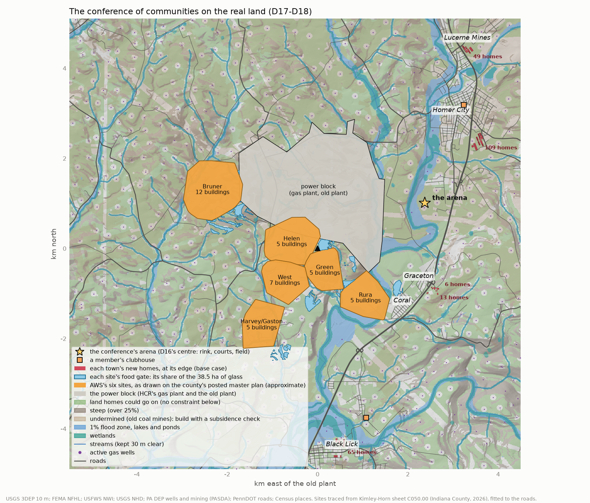
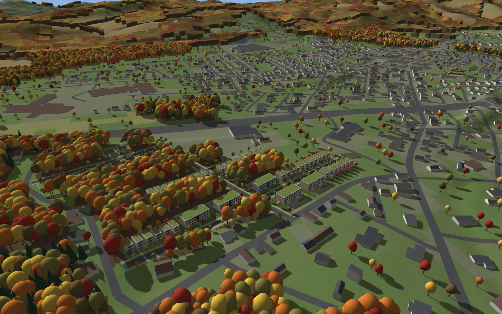
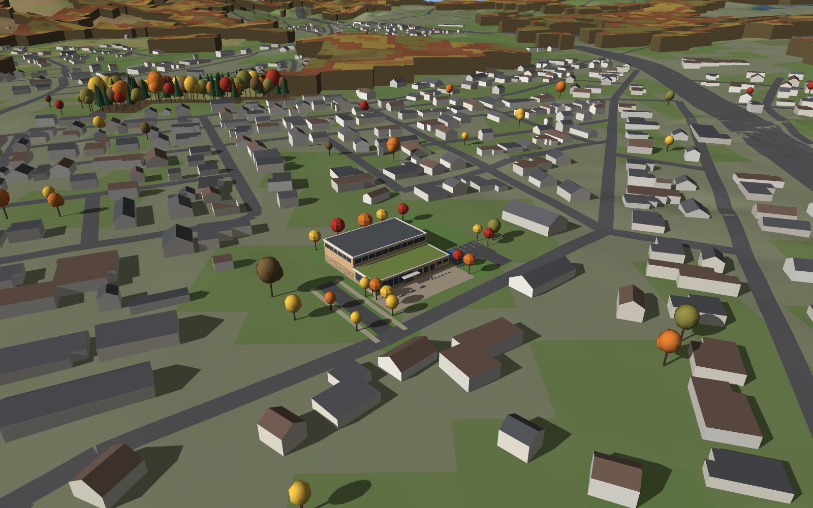
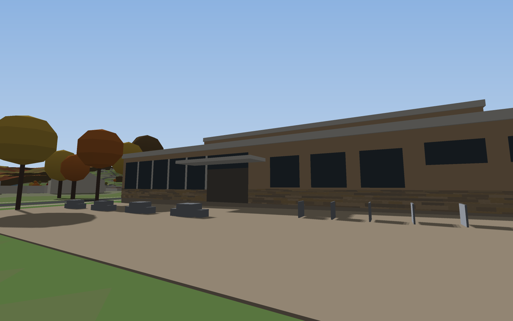
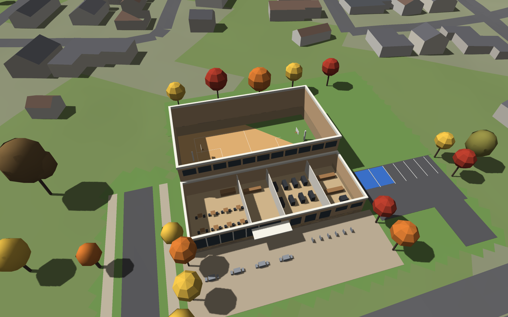
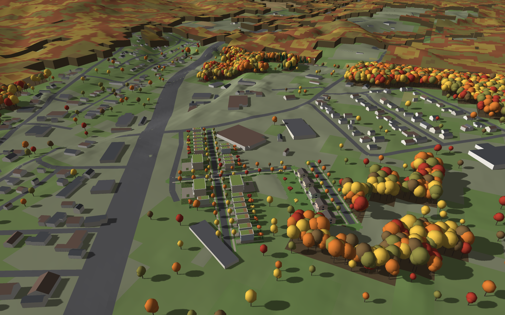
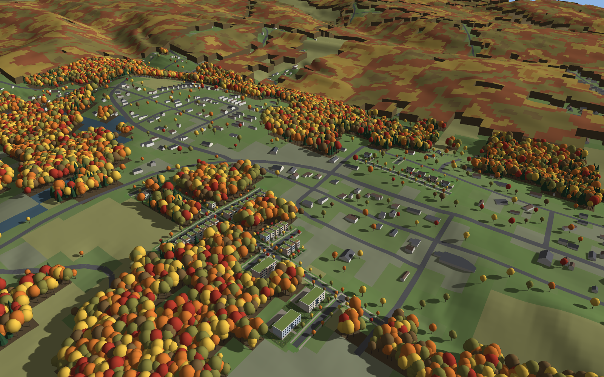
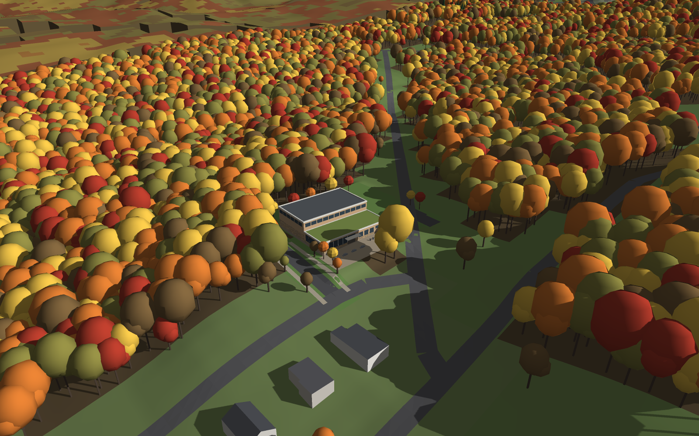
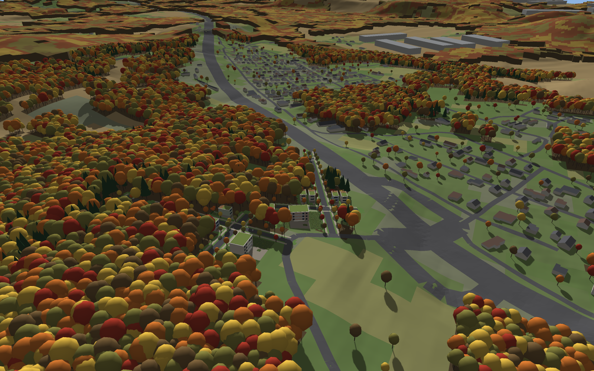

# The conference of communities, on the real land and drawn (D17-D18)

Jon, 2026-11-17: "communities that are pulling heat and eating the food from the greenhouse ... like
a conference of communities, which makes it fun. your community can play the other community in your
sport, etc." Then "let's go with your plan" (D17: map AWS's six sites, put a community at each), and
"draw the 3D homes and clubhouses" (D18).

`uv run brownfield conference` (`src/brownfield/conference.py`, `src/brownfield/neighbourhood.py`)
writes `out/pass3/conference.md`, the map below and the drawing data. Then forge draws the scenes:
`cargo run --release -- conference` (`forge/src/conference.rs`).

## The answer

**The newcomers join the towns already there, every town growing by the same sixth. Two clubhouses
and the arena make the conference's three home grounds.**

- **D17's placement didn't join the towns, so D18 changed it.**
  - **The problem:** D17 put each site's homes within 900 m of that site. That left Bruner's 74
    homes in the woods north of the power block, 3.1 km from Homer City. A drawing of that would
    have shown an enclave.
  - **The fix:** homes at a town's edge use its water and sewer mains, its school bus and its
    shops. Heat doesn't hold them near the sites either: D16 found heat pumps cost less than the
    warm loop for the houses.
  - **The new rule:** the newcomers are shared among the towns by their people. Each town's homes
    are laid out at its edge on the real ground.
- **Each town grows by about 15%; D17 more than doubled Graceton and Coral.**

  | Town | People now | New homes | Newcomers | School children | Over old mines |
  |---|---|---|---|---|---|
  | Homer City | 1,716 | 109 (55 flats, 44 townhouses, 10 houses) | 262 | 52 | 100% |
  | Lucerne Mines | 764 | 49 (24 flats, 20 townhouses, 5 houses) | 119 | 24 | 100% |
  | Black Lick | 1,008 | 65 (33 flats, 26 townhouses, 6 houses) | 156 | 31 | 0% |
  | Coral | 206 | 13 (7 flats, 5 townhouses, 1 house) | 30 | 6 | 2% |
  | Graceton | 100 | 6 (2 flats, 3 townhouses, 1 house) | 16 | 3 | 43% |
  | **All five** | **3,794** | **242** | **584** | **117** | |

  - In pass 4's high case there are 664 homes: 299 in Homer City, 176 in Black Lick, 133 in
    Lucerne Mines, 37 in Coral and 19 in Graceton.
  - Every home found a place, and the limits hold:
    - 242 homes against room for about 1,346 on Homer City's sewage plant;
    - about 9 children a grade against Homer-Center's ~60.
- **Where they stand:**
  - **Lucerne Mines:** its homes sit 0.2 km from the village's middle, beside the existing
    subdivision.
  - **Black Lick:** its homes sit in the village itself, in two clusters off its streets.
  - **Homer City:** its homes sit 0.9 km from the borough's middle, across US 119, among the houses
    already on that side.
  - **Graceton and Coral:** their homes stand together, 0.5-0.7 km from the villages, also across
    US 119. How people would cross the highway to the villages needs checking.
  - **Old mines:** Homer City's and Lucerne Mines' new land lies entirely over old mine workings.
    Those homes need subsidence checks and mine subsidence insurance.
- **Two clubhouses; the arena is Graceton and Coral's home ground.** A member gets a clubhouse where
  it costs a household under $1,200 a year to run.

  | Member | New homes | People (newcomers) | Households | A clubhouse's running cost a household a year | Home ground |
  |---|---|---|---|---|---|
  | Homer City and Lucerne Mines | 158 | 2,862 (382) | 1,150 | $442 | its clubhouse, in Homer City |
  | Black Lick | 65 | 1,164 (156) | 468 | $1,085 | its clubhouse, in Black Lick |
  | Graceton and Coral | 19 | 352 (46) | 141 | $3,593 | the arena |

  - **Cost:** the two cost $9.6M to build and $1.02M a year to run, $577 a household across the
    conference's 1,760. D17's three cost $1.5M a year.
  - **The arena** (D16's centre: rink, courts, field) stands 2.4 km east and 1.0 km north of the old
    plant, under 2 km from Graceton.
- **Black Lick's clubhouse is the weak spot.**
  - A court hall needs about 35 m of nearly level ground. Black Lick sits on a creek's floodplain
    under steep hills, and the nearest such ground is 833 m from its middle, in the woods up the
    road.
  - Homer City's clubhouse stands on open ground 326 m from the borough's middle.
  - A better answer for Black Lick is probably an existing building in the village, a hall or a
    school's gym, made over. That needs asking.
- **The food gates.** AWS's 38.5 ha of glass is shared by the sites' buildings (each site's jobs).
  Each share stands within 300 m of its site, facing the nearest town's new homes.

## The drawings

Every image is drawn on the real ground:
- **Ground and woods:** USGS 10 m levels, and NLCD 2021 land cover for the woods and fields.
- **The towns:** Microsoft's building footprints for the towns as they stand, and PennDOT's roads.
- **The new homes:** pass 3's walk-ups and D16's townhouses and houses, each on its lot, turned to
  its street. Each building stands on a level pad, with a stone plinth taking up the fall, and its
  garden follows the lot's graded ground.
- **The look:** an October afternoon, the woods in autumn colour. The old town's buildings are
  plain white and grey, so the new ones read apart.

**The clubhouse** (12,000 ft2, the same building in both towns):

| Room | m2 | Source |
|---|---|---|
| Court hall | 670 | an NFHS high-school court, 84 x 50 ft, with 3 m all round; 7 m clear (FIBA) |
| Cafe | 150 | about 60 seats and a counter |
| Fitness room | 120 | about 15 machines and a free-weights corner |
| Workshop | 90 | benches, a tool wall, a roll-up door to the parking |
| Lobby, toilets, store | 85 | |

- **Massing:** the court hall stands behind a low wing on the street. A stone base runs below,
  timber above, with a clerestory band round the hall.
- **Roofs:** planted on the wing, metal on the hall.
- **Outside:** a plaza with tables, bike racks, and six parking spaces, two of them accessible.
- **Cost:** $4.8M to build and $508k a year to run (4.2 full-time posts).

## How it was done

- **The towns' shares:** D16's homes (pass 4's newcomers) split by each town's people, type by
  type (`town_homes`).
- **The land a lot may take:**
  - clear in [land.md](land.md), and under 15% slope;
  - 700 m from AWS's buildings (pass 2's conventional cooling at night);
  - 10 m from existing buildings, and 30 m from US 119 and US 22.
- **The layout** (`neighbourhood.py`):
  - A spine street leaves an existing local street at right angles.
  - D16's 15 m living streets cross it, with lots both sides and 30 m greens between the backs.
  - The lots fill outward from the spine's mouth: walk-ups, then townhouses, then houses (D16's
    rings).
  - A lot is kept where at least 95% of it is clear, it lies within a 400 m walk (Perry's
    pedestrian shed), and the ground under its building falls no more than 3 m (a walk-out
    storey).
  - Up to three clusters a town, each as near the town's middle as the land left allows.
  - The clubhouse goes first, on a public street as near the town's middle as a 60 x 60 m lot
    fits.
- **The drawing data** (`neighbourhood.drawing`):
  - one region per member's homes, at 2 m round the homes and 10 m for 3 km round;
  - each lot graded to the plane that best fits its ground, blending back over 6 m;
  - trees every ~6.5 m in NLCD's woods, fewer in the towns' yards;
  - cameras.

  forge builds and draws it with its own scene renderer. The ground is sampled with CortenForge's
  `HeightFieldData`.

## What we don't know

- **What the towns would say.** This is a plan for the towns to be asked about, not one made for
  them.
- **Who owns the edge land,** and what the open ground under Homer City's clubhouse is today (a
  field, a park?).
- **Where the sewer and water mains run,** and whether Black Lick, Graceton and Coral are on public
  sewer. The limit above is Homer City's plant.
- **How Graceton's and Coral's homes would cross US 119** to the villages.
- **The real setback.** It depends on AWS's cooling: 150 m with the good-neighbour design (D11),
  not 700 m.
- **Ground conditions.** Homer City's and Lucerne Mines' new land is all over old mines; soils and
  the 1 m lidar would refine the grading.
- **Microsoft's building heights** are machine-estimated and read low (median 3.7 m), so the old
  towns are drawn to the eaves with a gable on the small buildings. The footprints may miss some
  sheds and include some demolished buildings.
