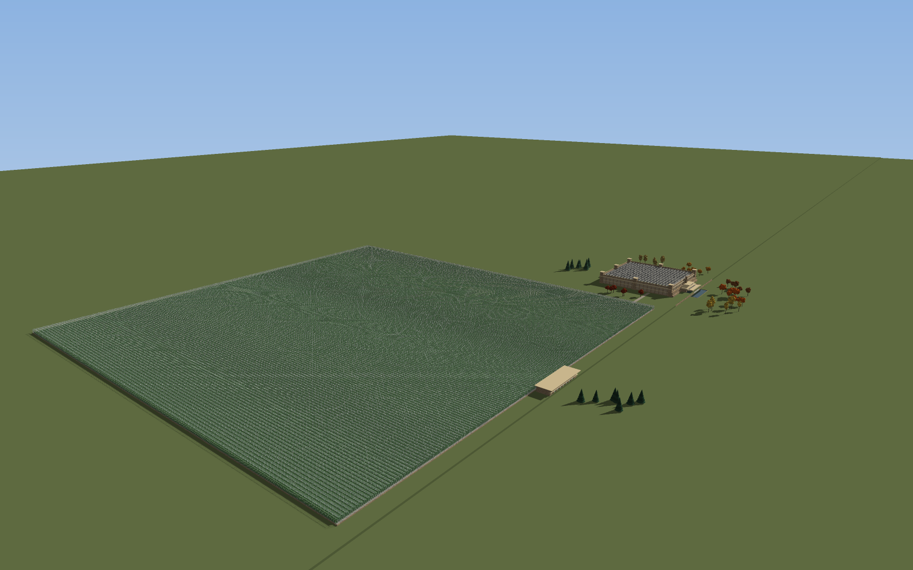

# Pass 3d: winter food on the data center's warm water

The winter garden (pass 3c) uses about 0.01% of one module's heat. Jon asked to put that warm water
to "something inspiring/usefful", and then: "i definetely think it should be put into growing food
in the winter". This pass sizes glasshouses beside the data hall that grow food through the winter
on the hall's warm water, with grow lights where the winter sun falls short. It asks how much of the
heat they can use, what they need in return (electricity for the lights, money, people to buy the
food), and how a future stellarator on the site would change that.

`uv run brownfield food` (`src/brownfield/food.py`, `params/food.yaml`; output `out/pass3/food.md`,
and `out/pass3/food.json`, which forge `garden` draws from).

## The answer

**One module's spare heat can carry about 43 hectares (107 acres) of lit tomato glasshouses.** They
would grow about 29,500 tonnes of tomatoes a year and employ about 480 people. With pass 2's town
network, about a third of the module's heat is put to use, against a tenth without them.

- **The market is the limit, not the heat.** 29,500 tonnes is the fresh tomatoes 3.4 million people
  eat in a year, more than the whole Pittsburgh metro area (2.46 million). The US imports most of
  its fresh tomatoes (69%), and most of those imports are greenhouse-grown. So there is a market to
  take back, but one module's houses would already be a large share of it. The 39-building campus
  AWS plans can't fill its heat with tomatoes.
- **Winter food needs light as well as heat.** In December the glass lets through about 8 mol of
  light per m2 a day, against the 25 tomatoes need. The lights add 84 GWh a year, 11% more than the
  module itself uses, and 29 MW at peak on winter days. That is the energy the food takes from
  elsewhere: from the grid today.
- **The heat is worth about $7 million a year to the houses, and about 35,000 t of CO2.** That is
  the gas the houses don't burn. Their margin before overheads is about $17 million a year on the
  data center's heat, against $10 million on a gas boiler. The margin leaves out every running cost
  but wages, lamps and gas, so it is an upper bound.
- **Lettuce loses money at the price field lettuce sells for**, about $36 million a year at 47 ha.
  Pennsylvania's greenhouse lettuce growers (Little Leaf Farms, McAdoo) sell at a premium we could
  not find a price for.
- **No one has done this at this scale yet.** No hectare-scale food greenhouse heated by a data
  center is confirmed running:
  - Microsoft's plan at Agriport (the Netherlands) offers ~25 C water, through heat pumps.
  - QScale's 12 ha in Quebec also use heat pumps and weren't running as of March 2026.
  - This design heats straight off a 50 C chip-cooling loop, with no heat pump. That is the
    difference to prove.

## How it works

Hour by hour over Homer City's typical year (PVGIS), per square metre of glasshouse:

1. **Light.** The sun's growing light inside is the global sunlight x 2.1 umol per J x the glass's
   0.73 (with its structure and screen). Each day, the lamps make up the shortfall against the
   crop's target (tomato 25 mol/m2/day), in the dimmest hours of its photoperiod (17 h), at
   200 umol/m2/s from LEDs giving 3.0 umol/J.
2. **Heat.**
   - Loss through the glass: 6.2 W/m2K by day, 4.0 at night with the energy screen closed.
   - Plus air leakage.
   - Less the half of the sun and the lamps that warms the air (the rest goes into the crop's
     transpiration).
3. **Supply.**
   - The liquid loop's heat after pass 2's town network has taken its share.
   - The houses take it straight off the loop's 50 C return and send it back at 40 C.
   - Standard heating pipe gives only about half its usual output on water this cool, so the
     houses have twice the pipe (Dutch growers run a second, larger heating system on 40-50 C
     water). On the coldest nights the pipe still falls short, and a gas boiler runs hotter water
     through the same pipe.
   - A 200 m3/ha hot-water tank carries the day's spare heat into the night.
4. **Size.** The design point is the largest area whose heat the module has spare, short by no more
   than 5% of the houses' heat.

## Light at Homer City

Mol of growing light per m2 a day, PVGIS typical year:

| | Jan | Feb | Mar | Apr | May | Jun | Jul | Aug | Sep | Oct | Nov | Dec |
|---|---|---|---|---|---|---|---|---|---|---|---|---|
| Outside | 13 | 22 | 27 | 34 | 41 | 46 | 46 | 37 | 29 | 24 | 16 | 10 |
| Inside glass | 9 | 16 | 19 | 25 | 30 | 34 | 33 | 27 | 21 | 18 | 12 | 8 |

Targets: lettuce 17, tomato 25. From October to March the sun alone falls short.

## Four ways to build it, at each one's design point

| Crop, cover | Area | Module heat used | Boiler (of it pipe-limited) | Lamps a year | Lamps at peak | Food a year | People's yearly supply | Jobs | To build | Margin a year (on gas) | CO2 a year (on gas) |
|---|---|---|---|---|---|---|---|---|---|---|---|
| **tomato, glass** | **43.5 ha** | **24% (176 GWh)** | **7.1% (2.6%)** | **84 GWh** | **29 MW** | **29,509 t** | **3,431,255** | **478** | **$169M** | **$17.3M ($10.3M)** | **2,709 t (38,034 t)** |
| tomato, poly | 62.5 ha | 22% (163 GWh) | 5.1% (0.1%) | 143 GWh | 42 MW | 40,719 t | 4,734,728 | 688 | $243M | $19.8M ($13.3M) | 1,763 t (34,529 t) |
| lettuce, glass | 46.5 ha | 32% (235 GWh) | 19.7% (14.8%) | 38 GWh | 16 MW | 15,318 t | 1,178,314 | 976 | $153M | -$35.9M (-$45.3M) | 11,557 t (58,728 t) |
| lettuce, poly | 51.5 ha | 28% (205 GWh) | 7.6% (2.8%) | 53 GWh | 17 MW | 16,817 t | 1,293,646 | 1,082 | $169M | -$39.1M (-$47.3M) | 3,408 t (44,629 t) |

Why the design is tomatoes in glass:
- **Tomatoes are the crop the country imports from greenhouses.**
- **Glass lets in more of the winter light than double poly** (0.73 against 0.62). That means less
  lamp power: 29 MW at peak against 42 MW for the same rule.
- **Poly carries more area,** because it holds heat better. But it needs half again the lamps and
  is replaced every few years.
- **Lettuce in glass is warm-grown (24 C by day).** Its pipe can't carry the coldest nights on
  50 C water, so 15% of its heat would come from the boiler.

## Area against heat (tomatoes in glass)

| Area | Heat the houses need | From the data center | Share of the module's heat | Boiler: pipe-limited | Boiler: module short | Lamps at peak |
|---|---|---|---|---|---|---|
| 5 ha | 22 GWh | 21 GWh | 3% | 3% | 0% | 3 MW |
| 10 ha | 43 GWh | 42 GWh | 6% | 3% | 0% | 7 MW |
| 25 ha | 109 GWh | 106 GWh | 15% | 3% | 0% | 17 MW |
| 50 ha | 217 GWh | 192 GWh | 26% | 3% | 9% | 33 MW |
| 100 ha | 435 GWh | 255 GWh | 35% | 3% | 39% | 67 MW |

The module's heat runs out on winter nights first. Past ~45 ha, more houses mostly burn more gas.
Even 100 ha would use only about a third of the module's heat, because in summer the houses need
almost none.

## Where every MW goes

One module over a year, with the design point's 43.5 ha of tomatoes:

| | GWh a year | Average MW |
|---|---|---|
| Computers (IT) | 701 | 80.0 |
| Cooling (trim chillers, fans, pumps) | 29 | 3.3 |
| Heat pumps for the town network (pass 2) | 14 | 1.5 |
| Grow lights | 84 | 9.5 |
| **Electricity in all** | **827** | **94.4** |
| Heat to the town | 75 | 8.6 |
| Heat to the food houses | 176 | 20.1 |
| Heat still let go to the air | 493 | 56.2 |

## The stellarator: pass 5's option, not the plan

Type One Energy's Infinity Two is a 350 MW stellarator plant (400 in the company's 2026 copy) aimed
at the mid-2030s. All its figures are design targets.

- **Its heat:** 350 MW of electricity from about 1,000 MW of heat, so about 650 MW is let go. The
  temperature it is let go at isn't published; 35 C is assumed here.
- **The lamps:** the design point's lamps would take 8% of its output at their peak (29 MW).
- **More houses:** if half its rejected heat were lifted to 50 C by heat pumps (COP 7.2, 52 MW of
  electricity), it could carry about 330 ha more under the same rule. That is far more than any
  market nearby could take.

So with a stellarator, the food houses wouldn't be short of heat or power; the limits are the
market and the people to work them. Nothing here depends on it.

## Known cases

The same model of tomatoes in glass, on PVGIS weather at the growers' own districts:

| | This model | Published |
|---|---|---|
| Leamington, Ontario: yield, kg/m2 a year (unlit / lit) | 55 / 69 | 55.5 (46-60), 8 growers, mostly unlit |
| Leamington: heat, MJ/m2 a year (unlit) | 2,042 | 1,650 (1,360-1,880) |
| Westland, the Netherlands: lit over unlit yield | 1.49 | 1.27 (1.15-1.40) |

- **Yield:** the light use efficiency (8.2 g of tomatoes per mol) is set from the Ontario growers,
  so their yield matching is by construction. A Wageningen trial measured 7.98 g/mol on its own.
  Dutch growers get about 1.5 times more from a mol, so the model is cautious about yield.
- **Heat:** the model's heat is 24% above the Ontario growers'. Many of them run two screens; the
  model has one and assumes leakage and the share of sun that warms the air (both placeholders).
  So the houses here are, if anything, sized small.
- **Lamps:** the model credits the lamps with more yield than Dutch growers see (1.49 against
  1.27). So the lit yield, and the margin, are overstated by up to ~15%.

## What we don't know

- **Who buys the food.** AppHarvest's 25.7 ha of lit tomatoes in Kentucky went bankrupt in July
  2023. Yield and grade, a plant virus, working conditions and debt sank it, not heat. The design
  point grows more tomatoes than Pittsburgh eats.
- **Costs:**
  - The build cost ($269/m2, $108-390) is a builder's range and AppHarvest's financing. No neutral
    US split between glass and poly was found.
  - The LED cost per unit of light is a placeholder.
  - Running costs other than wages, lamps and gas are left out.
  - Prices are one year (tomato) and field lettuce's value (lettuce).
- **Lettuce yield per mol of light** differs about threefold between sources (6.8 against ~18.6
  g/mol); the lower is used.
- **Heating pipe on 50 C water:** AHDB's linear rule overstates pipe output at small temperature
  differences.
- **Placeholders:**
  - air leakage;
  - the share of sun and lamp energy that warms the air;
  - the share of floor in crop;
  - the 5% rule;
  - the pipe laid;
  - Infinity Two's rejected-heat temperature and how much of it could be piped.
- **The site:** where on the real parcel 43 ha of glass would go. The 244-acre coal ash disposal
  site is not ground for houses or trees.
- **The data center's own heat in summer** still mostly goes to the air (493 GWh a year).
