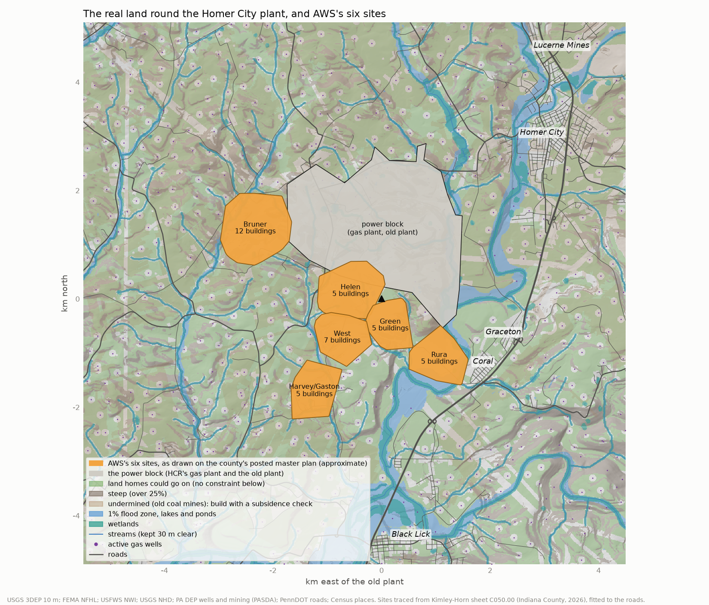

# The real land, and AWS's six sites (D17)

Every position in the site plan so far was schematic, and the [checklist](checklist.md) said the
land is what still made it concept art. This maps the real ground round the Homer City plant from
public data, and puts AWS's six sites on it. D17 in [PLAN.md](../PLAN.md) has Jon's brief.

`uv run brownfield land` (`src/brownfield/land.py`, `params/land.yaml`). It writes
`out/pass3/land.md`, `data/aws_sites.geojson` and the map below.

## The answer

- **AWS's six sites, mapped.** The county's posted master plan (Kimley-Horn sheet C050.00) was fitted
  to the real roads, and the fit checks out three ways:
  - the drawn township line falls on the real Center/Black Lick line;
  - the roads fall on PennDOT's;
  - DEP's grading-permit centres land inside Rura and at the edge of West's buildings.

  | Site | Buildings | Drawn development | Where |
  |---|---|---|---|
  | Bruner | 12 | 343 acres | 2.3 km west, 1.3 km north of the old plant |
  | Helen | 5 | 253 acres | beside the power block, west |
  | Green | 5 | 154 acres | beside the power block, south |
  | West | 7 | 183 acres | 0.7 km south-west |
  | Harvey/Gaston | 5 | 188 acres | 1.2 km west, 1.7 km south |
  | Rura | 5 | 193 acres | 1.1 km east, 1.1 km south, by Route 119 |
  | **All six** | **39** | **1,314 acres** | |

  - The drawn buildings add up to about 42 of the filing's 112,500 ft2 footprints against its 39,
    so the 39 are shared out by drawn area.
  - The development drawn covers 1,314 acres. AWS proposes to acquire about 2,200, and press
    reports put what is built on at about 1,100.
- **About half the land has no hard constraint on it.** Of 22,639 ha in the box, 11,381 ha (50%)
  is clear. The rest is taken by:
  - steep slopes over 25% (4,825 ha);
  - streams and their 30 m margins (2,166 ha);
  - setbacks from oil and gas wells (1,995 ha);
  - wetlands and their margins (1,788 ha);
  - the 1% flood zone (1,645 ha);
  - house lots of 5 acres or less (1,244 ha);
  - transmission lines, abandoned mine land, coal refuse, AWS's sites and the power block.
- **Two big flags. Neither stops building, but each needs care:**
  - **Old coal mines lie under 10,940 ha, about half the box.** Homes there need a subsidence check
    and mine subsidence insurance. Several of the communities below stand entirely over old
    workings.
  - **There are 1,414 active conventional gas wells** (plus 10 unconventional). Each keeps homes
    61 m off; unconventional wells keep them 152 m off (58 Pa.C.S. 3215(a), applied the other way).
- **Every site has room nearby:**
  - **Within 700 m of a site:** 70 to 186 ha buildable.
  - **Between 700 m and 1.5 km:** 268 to 505 ha.
  - **A community of about 240 homes** needs about 12 ha. Land isn't the limit.

## How it was done

| Layer | Source (public, no key) | Used for |
|---|---|---|
| Ground | USGS 3DEP 1/3 arc-second (10 m) | slope, hillshade |
| Flood | FEMA National Flood Hazard Layer | the 1% flood zone |
| Wetlands | USFWS National Wetlands Inventory | wetlands, 15 m margins |
| Streams, lakes | USGS National Hydrography Dataset | 30 m stream margins |
| Wells | PA DEP oil and gas wells (PASDA) | setbacks by type and status |
| Mining | PA DEP mined-out areas, longwall panels, surface permits, coal refuse, abandoned mine land (PASDA) | flags and exclusions |
| Roads, rail | PennDOT (PASDA) | the map, and fitting the master plan |
| Power lines | HIFLD transmission lines (PASDA) | 30 m corridors |
| Parcels | Indiana County parcels (PASDA, owners as of ~2021) | house lots, and the master plan's fit |
| Towns | Census TIGERweb places | the towns, as the conference's members |
| AWS's sites | the county's posted master plan, sheet C050.00 | traced, see below |

- **Fitting the master plan.** The sheet has no coordinates, so it was fitted in three steps.
  - **Start:** two published points. Rura's buildings go on DEP's Rura grading permit, and the
    power block's gas units on HCR's gas plant permit point.
  - **Refine:** the sheet's grey line work is moved, turned and scaled until it lies as close as
    it can to the real roads, parcel lines and township lines (chamfer matching).
  - **Result:** 9.47 m a pixel and a 0.93° turn. That turn is about the difference between
    Pennsylvania's state-plane grid north and true north here.
  - **Accuracy:** half the line work lands within 30 m of a real line, so the outlines are good
    to a few tens of metres.
- **Each site's outline is its drawn development,** not its deeded boundary. The sheet's
  buildings, stormwater basins and yards are picked out by colour, grouped by site and wrapped,
  with a 15 m margin. The property lines can't be read reliably at the sheet's resolution, and
  the deeds aren't public.
- **The power block** (HCR's gas plant and the old plant) is traced by hand from the sheet's large
  dashed loop. It is rough.
- **No security detail:** substations aren't drawn, and transmission lines appear only as
  corridors to keep clear.

## What we don't know

- **The sites' real boundaries** and how many buildings each will have. The outlines are drawn
  development, and the counts are shared by drawn area. The full application package, on the
  county's Dropbox, may have the sheets at full resolution.
- **Who owns what now.** PASDA's parcel owners date from about 2021, before AWS's purchases.
- **Ground conditions.** Soils, the depth of the old workings, and which wells are really
  plugged need site checks; the map flags them.
- **AWS's cooling and its noise.** The filing doesn't say. The conference keeps homes 700 m off,
  pass 2's distance for conventional cooling.
- **The slope and margin thresholds** (25% steep, 30 m from streams, 15 m from wetlands) are
  common practice and judgement; the county may set others.
- **1 m lidar** exists (PA Western 2019), about 0.9 GB for the box. At 10 m the map is good for
  planning, not for grading.
