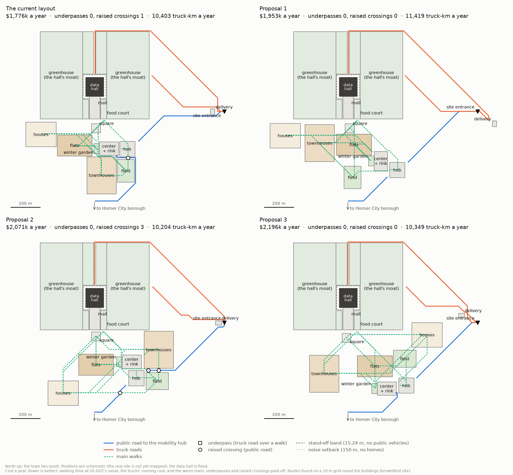
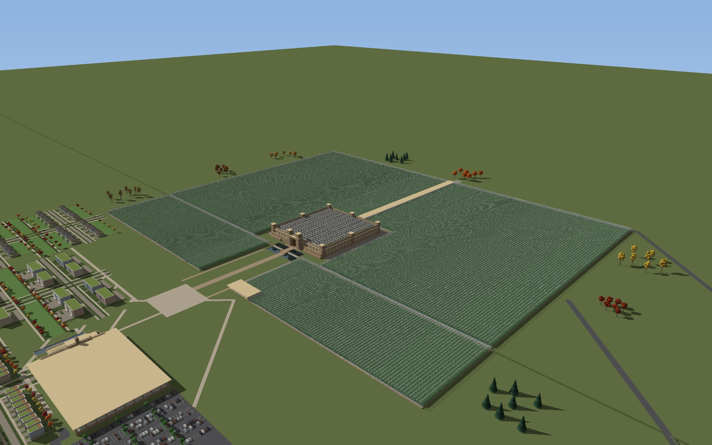

# The site plan: modules, routes and rings (D12)

Jon, after the neighbourhood drawings: "get everything modular so we can move things around for
optimal transportation, security, etc." The optimizer suggests and Jon edits. On security: "like
pentagon style. no fence, the community will be the fence/wall". Then, on the weights and the pick
(2026-11-17): "i will let you decide what matters most given the research backing it. same with
layout." Then the hall's front: "the larger doors like we had talked about earlier", with the
Fallingwater garden moved to the community center (D15). Then the town centre (D16): "the data
center is protected within all of it", "putting the data center inside the greenhouse. like if the
greenhouse was like its moat", and the homes in rings, "smaller apartments are closer to the city
center while the larger/more remote the house gets, the further away". D12, D14, D15 and D16 in
[PLAN.md](../PLAN.md) have the brief and the steers.

Every piece of the campus is a module: a rectangle sized by its own model, at a position and a
turn (0 or 90 degrees) set in `params/site.yaml`.
- The modules:
  - the data hall and its front: the great doors, the warm basins and the mall (fixed);
  - the greenhouse as the hall's moat, in six blocks round it with its food court on the mall
    (fixed to the hall, D16);
  - the winter garden, built against the community center (it moves with it);
  - the community center and rink;
  - the square;
  - the field;
  - the homes in three rings: flats, townhouses, houses (D16);
  - the mobility hub;
  - the remote delivery building.
- `uv run brownfield site` (`src/brownfield/site.py`):
  - checks a layout against the rules;
  - prices it;
  - proposes cheaper ones. It never edits the params.
- It writes `out/pass3/site.md` and `out/pass3/site.json` (each layout's modules and routes, which
  the drawings read), and draws the figure below.

## The answer

**The layout: the hall inside the greenhouse's moat, its great doors, the mall and the square on
one axis, and the homes in rings round the centre (D16).** It costs $1,776k a year in walking time,
truck running and pipe. No proposal beats it: the best costs $1,953k.

- **The greenhouse is the hall's moat.** Its 38.5 ha stand in six blocks round the hall:
  - 285 m deep to the west, east and north;
  - 150 m on the town side, where the court with the warm basins runs on as an open mall, 70 m
    wide and 150 m long, from the great doors to the square;
  - a 20 m fire and service road all round the hall: the fire code wants trucks within 150 ft of
    every wall (IFC 503), and the hall is about 400 ft deep;
  - the hall's trucks come in at its back, through a 15 m covered crossing in the north blocks,
    after screening at the delivery building;
  - the food court is at the town end of the south-east block, on the mall's mouth;
  - the produce loads on the east block's outer side.
- **What the moat does, and doesn't:**
  - **Public vehicles stay 320 m from the hall,** against the 15 m minimum. Stand-off distance is
    the first protection in the published criteria.
  - **Noise.** The glass doesn't stop the coolers' noise, which comes off the roof 14-17 m up. But
    nobody may sleep in the ring anyway, and the moat fills it: the first homes are 258 m out,
    under 40 dB(A) at night with pass 2's own fans.
  - **Glass:** 3,932 m of outside wall against 2,522 m for one block of the same area, so 2.0%
    more glass in all.
  - **Shade:** the hall's shadow at noon on the shortest day is 35 m long, over 0.22 ha of the
    north blocks. Packing, cold store and loading go there.
- **Why 150 m on the town side.** Each depth was tried with the town side moved with it:

  | Town side | Cost a year | First homes | Night, pass 2's fans | Public vehicles kept off |
  |---|---|---|---|---|
  | 40 m | breaks a rule: the flats inside the 150 m setback | 148 m | 43.1 dB(A) | 220 m |
  | 100 m | $1,786k | 208 m | 41.2 dB(A) | 274 m |
  | **150 m** | **$1,776k** | **258 m** | **39.7 dB(A)** | **320 m** |
  | 250 m | the townhouses run off the site | 336 m | 37.6 dB(A) | 416 m |

  Deeper is a little cheaper (the warm main to the glass is shorter, and the town's walkers are
  closer), and at 150 m no home needs quieter fans.
- **The rings** ([village.md](village.md)):
  - **The flats** (121 in 11 walk-ups) stand west of the square, beside the community center. The
    winter garden on the center's west face looks at them.
  - **The townhouses** (98) are to the south.
  - **The houses** (23) are beyond the flats.
  Each ring is further by its average walk to the square: 3.2, 4.4 and 5.1 minutes.
- **The community center is turned** to stand south of the square, its car park against its door
  and the field beside the car park.
- **No truck goes near the homes, and none crosses a walk.** All the site's trucks cost $30k a year
  to run.

**Short walks** from the homes, averaged over the people in each ring (furthest door in brackets):
- 4.0 minutes to the square (6.1);
- 2.3 to the community center (5.3);
- 2.3 to the winter garden (4.7);
- 3.6 to the field (7.4);
- 5.0 to the food court (7.5).

| | Cost a year | Walk to the square / food court / center / field / garden (min) | From the town (min) | Truck-km a year | Underpasses / raised crossings | Warm main | Land |
|---|---|---|---|---|---|---|---|
| **Chosen** | **$1,776k** | 4.0 / 5.0 / 2.3 / 3.6 / 2.3 | 5.4 | 10,403 | 0 / 1 | 2,781 m | 137 ha |
| Proposal 1 | $1,953k | 3.3 / 4.4 / 4.6 / 3.6 / 4.5 | 4.9 | 11,419 | 0 / 0 | 2,905 m | 160 ha |
| Proposal 2 | $2,071k | 5.0 / 5.5 / 2.7 / 3.7 / 3.3 | 6.6 | 10,204 | 0 / 3 | 3,384 m | 132 ha |
| Proposal 3 | $2,196k | 5.1 / 5.7 / 3.9 / 4.0 / 4.0 | 6.4 | 10,349 | 0 / 0 | 3,646 m | 117 ha |

**Where it came from.**
- The first layout with the moat and the rings was drawn by hand: the town side as before, moved
  south of the glass. It cost $1,914k a year.
- The optimizer's best find cost $1,777k and was cheaper in all 29 cases across the inputs' ranges
  (each input at its low and its high, the visits together, people per home low and high, no
  walkers from the town). So it was taken.
  - It turned the center and put it south of the square.
  - It put the flats beside the center, between the square and the garden.
  - It put the houses to the west.
- The cost isn't comparable with D15's $1,500k: phase 1 now houses 584 people in three rings, not
  300 in one block, and they walk further.

**Before D16** the greenhouse stood in one block east of the hall. The square was on the hall's
axis 24 m from the forecourt (D15). Earlier still, the field and the car park were moved to the
center's door from the optimizer's finds (D12, D14).

## What matters most, by the research

The score is what a layout costs a year, in dollars. Each term rests on a published value:

| Term | Value | Source |
|---|---|---|
| Walking time | $40.20 an hour (2024 dollars) | US DOT Benefit-Cost Analysis Guidance, 2026 Update, Table A-2: walking, waiting and transfer time, twice personal time in a vehicle ($20.10) |
| Running a truck | $2.336 a mile, $1.45 a km (2025), driver's pay included | ATRI, Operational Costs of Trucking, 2026 Update |
| An underpass | $2.2M (2024 dollars) | Bushell et al. 2013 (UNC HSRC): pedestrian underpasses $1.6-10.7M (2012 dollars), the low end brought to 2024 with the CPI |
| A raised crossing | $9,700 | Bushell et al. 2013: median $7,110 over 14 (2012 dollars), to 2024 with the CPI |
| The warm main | $1,100 a metre | pass 3 (a placeholder); to the hall's basins, the garden, the greenhouse, the center, the field, the flats and the townhouses (the houses heat themselves) |
| Paying off pipes and structures | 7% real, over 30 years | US DOT's rate since May 2025; the 30 years is a placeholder |
| Residents' visits | 584 people in the three rings, by home size | people per home by bedrooms (placeholders, averaging near ACS 2024's 2.5); trips by purpose from NHTS 2022, shared among the places by judgement |
| Visitors | about 1,450 a day to the center and rink, 36 to the field | ITE trip rates: community center 28.82 a day per 1,000 ft2; the rink scaled by its evening peak; soccer 71.33 a field |

What this says matters most, in order:
1. **People on foot are never asked to cross a truck road.** FHWA's Safe System hierarchy puts
   separation in space first. Physical separation "can permanently eliminate conflicts that lead to
   severe crashes". In 2024, 375 of the 6,144 pedestrians killed in single-vehicle crashes were hit
   by large trucks (NHTSA). The model sends trucks round any walk until an underpass would be cheaper:
   - the hall's trucks will go 9.3 km round before an underpass pays;
   - the produce trucks, fewer, 37 km.

   No layout above needs one. Many people won't use a bridge or tunnel if crossing at street level
   takes about the same time (FHWA, PEDSAFE). So where one is built, the walk stays level and the
   road dips.
2. **Visitors' walks:** the largest cost, $794k a year in the chosen layout.
   - About $530k is the walk from the car park to the doors (about 1,450 visitors a day). The hub
     belongs against the center.
   - The rest is the town's walk in, on a placeholder count.
3. **Residents' walks:** $704k a year. A minute more to the food court costs $57k a year.
4. **The warm main:** $247k a year.
5. **Truck distance matters least:** $30k a year. The trucks' extra kilometres round the
   glass are cheap next to anything else.

The public road to the hub meets the walks in one place. It gets a raised crossing, which slows
cars where people cross (Safe System: manage speeds where users mix).

## The rules

A layout that breaks any of these is never proposed:
- **Modules don't overlap.** Each keeps 5 m clear of the next. The winter garden is built against
  the community center, the hall's front against the hall, and the moat's blocks against each
  other.
- **Homes:**
  - none inside the 150 m noise setback (pass 3e);
  - the rings in order (D16): the flats' middle walks least to the square, then the townhouses',
    then the houses';
  - all on the town side of the hall, so the neighbourhood grows toward Homer City borough;
  - rows run east-west, so every house has a wall facing south for the winter sun. The DOE's
    guidance is windows within 30 degrees of true south
    ([Energy Saver](https://www.energy.gov/energysaver/passive-solar-homes)). A skinny townhouse's windows are at its
    front and back, so rows running north-south would face east and west.
  - every door within 400 m of a shuttle stop (D14).
- **The square stands before the hall's front, on its axis (D15)**, within 15 m of the hall's
  centre line and 40 m of the end of the forecourt (with the moat, of the mall), so the way from
  the great doors comes down into it. Both distances are judgement.
- **The public side faces the town (D12's rings).** The square, the center, the field, the hub
  and the food court never stand behind the hall, which is its service side.
- **The stand-off band.** No public vehicle within 15.24 m (50 ft) of the hall, the distance in
  the federal and defense criteria (UFC 4-010-01). Pedestrian places may sit in it.
- **Trucks are screened where they come in**, as at the Pentagon: the remote delivery building
  stands within 150 m of the site entrance. The 150 m is schematic.
- **Trucks stay on the service side.** No truck road comes within 100 m of the homes, the square,
  the center or the field; the hall's trucks come in at its back. The public road never runs
  behind the hall. The 100 m is judgement, as town truck routes keep off residential streets.
- **The homes' view of the winter garden stays open.** Jon wanted homes round the garden "having
  that as a view". No building stands in a 40 m wide band between it and the nearest ring, the
  flats.
- **Nothing is built on the ash cap.** Only the field may go there.

One condition comes with the greenhouse wherever it stands: blackout curtains at night. Its grow
lights would otherwise light the sky over the homes. Leamington, Ontario, North America's greenhouse
capital, now requires growers to cover ceilings, side walls and end walls from an hour before sunset
to an hour after sunrise
([Greenhouse Canada](https://www.greenhousecanada.com/north-americas-greenhouse-capital-passes-light-abatement-by-law/)).

**The warm basins cost heat and water** (`brownfield garden`). The method is ASHRAE's pool
evaporation equation, with convection and radiation to the sky, over PVGIS's typical year, with no
sun, so the heat is an upper bound. The water is not: the summer sun warms the basins past 20 C,
and the falls throw spray, so they lose more than shown.
- At 20 C, the four basins (1,272 m2) take 4.6 GWh a year, 1.7 MW at the coldest, windiest hour.
- They evaporate 3,725 m3 of water a year. That is about nine families' home use (EPA WaterSense:
  over 300 gallons a day each); the hall itself evaporates none (pass 2).
- At 30 C they would take 9.8 GWh and 9,400 m3. So 20 C, which still steams through a Pennsylvania
  winter, is the design value.
- A smaller warm basin, or a cover at night, would cut both. That choice is open.

## How the routes are found

- **The search** prices thousands of layouts by street-grid distances, to each building's nearest
  door. This is fast but blind to buildings in the way.
- **The check** takes the best layout from each search, and the current layout, and routes them
  on a 10 m grid round the buildings (Dijkstra; 8 directions, no corner cutting):
  - **Walks** go from the homes to each place, and from the hub to its draws.
  - **Roads:**
    - every road keeps a road's clearance off every module;
    - produce trucks, visitors' cars and the shuttle stay out of the stand-off band;
    - trucks keep 100 m off the homes and the public places, and the public road keeps off the
      hall's back;
    - the hall's trucks go through the screening building first, then to the hall's back.
  - **Crossings:**
    - a truck road goes round a walk until the detour costs more than an underpass;
    - the public road keeps off the walks where a way round is under 50 m (a drawing choice), and
      crosses them on raised crossings.
- **The tests** check by hand:
  - the router: the route round a wall in a 100 x 30 m strip is 4 x 14.1 + 5 x 10 m;
  - a road goes round a walk when the detour is short, and straight across when there's no way
    round;
  - the detour at which an underpass pays;
  - the capital recovery factor;
  - that a minute more on a walk costs what its visits are worth;
  - that each rule catches the layout it's meant to.

## The drawings

Forge `garden` now places every module from `out/pass3/site.json`, so moving a module in
`params/site.yaml` and rerunning `brownfield site` and `brownfield village` moves it in the
drawings. They also draw:
- the roads and walks the plan routes;
- the hub's car park with its shuttle stop;
- the remote delivery building;
- the raised crossings;
- stone planters along the stand-off line;
- the hall's front (D15) and the winter garden where the plan puts it. The garden is built in its
  own frame, then turned and moved onto its place;
- the moat (D16): a block of glasshouses on each of the plan's rectangles, stepping down with the
  ground, the food court across the town end of the south-east block, the road round the hall,
  and the covered crossing;
- the rings: the walk-ups and the houses on their lots, each ring with its streets, greens and
  spine;
- the community center turned as the plan turns it, built in its own frame.

**A correction to every earlier render.** The model's frame is x east, y south, z up, and the
renderer treated it as a right-handed frame. So every view before 2026-11-17 was the site's mirror
image: east and west were swapped. The renderer now puts east on the right when looking north (its
shadow-length check still passes, 3,480 mm against 3,464 mm). All the campus and garden views are
redrawn.

## What we don't know

- **The real site:** where the access road meets the site, where the way to the borough leaves
  it, and the ground's slopes. The entrance and the town point are placeholders. The cap's
  outline is schematic.
- **How often people go where:**
  - the shares of NHTS's trips that go to each campus place are judgement;
  - the count of walkers from the borough (100 a day) is a placeholder;
  - ITE's rates come from suburban sites people drive to, and the rink's daily rate was not found.
- **The underpass's cost** for a campus truck road: Bushell's underpasses were mostly under
  highways. It decides nothing here, since no layout needs one.
- **How far the screening building should stand from the hall.** The model keeps it at the
  entrance. The operator's security advisers would set the real distance; this repo stays at
  published principles.
- **Traffic volumes:** visitors' cars and shuttle trips are priced at the door, not routed by count.
  Truck counts are pass 3d's produce at 29,509 t a year (to rerun at 38.5 ha) and about 18 a day for
  the hall.
- **The walks** start from the middle of each ring, not from each door; the people in each ring
  rest on placeholder household sizes.
- **The moat as a greenhouse:**
  - Growers build glasshouses as rectangles. A ring of blocks joined by a loop corridor is
    untested; its internal haul distances aren't modelled.
  - Whether the greenhouse's warm, humid exhaust reaches the coolers' intakes isn't modelled;
    the 20 m road between them is judgement.
  - The covered crossing is drawn, not designed.
- **The warm basins:**
  - the wind over the water (taken as half PVGIS's at 10 m, for the hall's shelter) is a
    placeholder;
  - the falls' spray and the sun aren't modelled;
  - the steam isn't drawn.
