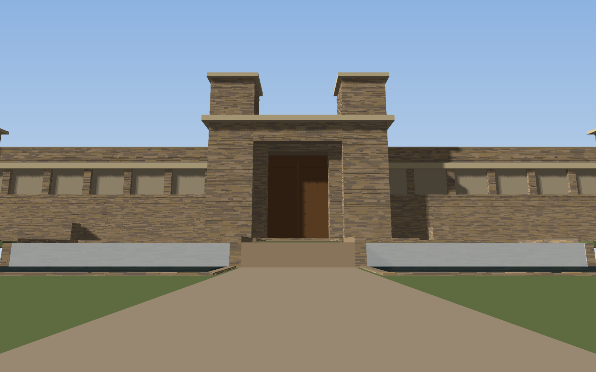
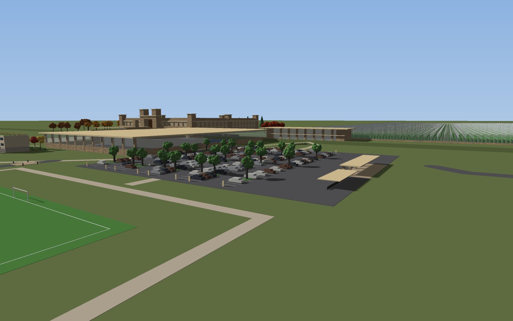

# The site plan: modules, routes and rings (D12)

Jon, after the neighbourhood drawings: "get everything modular so we can move things around for
optimal transportation, security, etc." The optimizer suggests and Jon edits. On security: "like
pentagon style. no fence, the community will be the fence/wall". Then, on the weights and the pick
(2026-11-17): "i will let you decide what matters most given the research backing it. same with
layout." Then the hall's front: "the larger doors like we had talked about earlier", with the
Fallingwater garden moved to the community center (D15). D12, D14 and D15 in [PLAN.md](../PLAN.md)
have the brief and the steers.

Every piece of the campus is a module: a rectangle sized by its own model, at a position and a
turn (0 or 90 degrees) set in `params/site.yaml`.
- The modules:
  - the data hall and its front, the great doors and the warm basins (fixed);
  - the winter garden, built against the community center (it moves with it);
  - the greenhouse with its food court;
  - the community center and rink;
  - the square;
  - the field;
  - the homes;
  - the mobility hub;
  - the remote delivery building.
- `uv run brownfield site` (`src/brownfield/site.py`):
  - checks a layout against the rules;
  - prices it;
  - proposes cheaper ones. It never edits the params.
- It writes `out/pass3/site.md` and `out/pass3/site.json` (each layout's modules and routes, which
  the drawings read), and draws the figure below.

## The answer

**The layout: the hall's great doors and the square on one axis, with the winter garden on the
community center (D15).** It costs $1,500k a year in walking time, truck running and pipe.
- **The hall's front faces the town.** Its bronze doors, 10 m wide and 14 m high, stand between
  two stone pylons. Before them, two warm basins spill over a ledge into two lower pools, either
  side of a causeway and a stair. The stair comes down into the square.
- **The winter garden stands against the community center's west face**, its terraces reaching
  out over its pools toward the square. Jon moved it from the hall's face: the center is "the
  beloved 3rd space of the community".
  - To make room, the center moved 31 m east, with the car park against its door.
  - The greenhouse moved 25 m east to clear the center.
- **The field stands beside the car park**, 55 m from the nearest homes.
- **No truck goes near the homes, and none crosses a walk.** The hall's trucks come in at its
  back, round the greenhouse's far side.
  - All the site's trucks cost $40k a year to run.
  - One underpass would cost $177k a year.

**Short walks** from the homes:
- 2.6 minutes to the square;
- 2.8 to the winter garden;
- 2.9 to the center;
- 1.9 to the field;
- 6.1 to the food court.

| | Cost a year | Walk from the homes to the square / food court / center / field / garden (min) | From the town (min) | Truck-km a year | Underpasses / raised crossings | Warm main |
|---|---|---|---|---|---|---|
| **Chosen** | **$1,500k** | 2.6 / 6.1 / 2.9 / 1.9 / 2.8 | 8.3 | 13,727 | 0 / 2 | 1,911 m |
| With the garden on the hall (before D15) | $1,462k | 2.6 / 5.8 / 2.5 / 1.9 / 3.3 | 8.1 | 13,708 | 0 / 2 | 1,724 m |
| Proposal 1 | $1,578k | 3.5 / 1.9 / 6.1 / 2.2 / 5.8 | 4.8 | 9,994 | 0 / 1 | 3,359 m |
| Proposal 2 | $1,589k | 4.5 / 3.2 / 3.6 / 2.6 / 5.4 | 6.5 | 9,889 | 0 / 6 | 2,150 m |
| Proposal 3 | $1,625k | 3.1 / 2.0 / 2.6 / 4.2 / 2.2 | 7.6 | 9,842 | 0 / 0 | 2,493 m |

**What the move costs: $38k a year.** The center stands further from the homes, and the warm
main is longer. The garden is closer to the homes.

**No proposal beats the chosen layout once the square has to stand on the hall's axis.** The
inputs were each moved to their low and their high (27 cases). The chosen layout is the cheapest
in 25 of them. Proposal 1 wins only two:
- 400 walkers a day from the town;
- residents going to the food court twice as often as assumed.

Without the axis rule, the optimizer found a layout 2.5% cheaper. It moved the square to the far
end of the homes, so the stair from the great doors led nowhere.

**Earlier the same day,** before D15, the chosen layout came from two edits to the optimizer's
finds. The field moved beside the car park, which saved $66k a year. The car park moved against
the center's door, which saved $186k a year. A proposal then tied it ($1,456k against $1,462k),
and was turned down because its edge rested on the placeholder count of walkers from the town.

## What matters most, by the research

The score is what a layout costs a year, in dollars. Each term rests on a published value:

| Term | Value | Source |
|---|---|---|
| Walking time | $40.20 an hour (2024 dollars) | US DOT Benefit-Cost Analysis Guidance, 2026 Update, Table A-2: walking, waiting and transfer time, twice personal time in a vehicle ($20.10) |
| Running a truck | $2.336 a mile, $1.45 a km (2025), driver's pay included | ATRI, Operational Costs of Trucking, 2026 Update |
| An underpass | $2.2M (2024 dollars) | Bushell et al. 2013 (UNC HSRC): pedestrian underpasses $1.6-10.7M (2012 dollars), the low end brought to 2024 with the CPI |
| A raised crossing | $9,700 | Bushell et al. 2013: median $7,110 over 14 (2012 dollars), to 2024 with the CPI |
| The warm main | $1,100 a metre | pass 3 (a placeholder); to the hall's basins, the garden, the greenhouse, the center, the field and the homes |
| Paying off pipes and structures | 7% real, over 30 years | US DOT's rate since May 2025; the 30 years is a placeholder |
| Residents' visits | 300 people, 2.5 a home | ACS 2024 household size; trips by purpose from NHTS 2022, shared among the places by judgement |
| Visitors | about 1,450 a day to the center and rink, 36 to the field | ITE trip rates: community center 28.82 a day per 1,000 ft2; the rink scaled by its evening peak; soccer 71.33 a field |

What this says matters most, in order:
1. **People on foot are never asked to cross a truck road.** FHWA's Safe System hierarchy puts
   separation in space first. Physical separation "can permanently eliminate conflicts that lead to
   severe crashes". In 2024, 375 of the 6,144 pedestrians killed in single-vehicle crashes were hit
   by large trucks (NHTSA). The model sends trucks round any walk until an underpass would be cheaper:
   - the hall's trucks will go 9.3 km round before an underpass pays;
   - the produce trucks, fewer, 37 km.

   No layout above needs one. Many people won't use a bridge or tunnel if crossing at street level
   takes about the same time (FHWA, PEDSAFE). So where one is built, the walk stays level and the
   road dips.
2. **Visitors' walks:** the largest cost, $922k a year in the chosen layout.
   - About $518k is the walk from the car park to the doors (about 1,450 visitors a day). The hub
     belongs against the center.
   - The rest is the town's walk in, on a placeholder count.
3. **Residents' walks:** $367k a year. A minute more to the food court costs $29k a year.
4. **The warm main:** $169k a year.
5. **Truck distance matters least:** $40k a year. The trucks' extra kilometres round the
   greenhouse are cheap next to anything else.

The public road to the hub meets the walks in two places. Each gets a raised crossing, which slows
cars where people cross (Safe System: manage speeds where users mix).

## The rules

A layout that breaks any of these is never proposed:
- **Modules don't overlap.** Each keeps 5 m clear of the next. The winter garden is built against
  the community center, and the hall's front against the hall.
- **Homes:**
  - none inside the 150 m noise setback (pass 3e);
  - all on the town side of the hall, so the neighbourhood grows toward Homer City borough;
  - rows run east-west, so every house has a wall facing south for the winter sun. The DOE's
    guidance is windows within 30 degrees of true south
    ([Energy Saver](https://www.energy.gov/energysaver/passive-solar-homes)). A skinny townhouse's windows are at its
    front and back, so rows running north-south would face east and west.
  - every door within 400 m of a shuttle stop (D14).
- **The square stands before the hall's front, on its axis (D15)**, within 15 m of the hall's
  centre line and 40 m of the forecourt, so the stair from the great doors comes down into it. Both
  distances are judgement.
- **The public side faces the town (D12's rings).** The square, the center, the field, the hub
  and the food court never stand behind the hall, which is its service side.
- **The stand-off band.** No public vehicle within 15.24 m (50 ft) of the hall, the distance in
  the federal and defense criteria (UFC 4-010-01). Pedestrian places may sit in it.
- **Trucks are screened where they come in**, as at the Pentagon: the remote delivery building
  stands within 150 m of the site entrance. The 150 m is schematic.
- **Trucks stay on the service side.** No truck road comes within 100 m of the homes, the square,
  the center or the field; the hall's trucks come in at its back. The public road never runs
  behind the hall. The 100 m is judgement, as town truck routes keep off residential streets.
- **The homes' view of the winter garden stays open.** Jon wanted homes round the garden "having
  that as a view". No building stands in a 40 m wide band between them.
- **Nothing is built on the ash cap.** Only the field may go there.

One condition comes with the greenhouse wherever it stands: blackout curtains at night. Its grow
lights would otherwise light the sky over the homes. Leamington, Ontario, North America's greenhouse
capital, now requires growers to cover ceilings, side walls and end walls from an hour before sunset
to an hour after sunrise
([Greenhouse Canada](https://www.greenhousecanada.com/north-americas-greenhouse-capital-passes-light-abatement-by-law/)).

**The warm basins cost heat and water** (`brownfield garden`). The method is ASHRAE's pool
evaporation equation, with convection and radiation to the sky, over PVGIS's typical year, with no
sun, so the heat is an upper bound. The water is not: the summer sun warms the basins past 20 C,
and the falls throw spray, so they lose more than shown.
- At 20 C, the four basins (1,272 m2) take 4.6 GWh a year, 1.7 MW at the coldest, windiest hour.
- They evaporate 3,725 m3 of water a year. That is about nine families' home use (EPA WaterSense:
  over 300 gallons a day each); the hall itself evaporates none (pass 2).
- At 30 C they would take 9.8 GWh and 9,400 m3. So 20 C, which still steams through a Pennsylvania
  winter, is the design value.
- A smaller warm basin, or a cover at night, would cut both. That choice is open.

## How the routes are found

- **The search** prices thousands of layouts by street-grid distances, to each building's nearest
  door. This is fast but blind to buildings in the way.
- **The check** takes the best layout from each search, and the current layout, and routes them
  on a 10 m grid round the buildings (Dijkstra; 8 directions, no corner cutting):
  - **Walks** go from the homes to each place, and from the hub to its draws.
  - **Roads:**
    - every road keeps a road's clearance off every module;
    - produce trucks, visitors' cars and the shuttle stay out of the stand-off band;
    - trucks keep 100 m off the homes and the public places, and the public road keeps off the
      hall's back;
    - the hall's trucks go through the screening building first, then to the hall's back.
  - **Crossings:**
    - a truck road goes round a walk until the detour costs more than an underpass;
    - the public road keeps off the walks where a way round is under 50 m (a drawing choice), and
      crosses them on raised crossings.
- **The tests** check by hand:
  - the router: the route round a wall in a 100 x 30 m strip is 4 x 14.1 + 5 x 10 m;
  - a road goes round a walk when the detour is short, and straight across when there's no way
    round;
  - the detour at which an underpass pays;
  - the capital recovery factor;
  - that a minute more on a walk costs what its visits are worth;
  - that each rule catches the layout it's meant to.

## The drawings

Forge `garden` now places every module from `out/pass3/site.json`, so moving a module in
`params/site.yaml` and rerunning `brownfield site` and `brownfield village` moves it in the
drawings. They also draw:
- the roads and walks the plan routes;
- the hub's car park with its shuttle stop;
- the remote delivery building;
- the raised crossings;
- stone planters along the stand-off line;
- the hall's front (D15) and the winter garden where the plan puts it. The garden is built in its
  own frame, then turned and moved onto its place.

**A correction to every earlier render.** The model's frame is x east, y south, z up, and the
renderer treated it as a right-handed frame. So every view before 2026-11-17 was the site's mirror
image: east and west were swapped. The renderer now puts east on the right when looking north (its
shadow-length check still passes, 3,480 mm against 3,464 mm). All the campus and garden views are
redrawn.

## What we don't know

- **The real site:** where the access road meets the site, where the way to the borough leaves
  it, and the ground's slopes. The entrance and the town point are placeholders. The cap's
  outline is schematic.
- **How often people go where:**
  - the shares of NHTS's trips that go to each campus place are judgement;
  - the count of walkers from the borough (100 a day) is a placeholder;
  - ITE's rates come from suburban sites people drive to, and the rink's daily rate was not found.
- **The underpass's cost** for a campus truck road: Bushell's underpasses were mostly under
  highways. It decides nothing here, since no layout needs one.
- **How far the screening building should stand from the hall.** The model keeps it at the
  entrance. The operator's security advisers would set the real distance; this repo stays at
  published principles.
- **Traffic volumes:** visitors' cars and shuttle trips are priced at the door, not routed by count.
  Truck counts are pass 3d's produce at 29,509 t a year (to rerun at 40 ha) and about 18 a day for
  the hall.
- **The walks** start from the middle of the neighbourhood, not from each door.
- **The warm basins:**
  - the wind over the water (taken as half PVGIS's at 10 m, for the hall's shelter) is a
    placeholder;
  - the falls' spray and the sun aren't modelled;
  - the steam isn't drawn.
