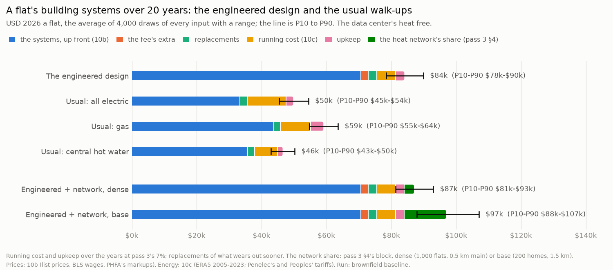

# Pass 3g: the walk-up's systems, designed before bidding

Pass 3b's 12-flat walk-up went out as a bid set in pass 3f ([the bid set as data](bidset.md)).
Its plumbing, heating, cooling, ventilation, electrical work and sprinklers were left to the
trades, as they usually are in the US. Pass 3g (D28) asked two things:
- can those systems be designed in full before bidding, so the trades price a design rather than
  design what they price?
- what does that design cost, and what does it buy?

Steps 0-9 designed them, to the 2021 I-codes as Pennsylvania enforces them, plus Phius where it
asks more (ventilation, airtightness). The result is issued as Addenda 2-9: drawings, an open
model of every pipe, duct and cable, the specification sections, the tests, and a control
sequence. They are in the [plan room](https://youngmoolahbaby.github.io/brownfield-compute/).

This report is step 10. It sets that design against the walk-up a US developer would usually
build, both priced item by item from free sources. It's a study, not construction documents:
those need a licensed engineer's stamp.

Run `uv run brownfield routes` (it needs forge's routes), then `uv run brownfield baseline
--publish`. The run takes about 35 minutes: the Monte Carlo's 4,000 draws run in ten processes.
It writes `out/pass3/baseline.md`, `pricing.md`, `energy.md`, `comfort.md`, `savings.md` and
`ranges.md` with their `.json`, and the first figure here. Then `uv run brownfield choices
--publish` (10g, about an hour) writes `out/pass3/choices.md` and `.json` and the second figure,
and checks itself against the first run's draws. Each writes its figure only if every check passes.

The code is in `src/brownfield/baseline.py`, `pricing.py`, `energy.py`, `comfort.py`,
`savings.py`, `ranges.py` and `choices.py`. Every price, life and rate is in
`params/baseline.yaml`, each with its range and source.

## What it says

- **Two questions, kept apart.**
  - *The engineering* is the fee, paid so the design exists before bidding.
  - *The systems* are what this design chose: radiant floors on the data center's water, a central
    hot-water plant, an ERV in each flat, cast-iron drains, a separate fire service, submeters and
    solar panels.

  A design-build trade could have chosen the same systems at the same cost. Mixing the two would
  credit the engineering with the data center's heat, or blame it for the plant.
- **The engineering is cheap.** It adds about $2,200 a flat over the usual walk-up's fee, against
  the systems' $31,800. PHFA's fee cap for a walk-up already buys mechanical and electrical
  drawings, so the extra is depth, not a design from nothing. The range runs from nothing to
  $4,500, the whole mechanical and electrical share of a public-works fee.
- **The systems cost more over 20 years than every usual walk-up, in every draw.** Over 20 years
  the engineered design costs, a flat:
  - $29,400 more than the usual all-electric walk-up (the typical draw $34,300, P10-P90
    $30,400-38,300);
  - $20,600 more than gas ($24,900, $20,300-29,600);
  - $32,000 more than central hot water ($37,500, $34,100-41,100).

  None of the 4,000 draws puts it ahead of any of them: the closest, against gas, still has it $11,600
  dearer. Its share of the heat network adds $2,600
  (pass 3 §4's dense case) to $11,500 (its base case).
- **Why:** every engineered flat has a mini-split big enough to heat it alone, for when the data
  center's heat is gone (step 9a). The usual all-electric walk-up's mini-split *is* its heating. So
  the radiant floors and the loop that feeds them ($12,000 a flat), the plant and the network are
  extra capital. They save mostly the heat pump's and the water heaters' electricity: $535 a year a
  flat. Over 20 years at 7% that's worth about $5,700, against a $34,000 premium up front. Pass 3
  §4 found the same for homes on the loop, except in big blocks close to the campus.
- **Choice by choice** ([10g](#what-each-choice-buys-and-what-it-costs-10g)), the design buys
  quality of life, not savings. A flat, a month over 20 years:
  - quiet: the pipes held off the frame $4 (13 dB), the cast iron $38 (25 dBA against 33);
  - air: the ERVs $45 (outdoor air ducted to every bedroom), the airtightness $8;
  - warmth: the floors on the data center's water $89 (warm floors, the outdoor units quiet in
    winter);
  - the solar panels ($12) and the PRV ($2) buy no quality here.

  None pays for itself in money, except the hot-water plant in 18% of the draws. The ERVs even use
  606 kWh more electricity a year than bath fans; their case is the air.
- **The cheapest of the four is the usual walk-up with central gas hot water**, in all but 5 of the
  4,000 draws: $39,200 a flat over 20 years, against $41,800 all-electric.
- **What the premium buys** is quiet, air and warmth, not savings:
  - a neighbour's flush through cast iron at 25 dBA, against 33 through PVC (CMHC's limit);
  - supply pipes 13 dB quieter, held off the frame at every hole and hanger (Addendum 9);
  - outdoor air ducted to every bedroom, 15 cfm a person, against 4.5-9 through the walls;
  - warm floors (21-26 C at the design hour);
  - no outdoor units running in winter, except in the fallback;
  - tenants' own bills of $279 a year, against $958.
- **Who pays:** the owner pays the premium. The tenants keep most of the $535 a year.
  - **A market-rate owner** gets it back only through rent. The best study, from the Northeast,
    finds tenant-paid energy costs don't move rents. Carrying the premium would take $183 a month
    more rent, against a $409 a year saving to the tenant. No market-rate owner builds this for the
    bills.
  - **On a tax-credit walk-up** the federal credits pay 30% (4% credits) or 67% (9%) of it. The rest
    widens pass 4's gap per flat by $17,900 (4%) or $5,200 (9%) if an engineer's energy model sets
    the utility allowance, or by $22,300 or $9,600 on the housing authority's schedule. With the
    upkeep and replacements counted, the typical draw is $22,600 and $7,900 (energy model).
- **What would change it:**
  - density: pass 3 §4's dense block carries the network for $62/MWh of heat, its base case $276;
  - the price of the heat: free here, the engineered design's running cost meets the electric
    walk-up's at $136/MWh, gas's at $68 and central hot water's at $22;
  - what a tenant or a buyer pays for quiet, air and warm floors. No free source measures that
    here.
- **What moves the answer most:** what contractors pay below list prices, the gypsum topping over
  the radiant tubing, and how much of the fee the design adds. None of them moves the 20-year
  difference against the electric walk-up outside $26,000-33,500.
- **The engineering found problems before bidding** ([below](#what-the-engineering-found-before-bidding)):
  52 of 60 fixtures too far from hot water for the energy code, a heat pump counted only as
  cooling, a tank too small, an airtightness test four to ten times too loose, among others.
  Whether the trades or the inspector would have caught them otherwise can't be known from here.

## The usual walk-up (10a)

No free source gives a US walk-up's systems whole, so they're defined from what is built:
- **Census CHARS 2025,** new multifamily units in the Northeast: 52% heated by electricity, 48% by
  gas. Heat pumps 43%, furnaces 37%.
- **RECS 2020's microdata,** apartments in buildings of 5 or more units built 2010-2020, Northeast:
  35% have their own water heater; most of the rest share one.

So three usual walk-ups, each on the same layout as the engineered design:
- **all electric:** a ducted mini-split and a 50 gal electric water heater in each flat, a bath fan
  running all year, PVC drains, PEX at the street's pressure, the sprinklers on the domestic
  service;
- **gas:** a gas furnace, an air conditioner and a gas water heater in each flat, the rest alike;
- **central hot water:** each flat's mini-split, with one gas water heater for the building and the
  hot-water loops the energy code then asks for.

Each walk-up's items, 258 rows: the engineered design's from Addendum 7's model and schedules
(14,827 ft of pipe, duct and cable; 1,600 fittings; 89 pieces of equipment), the usual walk-ups'
by stated rules. Shared items count in every total and cancel in the differences.

## Up front (10b)

A flat, USD 2026, with the trade's and the builder's markups (PHFA's caps):

| | engineered | all electric | gas | central hot water |
|---|---|---|---|---|
| plumbing | $18,668 | $7,212 | $15,972 | $9,198 |
| heating | $11,630 | | | |
| heating, cooling, ventilation | $12,091 | $8,276 | $9,769 | $8,276 |
| electrical | $10,201 | $7,242 | $7,062 | $7,116 |
| sprinklers and services | $4,771 | $4,179 | $4,179 | $4,179 |
| envelope (air sealing, its tests) | $1,279 | $419 | $419 | $419 |
| tests and inspections | $984 | $485 | $485 | $656 |
| **total** | **$59,626** | **$27,814** | **$37,887** | **$29,843** |

What the engineered design's $31,812 over the all-electric walk-up buys, a flat:

| | over all electric | over gas | over central hot water |
|---|---|---|---|
| space heat from the data center's water | $12,016 | $12,016 | $12,016 |
| cast-iron drains and vents, for quiet | $4,860 | $4,860 | $4,860 |
| the hot-water plant and its loops | $4,702 | $2,478 | $2,874 |
| the ERVs and their preheaters | $3,869 | $3,869 | $3,869 |
| solar panels | $2,550 | $2,550 | $2,550 |
| the water and fire services, apart and supervised | $1,395 | $1,395 | $1,395 |
| airtightness to Phius | $860 | $860 | $860 |
| the flats' water submeters | $848 | $848 | $848 |
| the water pipes held off the frame, for quiet (Addendum 9) | $477 | $477 | $477 |
| the pressure-reducing valve, for quiet | $205 | $205 | $205 |
| the cold risers' insulation | $30 | $30 | $30 |
| the flats' heating and cooling | | -$1,520 | |
| gas service, meters, piping and vents | | -$6,487 | -$359 |
| the electrical service's main | | $158 | $158 |

- The premium is 17.9% of HUD's 2024 construction cost for a Johnstown walk-up flat, taken to
  2026.
- **The fee:** the building's construction cost is $2.13 million.
  - PHFA's cap is $147,644, mechanical and electrical drawings in it.
  - Washington State's public-works fee for the same building is $214,445, of which the
    mechanical and electrical share is $53,611.
  - The engineered design takes half of that share as its extra, $26,806 ($2,234 a flat): a
    placeholder, from none to all of it.
- **The heat network's share,** beside the systems (pass 3 §4's street, main and exchanger): $9,844
  a flat at its base case (200 homes on a 1.5 km main), $2,144 at its dense one (1,000 on 0.5 km).
- **Known cases:**
  - The usual all-electric walk-up's plumbing, electrical and HVAC come to 0.64-0.74 of NAHB's
    single-family shares of HUD's cost. So the stated labour is low if anything, which would
    understate the engineered design's labour-heavy items more.
  - Each piece of equipment, built up, is within a factor of 2 of NREL's REMDB installed cost.
  - The sprinklers come to $2.97 a ft2, against NFSA's $1.35 floor for a 13D house.

## A year (10c)

Each flat hour by hour over the site's weather, 2005-2023 (ERA5), on the local tariffs (Penelec,
Peoples). With the data center's heat free, a flat's running cost a year:

| | engineered | all electric | gas | central hot water |
|---|---|---|---|---|
| the flats' electricity | $279 | $958 | $198 | $343 |
| the house meter, net of the solar panels | $247 | $102 | $102 | $105 |
| gas | | | $493 | $163 |
| **total** | **$525** | **$1,060** | **$794** | **$611** |

- **Space heat:** a flat needs 1,079 kWh of heat a year, against the usual flats' 2,826. The ERV's
  heat recovery saves 1,180 kWh and the airtightness 567.
- **Hot water:** 43.7 gal a day a flat (FSEC's model, 2.39 people).
  - The engineered plant's largest use is its swing tank's element, which covers the loops' loss:
    14.3 MWh a year.
  - Its house meter lands on Penelec's GS-Medium rate, with a demand charge.
- **The data center's heat:** 3.92 MWh a flat a year.
- **Known cases:** RECS 2020's apartments, each within a factor of 1.5:
  - a flat's own electric water heater, 1,140 kWh per person against 1,154;
  - the usual flats' space heat, against heat-pump flats and gas-furnace flats in climate zones 4A
    and 5A.

## Noise and comfort (10d)

Only what the makers and the studies publish, side by side:

| | engineered | the usual walk-ups |
|---|---|---|
| a neighbour's flush through a stack | 25 dBA (cast iron) | 33 dBA (PVC), CMHC's limit |
| supply pipes (relative) | 47.9 dB, sleeved at 60 psi | 61.0 dB at the street's 55 psi |
| outdoor units' hours heating a year | 168 (the fallback, a placeholder) | 4,229 (electric and central) |
| outdoor units' hours cooling a year | 5,135 | 3,948 |
| outdoor air to a bedroom | 15.3-15.8 cfm a person, ducted, 16.5 C or more | 6.0-9.1 door open, 4.5-6.8 shut, at the outdoor temperature |
| what heats the room | floors at 20.9-26.2 C (ASHRAE 55's 19-29) | air at 28-37 C (mini-split) or 35-52 C (furnace) |
| the hot water's worst wait, tub | 10 s | 5 s (a flat's own heater) |

The ERV's sound and HP-1's aren't published. The engineered flats' mini-splits run more hours
cooling than the usual flats' (10c's model).

## Who gets the savings (10e)

- **Who pays what:**
  - the owner pays the construction, the fee and the house meter;
  - each tenant pays their own meter and gas account;
  - the engineered flats also have heat and hot-water meters. Billed at the owner's cost, they
    would move $270 a year a flat from the owner to the tenant.
- **A tax-credit flat** (pass 4's): the rent is capped at 30% of the 60% income limit, less the
  utility allowance.
  - Of the engineered design's $34,046 a flat up front, the credits pay $10,186 (4%) or $22,920
    (9%). The owner's higher net rent carries $5,953 of debt if an energy model sets the
    allowance, $1,530 on the schedule.
  - In a tax-credit building the data center's heat can't be billed by meter (26 CFR
    1.42-10(e)), so the owner provides it inside the rent.
- **A market-rate flat:**
  - the tenant saves $409 a year, billed by the meters;
  - the rent that would carry the premium at pass 4's yield is $183 a month more;
  - the best evidence, Myers (2018, American Housing Survey, Northeast), finds tenant-paid energy
    costs don't reach the rent. The range runs the rent's share of the saving from none to all.
- **The data center:** in a tax-credit building the owner would pay any price on its heat, and
  the rent could then carry less debt. At $276/MWh, the price that would carry the network's base
  case, pass 4's gap widens by $12,905 a flat.

## Over 20 years, and the ranges (10f)

Every input with a range, 1,021 of them, drawn together 4,000 times. 10b, 10c and 10e run again
for each draw; 10a's quantities are held, since they are the design. Over 20 years, each walk-up's
cost is:
- up front;
- plus replacing what wears out sooner (an item lasting L years costs its price spread over L
  years, every year);
- plus each year's running cost and upkeep at 7%, as pass 3 counts them (×10.59). The draws take
  pass 3's ranges for these too: 15 to 30 years, at 4% to 10%.

A flat, USD 2026: the central values, then the typical draw (P50) with P10-P90:

| | engineered | all electric | gas | central hot water |
|---|---|---|---|---|
| the systems | $59,626 | $27,814 | $37,887 | $29,843 |
| the fee's extra | $2,234 | | | |
| replacements | $1,269 | $1,177 | $1,053 | $1,219 |
| running cost × 10.59 | $5,567 | $11,226 | $8,409 | $6,470 |
| upkeep × 10.59 | $2,478 | $1,537 | $3,223 | $1,661 |
| **over 20 years, central** | **$71,173** | **$41,753** | **$50,572** | **$39,193** |
| the typical draw (P10-P90) | $83,847 ($78,391-89,865) | $49,488 ($45,448-54,442) | $58,956 ($54,743-63,563) | $46,274 ($42,933-50,192) |

The engineered design less each usual walk-up:

| | all electric | gas | central hot water |
|---|---|---|---|
| up front, central | $34,046 | $23,972 | $32,016 |
| a year (running cost and upkeep), central | -$445 | -$339 | -$8 |
| over 20 years, central | $29,420 | $20,601 | $31,980 |
| the typical draw (P10-P90) | $34,272 ($30,407-38,270) | $24,933 ($20,348-29,609) | $37,452 ($34,125-41,069) |
| with the network share, dense | $37,214 ($33,340-41,304) | $27,929 ($23,338-32,718) | $40,415 ($37,070-44,068) |
| with the network share, base | $45,981 ($39,557-55,552) | $36,685 ($29,653-46,979) | $49,214 ($42,956-58,789) |
| draws in which the engineered design costs less | 0 of 4,000 | 0 | 0 |
| the lowest draw | $22,459 | $11,617 | $29,376 |

- **The sign holds** from P10 to P90 against every usual walk-up, with and without the network.
  So the plan's private cross-check of the prices isn't needed for the sign. It would still narrow
  the size.
- **The draws run above the central values:** the typical draw's difference is about 16% over
  the central one (the systems' cost about 18%). Most ranges reach further above their likeliest
  value than below it. A contractor's discount off list runs from 45% to none, around 25%. Each
  labour hour runs from half to twice.
- **Upkeep and replacements** add about $1,000 a flat over 20 years to the engineered design's
  side against the electric walk-up: $92 more in replacements ($1,269 against $1,177) and $89 a
  year more in upkeep ($234 against $145). The mini-split wears out in every walk-up that has one
  (DOE: 16.4 years in the North). The engineered design adds the plant's heat pump, tanks,
  circulators and heat meters; the electric walk-up has each flat's water heater.
- **What moves the engineered design less the electric walk-up most**, each input from its low to
  its high (the central $29,420):

  | input | low | high |
  |---|---|---|
  | what a contractor pays below list (55% to par) | $26,289 | $33,334 |
  | the gypsum topping over the radiant tubing, a ft2 | $27,809 | $33,524 |
  | how much of the MEP fee the design adds (none to all) | $27,187 | $31,654 |
  | the trades' overhead and profit | $27,350 | $31,154 |
  | an electric water heater's life (4.7 to 27.7 years) | $25,994 | $29,768 |
  | hot water a person a day (FSEC) | $30,930 | $27,840 |
  | people a flat | $30,496 | $27,765 |
  | an electric water heater's upkeep | $29,561 | $27,221 |
  | the discount rate (4% to 10%) | $28,121 | $30,321 |

  Against gas, the gas water heater's life and the mini-split's come next after the list
  discount. The energy model's own inputs (the flats' mass, the set points, the heat pump's
  seasonal efficiency) move it by less than $1,000 each.
- **10e under the draw,** with the owner's upkeep and replacements counted:
  - pass 4's gap per flat, by an energy model, is $22,629 at 4% ($19,501-25,766) and $7,892 at 9%
    ($5,325-10,591);
  - the tie prices for the heat: electric $137/MWh ($120-153), gas $79 ($69-91), central hot water
    $25 ($14-38).

## What each choice buys, and what it costs (10g)

10f's premium is the design's choices together. 10g splits it up. Each choice is taken out of the
engineered design alone, the rest as designed, and the usual all-electric walk-up's way is put in
its place. A choice's line is what the design would save over 20 years without it: up front, the
replacements, and each year's running cost and upkeep at 7% (×10.59). It runs over 10f's 4,000
draws, so the lines split 10f's whole, draw for draw.

The design is after quality of life: quiet, fresh air, warmth, safe water and fire service.
What a flat gets from each choice, and what that costs it a month over 20 years (central):

| what a flat gets | the choice | a month |
|---|---|---|
| **Quiet** | | |
| supply pipes 13 dB quieter | the water pipes held off the frame | $4 |
| a neighbour's flush at 25 dBA, against 33 (CMHC's limit) | cast-iron drains and vents | $38 |
| nothing at the street's 55 psi; 1.7 dB if it were at the code's 80 | a pressure-reducing valve | $2 |
| **Air** | | |
| outdoor air ducted to every bedroom, 15 cfm a person at 16.5 C or warmer, against 4.5-9 through the walls at the outdoor temperature | an ERV and its preheater | $45 |
| 0.31-0.75 ACH50 against 3.0, which keeps the floors' heat at the design hour at 19.4 kW against 23.4 | airtightness to Phius | $8 |
| **Warmth** | | |
| floors at 21-26 C at the design hour; the outdoor units heat 168 hours a year, against 4,229 | the floors on the data center's water | $89 |
| **Water and fire** | | |
| the sprinklers on a service of their own, supervised, alarms to a monitoring station | the services apart | $12 |
| each flat billed for its own water | a submeter in each flat | $7 |
| no condensation on the cold risers | the cold risers' insulation | $0 |
| **Energy, not comfort** | | |
| 2.9 MWh of the data center's heat a year and no heater in the closet; the tub's worst wait 10 s, against 5 | the hot-water plant and the loops | $10 |
| 797 kWh a year on the house meter | solar panels | $12 |

- **Per dollar, the most quality** is in the pipes held off the frame and the airtightness. The cast
  iron and the ERVs buy quiet and air a tenant notices every day. The floors are the dearest, and
  dearer still with the network's share.
- **The solar panels and the PRV buy no quality a tenant feels here.** The panels don't pay in
  money either (below). The PRV guards against a street pressure this one doesn't have. On a
  quality-of-life brief they're the first to question.
- **What no free source here measures** is what a tenant or a buyer would pay for each, or what
  each does for sleep and health ([what we don't know](#what-we-dont-know)).

**In money,** a flat, USD 2026: the central values, then the typical draw. "A year" is the
running cost and upkeep; negative, the choice saves. "A month" is the 20 years' cost spread over
them at 7%.

| the choice | up front | replacements | a year | over 20 years | a month | the typical draw (P10-P90) |
|---|---|---|---|---|---|---|
| the floors on the data center's water | $12,016 | $163 | -$76 | $11,374 | $89 | $13,303 ($11,495-15,482) |
| an ERV and its preheater in each flat | $3,869 | -$145 | $186 | $5,697 | $45 | $6,361 ($5,684-7,131) |
| cast-iron drains and vents | $4,860 | | | $4,860 | $38 | $5,680 ($4,772-6,652) |
| the water and fire services apart, the fire's supervised | $1,395 | | $9 | $1,492 | $12 | $1,967 ($1,505-2,499) |
| solar panels on the house meter | $2,550 | | -$92 | $1,575 | $12 | $1,704 ($1,307-2,168) |
| the hot-water plant and the flats' loops | $4,702 | $74 | -$335 | $1,226 | $10 | $1,385 (-$623 to $3,151) |
| airtightness to Phius, and its tests | $860 | | $12 | $983 | $8 | $1,314 ($929-1,910) |
| a water submeter in each flat | $848 | | | $848 | $7 | $1,007 ($821-1,229) |
| the water pipes held off the frame (Addendum 9) | $477 | | | $477 | $4 | $563 ($484-659) |
| a pressure-reducing valve on the service | $205 | | | $205 | $2 | $194 ($161-218) |
| the cold risers' insulation | $30 | | | $30 | $0 | $41 ($31-53) |
| the engineering's fee | $2,234 | | | $2,234 | $18 | $2,192 ($978-3,636) |
| how the choices interact | | | -$149 | -$1,580 | -$12 | -$1,620 (-$2,259 to -$1,162) |
| **the whole, over the all-electric walk-up** | **$34,046** | **$92** | **-$445** | **$29,420** | **$231** | **$34,272 ($30,407-38,270)** |

Taken out together, or set against other ways:

| | over 20 years | the typical draw (P10-P90) |
|---|---|---|
| the plant and loops, against one gas water heater for the building (the central walk-up's way) | $3,638 | $4,280 ($3,618-5,089) |
| the floors and the plant together: all the data center's water does | $12,648 | $14,803 ($11,915-17,710) |
| the same, with the heat network's share, dense (pass 3 §4) | $15,211 | $17,749 ($14,801-20,797) |
| the same, with the network's share, base | $24,135 | $26,308 ($20,790-35,982) |
| the ERVs, added to the usual all-electric walk-up | $4,691 | $5,176 ($4,398-5,949) |
| the airtightness, added to it | $764 | $1,154 ($768-1,760) |
| solar panels, added to it | $1,383 | $1,508 ($1,095-1,978) |

- **No choice pays for itself in money, in any draw, except the hot-water plant in 18% of them.**
  Every other line is a cost from its lowest draw to its highest, the fee's too.
- **The floors are the largest line, $11,374 a flat.** Every flat keeps a mini-split big enough to
  heat it alone (step 9a), so the floors save only that mini-split's electricity: 333 kWh a flat a
  year net of their pump, $76 with the upkeep. They bring 1.1 MWh of the data center's heat a flat
  a year. What they buy is warm floors (21-26 C at the design hour) and outdoor units that heat only
  in the fallback: 168 hours a year, against 4,229.
- **The plant is the only one that may pay.** Against each flat's own electric water heater, it
  saves 1,261 kWh a flat a year net of its own use, $335 with the upkeep, and brings 2.9 MWh of the
  data center's heat. It pays in 724 of the 4,000 draws. What decides it, each input from its low
  to its high, the rest central (the central $1,226):

  | input | low | high |
  |---|---|---|
  | a flat's electric water heater's life (4.7 to 27.7 years) | -$2,200 | $1,574 |
  | hot water a person a day (FSEC) | $2,736 | -$354 |
  | people a flat (1.99 to 3.0) | $2,302 | -$429 |
  | a flat's electric water heater's upkeep ($7 to $228 a year) | $1,367 | -$973 |
  | the discount rate (4% to 10%) | $248 | $1,905 |
  | the plant's heat pump's life (5.3 to 29.3 years) | $2,694 | $1,102 |

  Against one gas water heater for the building it never pays. It costs $2,514 more up front, uses
  1,444 kWh more electricity a flat a year and 4,226 kWh less gas, and runs $103 a year dearer
  with the upkeep.
- **The ERVs and the airtightness save heat that's free here.**
  - With the floors on the data center's water, the ERVs save 1.6 MWh of that heat a flat a year.
    Their fans and preheaters use 606 kWh more electricity than the bath fans they replace.
  - Added to the usual walk-up, where the heat is the mini-split's, they still use 187 kWh more
    than they save.
  - Their case is the air, not the bill: 15 cfm a person ducted to every bedroom at 16.5 C or
    warmer, against 4.5-9 through the walls at the outdoor temperature.
  - The airtightness saves 567 kWh of heat a flat a year behind the ERVs, but 143 with only bath
    fans. So the order matters. It also keeps the floors' heat at the design hour at 19.4 kW,
    against 23.4 at the code's leakage.
  - The tight flats carry a larger cooling load, 3,672 kWh a flat a year against 3,360 (the model
    has no ERV bypass and the windows shut). With the heat free, the airtightness uses 51 kWh more
    electricity a year than it saves.
- **The solar panels don't pay at 7%.** Their 797 kWh a flat a year are worth $92 on the design's
  house meter and $110 on the usual walk-up's. No federal credit is counted. A solar facility
  whose construction begins after July 4, 2026 gets section 48E's credit only if it's in service
  by the end of 2027 (IRS Notice 2025-42). If this one made it, the credit's 30% (under 1 MW)
  would take about $765 off the panels' line, leaving about $810 a flat: still a cost.
- **The quiet choices are cheap:** the pipes held off the frame $4 a month a flat, the cast iron
  $38. The PRV, $2 a month, buys nothing at the street's 55 psi, under its 60. It's there for a
  street at the code's 80 psi, where it takes off 1.7 dB.
- **How the choices interact, -$1,580:** taking them out one at a time counts $1,580 more than
  taking them out together, almost all of it running cost ($149 a year). Most of it is the ERVs and
  the airtightness. In the design the heat they save is free, so their lines are at their
  dearest. Added to the usual walk-up, they cost $1,225 less between them.
- **The data center's water, taken out whole** (the floors and the plant), costs $12,648 a flat
  over 20 years net of what it saves; with the network's share, $15,211 (dense) to $24,135 (base).
  That's the part of the design that uses the data center's heat. What would change it is what
  would change the whole: density, and the heat's price.

## What the engineering found before bidding

The fee buys a design that exists before anyone prices it. These are what designing it in full
found, each before a trade saw the drawings (PLAN.md D28 has each one's step):
- **The hot water:** 52 of the 60 fixtures were farther from hot water than the energy code allows
  (C404.5). Each flat now has its own loop, and every fixture is within its limit.
- **The heat pump counted as cooling only.** Counted as the heat it is, with the preheaters, the
  service rose to 455 A, still on its 600 A main.
- **The storage:** the loops raised the plant's need to 255-259 gal, over the 250 gal tank drawn.
  It is now two 150 gal tanks; the next single tank wouldn't pass the room's door.
- **The airtightness test** passed flats four to ten times leakier than the heat loads assume.
  Addendum 8 tests to Phius's limit.
- **The floors' water:** pass 3's floor was optimistic (35-40 C water, not about 30), and the
  ERV's air reached the bedrooms at 6.8 C on the coldest hour, hence the preheaters.
- **The hot water's heat pump** had no real unit at its first source temperature. It now draws on
  the data center's water after the preheat, as a rated unit.
- **Fire separation:** the annex's walls and its mechanical room's door near the stair need
  ratings (IBC 1023.7).
- **The frame:**
  - each water closet must sit in a joist bay;
  - the hall was too narrow for the mini-split;
  - the heating loop needed a riser pair a column;
  - the floors below the top needed a vent stack;
  - the fire service's backflow assembly needed listed shutoff valves of its own.
- **The supply pipes' sleeves** the quiet depends on were in no document (step 10d). Addendum 9
  adds them, and found on the way that a sleeve won't pass 56 of the hot pipe's holes within what
  their joists allow. The hot pipe takes the maker's through-stud isolators instead.
- **Not yet chosen:** eight of the plant's sixteen control points.

Whether a design-build trade, the plan reviewer or the inspector would have caught each of these,
and at what cost, can't be known from here. Fewer change orders isn't modelled: no free source
measures it. The installers' round (the packets in the plan room) asks each trade how it would
usually do it and what it would cost; their answers will go in as each contractor's word, beside
the sources.

## How it was done

- **10a, the usual walk-up** (`baseline.py`): what new US walk-ups have, from Census CHARS 2025 and
  RECS 2020's microdata read first-hand, then both item lists.
  - The engineered design's items come from Addendum 7's services model and its schedules.
  - The usual walk-ups' items come from stated rules on the same layout.
- **10b, up front** (`pricing.py`): every item priced by its class.
  - Material: list prices from named sellers, dated and ranged.
  - Equipment installed: NREL's REMDB where it has the measure.
  - Labour: stated hours at BLS's May 2025 wages for Indiana County's area, times the employer's
    burden.
  - Markups: PHFA's caps.
  - The fee: a share of the MEP part of Washington's public-works fee, since PHFA's cap already
    buys the drawings.
- **10c, a year** (`energy.py`): each flat hour by hour over ERA5's weather, the hot water by
  FSEC's model, the bills on the local tariffs.
- **10d, noise and comfort** (`comfort.py`): the makers' and the studies' figures.
- **10e, who pays** (`savings.py`): the owner's and the tenants' bills, and pass 4's gap per flat
  with the allowance two ways (26 CFR 1.42-10).
- **10f, the ranges** (`ranges.py`):
  - **The draws:** each input triangular between its low, its value and its high, independent, a
    fixed seed (2610). The draws run in ten processes and give the same result in any number.
  - **The lives and upkeep:** from DOE's appliance-standards analyses (furnaces, water heaters,
    commercial water heaters, circulators, heat pumps), EIA's equipment study, HUD's and Fannie
    Mae's useful-life tables, NREL's upkeep figures for solar panels, and the makers'.
  - **Older dollars** to 2026 by CPI-U.
  - **The tornado:** each input from its low to its high, the rest central. The slow energy model
    runs again only for the inputs it reads.
- **10g, which choices pay their way** (`choices.py`):
  - Each choice is taken out of the engineered design alone, the rest as designed, and the usual
    all-electric walk-up's way is put in its place.
  - Its cost up front, replacements and upkeep are its own lines'. Its running cost is the energy
    model's with that one switch flipped: the flats' ventilation and leakage, where the space heat
    and the hot water come from, the solar panels.
  - A fourth case of the energy model, the usual flats at Phius's leakage, lets the ERVs and the
    airtightness each be taken out without the other.
  - The service's main stays at 600 A in every mix but the central walk-up itself. The design's
    flats with their ERVs and preheaters need 406 A even on the central walk-up's house.

## Checks

`brownfield baseline` runs 44, and all pass. Among them:
- **10a:**
  - the RECS microdata reproduce EIA's published table and its errors;
  - the model's runs, fittings and equipment are its schedules', counted once;
  - every item traces to the model, a design parameter or a stated rule;
  - each usual flat's heat pump carries its heat at the code's leakage.
- **10b:**
  - every item is priced but the fixtures and appliances (alike in every walk-up);
  - the known cases above.
- **10c:**
  - the hourly model reproduces each flat's design heat at the design hour;
  - the plant reproduces step 4's design day;
  - the RECS cases.
- **10d:** each figure's source formula against the source's own number (Warnock and Morin's 5 dB,
  step 9's 52.5 fl oz).
- **10e:**
  - every dollar has a payer;
  - pass 4's gap moves as its parts add up;
  - the network's carrying price gives pass 3 §4's own cost of it.
- **10f:**
  - at every input's central value, with no upkeep and nothing replaced, its run gives 10b's, 10c's
    and 10e's figures exactly;
  - the draws reproduce, evaluated alone or by the workers;
  - each difference's P10, P50 and P90 is known to within 2.5% of its spread (the bootstrap's
    standard error; 1.7% at worst);
  - the tornado's centre is the central run.
- **10g** (`brownfield choices` runs 8, and all pass):
  - every priced line belongs to one choice, or is alike in the engineered and all-electric
    walk-ups;
  - with every choice in, and with none, it gives 10f's walk-ups exactly at the central values, and
    draw for draw against 10f's saved draws;
  - the choices one at a time, the fee and their interaction add up to the whole;
  - the draws reproduce, and each line's percentiles are known to within 2.5% of its spread (2.1%
    at worst);
  - the plant's line against central gas keeps the 600 A main (the 406 A above).

The tests are `tests/test_walkup_baseline.py`, `test_walkup_pricing.py`, `test_walkup_energy.py`,
`test_walkup_comfort.py`, `test_walkup_savings.py` and `test_walkup_ranges.py`. 10f's tests check:
- an item lasting half the years is bought again once, at mid-life;
- a dearer engineered-only price widens the difference and moves no usual walk-up;
- the draws are the same whatever the number of workers;
- the tornado's shortcut gives what a full run gives.

10g's (`test_walkup_choices.py`) check:
- the whole design and none of it are 10c's walk-ups;
- a dearer price moves only its own choice's line;
- with the data center's heat priced, taking out the ERVs or the airtightness costs that heat,
  and the floors' line rises with the heat they bring;
- the fourth case's heat lies between the engineered and the usual flats'.

## What we don't know

- **Every labour hour is stated.** No free source of labour units was found (RSMeans and the
  trades' manuals are paid). The ranges run each from half to twice. The NAHB check suggests
  they're low if anything, which understates the engineered design's labour-heavy items more.
- **What contractors pay below list.** It's the largest single input here, a placeholder from 45%
  off to none.
- **Placeholders:** the gypsum topping (no source for 1-1/2 in.), the heat meter's US price, the
  plant's controls (none chosen), the fallback's hours a year, the expansion tanks' life, a
  sleeve's length.
- **No free life for a water-to-water heat pump:** HP-1 takes a ground-source heat pump's (EIA),
  with DOE's water-source figure beside it. The engineered flats' mini-splits heat only in the
  fallback, yet they're given the same life as the usual flats'.
- **The fee:** what US engineers charge for this on a 12-flat building, and what share of a fee
  the mechanical and electrical design takes. No free source gives either.
- **Not counted:**
  - fewer change orders and fewer callbacks, which a design before bidding may bring;
  - the meters' reading and billing service;
  - the ERV's cleaning labour;
  - a replacement's cost in a lived-in flat, which is above the new-construction price used here.
- **The usual walk-ups aren't designed,** only listed by rule. Their hot pipes, ducts, gas lines and
  vents are taken by reach.
- **The rents:** whether a tenant or a buyer pays for quiet, fresh air and warm floors. The studies
  found are of green labels in big-city stock, not of these. Nor is what bedroom air and quiet do
  for sleep and health measured here: 10g prices each in dollars a month, and the reader weighs
  it.
- **10g's limits:**
  - The ERV is modelled with no summer bypass, and the windows shut all year. Both cost the tight,
    ventilated flats some free cooling, which counts against the ERVs and the airtightness here.
  - Without the ERVs, the flats would need 29.8 kW at the design hour. The floors are checked at
    19.4 kW, and at 23.4 kW at the code's leakage, but not at that. So the ERVs' line assumes the
    floors would still carry the heat.
  - How much water the submeters save isn't modelled. Their line is their cost alone.
  - Taking one choice out at a time is one way to split the whole, and the order matters where
    choices share the heat. The interaction line is what that split leaves over.
- **The inputs are drawn independently.** Prices that move together (copper, labour) would widen
  the range; the sign is far enough from zero that it would still hold.
- **Indiana County's own utility allowance schedule** isn't posted; Westmoreland County's stands in.
- **The installers' word.** The round's answers come later, each as one contractor's word beside
  the sources.

## Sources

Every source is in `docs/RESEARCH.md` under step 10 (10a-10g), with its numbers and limits, and
each param in `params/baseline.yaml` quotes its own. The downloads are saved under
`data/raw/pass3g/step10/` (not in git). The main ones:
- **What is built:** Census CHARS 2025; EIA's RECS 2020 microdata.
- **Prices:** makers' and distributors' list prices, each dated; NREL's REMDB (CC BY 4.0); LBNL's
  Tracking the Sun; BLS OEWS May 2025 and ECEC; BLS PPI and CPI-U; PHFA's 2025 cost limits and
  fee schedule; Washington OFM's fee schedule; HUD's 2024 total development cost limits; NAHB's
  *Cost of Constructing a Home 2024*.
- **Energy:** ERA5 and PVGIS; FSEC-PF-464-15; LBNL's infiltration superposition; Penelec's and
  Peoples' tariffs; the makers' certified ratings (AHRI, HVI).
- **Noise and comfort:** Warnock and Morin (NRC, 1990); CMHC; ASHRAE 55; Phius 2024.
- **Who pays:** 26 CFR 1.42-10; 26 USC 45, 48 and 48E; IRS Notice 2025-42; 66 Pa.C.S. § 102;
  PHFA's Tab 19, compliance manual and allocation plans; the Westmoreland County Housing
  Authority's 2026 schedule; Myers (2018); Levinson and Niemann (2004); Fannie Mae's Green
  Rewards.
- **Lives and upkeep:** DOE's technical support documents for consumer furnaces (2023), consumer
  water heaters (2023), commercial water heating (2023) and circulator pumps (2024); DOE's CAC/HP
  rule (82 FR 1786); EIA's *Updated Buildings Sector Appliance and Equipment Costs and
  Efficiencies* (2023); HUD's CNA useful-life table; Fannie Mae Form 4099.F; NREL's ATB 2025; IPC
  2021 Table 308.5 and 312.10.2.
