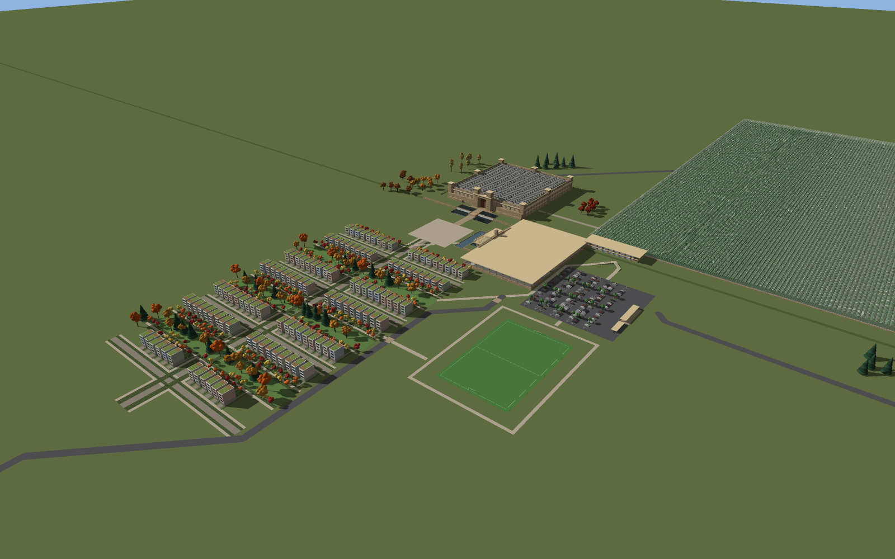
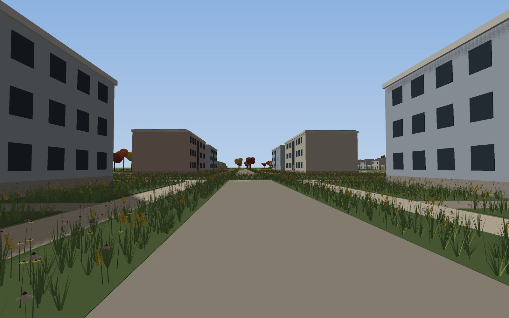
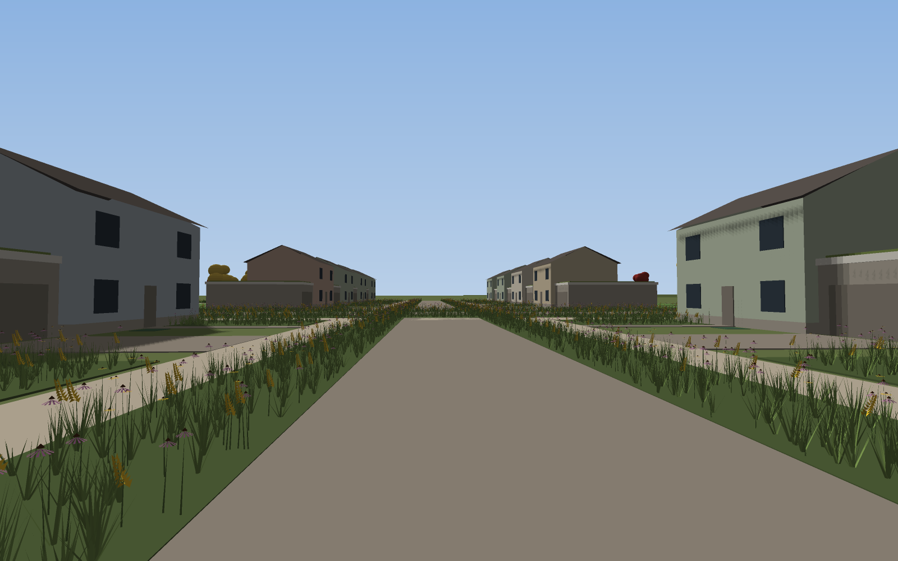
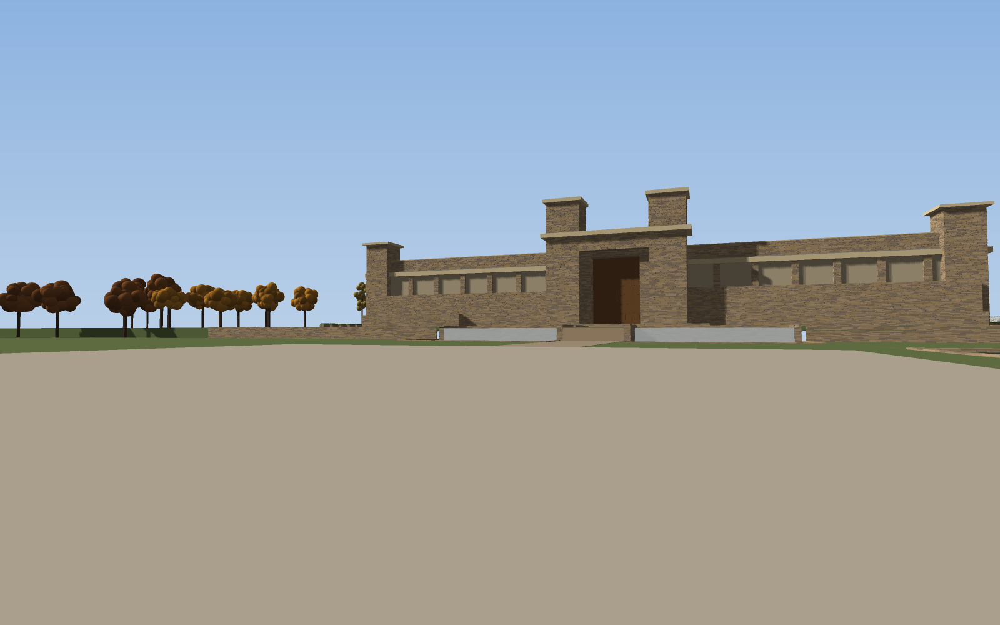

# Pass 3e: the neighbourhood at the campus edge

Jon, after seeing the winter garden and the food houses: "personally id wanna live by this place ...
id be thankful for the data center. not be angry that its there." This pass designs phase 1 of a
neighbourhood next to the campus and checks it. D11 in [PLAN.md](../PLAN.md) has Jon's brief and the
steers. Then (D16): "maybe some people actually just will want a small apartment ... smaller
apartments are closer to the city center while the larger/more remote the house gets, the further
away". Phase 1 has:

- 242 homes in three rings round the centre (D16):
  - 121 flats in 11 three-storey walk-ups nearest the square;
  - 98 townhouses, each over its own two-car garage-workshop, with no shared walls;
  - 23 four-bedroom houses furthest out;
- a public street from the town through each ring to a square;
- the greenhouse's entrance with a vegan food court and a market section that grows to order;
- a community center with an ice rink, a roller hockey floor, a two-court gym and a shared
  makerspace;
- one heated grass field with a walking loop.

`uv run brownfield village` (`src/brownfield/village.py`, `params/village.yaml`; output
`out/pass3/village.md`, and `out/pass3/village.json`, which forge `garden` draws from).

## The answer

- **Who lives there decides the rings.**
  - Pass 4's newcomers near the campus are about 121 households renting and 121 buying.
  - The renters take flats, in the mix now built to rent. Census 2025 found half of new rental
    flats are studios or 1-beds, so Jon's "small apartment" is half of what's built.
  - The buyers take townhouses, or houses if they need 4 bedrooms, as 19% of Indiana County's
    owners do.
  - That makes 584 people and about 117 school-age children, ~9 a grade against Homer-Center's ~60.
- **It is quiet enough to sleep beside, with ordinary fans.**
  - The greenhouse rings the hall and nobody sleeps inside it (D16), so the nearest homes, the
    flats, stand 258 m from the hall.
  - Every ring stays under the 40 dB(A) night guideline at its worst window with pass 2's own fans:
    flats 39.7, houses 39.5, townhouses 36.1.
- **Neighbours stay out of each other's sleep.** The flats' floors get 1 in. of gypsum concrete
  over a mat. That rates STC 63 / IIC 65 against the code's 50. The plain floor rates STC 48, under
  the code.
- **The data center heats the flats and the townhouses.**
  - The flats beat a heat pump on the loop even paying their own share of the pipes.
  - The townhouses tie and stay on it because the operator pays the pipes (D11).
  - The houses, 20 m apart, heat themselves with heat pumps: the loop would cost $45,488 a house
    over 20 years against $38,512.
  - The whole neighbourhood takes 16.8 GWh a year, 10.4 MW at its peak, with the heated walks and
    the hall's warm basins. The module's spare heat never runs short, and the tomato houses
    shrink from 43.5 to 38.5 ha.
- **Everything is a short walk.**
  - From the average home: 2.3 minutes to the community center and the winter garden, 4.0 to the
    square, 5.0 to the food court.
  - From the far end of each ring's spine, at most 7.5 minutes to any of them
    ([site plan](site.md)). Door by door along the streets, the furthest house is 11.9 minutes
    from the field.
- **What it costs, and who can pay:**
  - **Flats** don't pencil here, small or large. At market rents the 121 flats leave a $20.2M gap;
    as 4% tax-credit flats $18.7M; as 9% $6.1M (scarce, competitive credits). That gap is for the
    benefits agreement.
  - **A townhouse** ($441k as a price) is in reach of an AWS household ($117,000 a year, with
    $60,604 to spare). The county's median household is $81,866 short.
  - **A house** ($617k) is $114,849 beyond even an AWS household. The outer ring is the smallest
    for a reason.
- **The centre pays its way with memberships** (Jon: "costco x planet fitness x your adult rec
  sports").
  - Running it 24 hours costs $3.18M a year. Leagues and ice rental bring $0.43M.
  - At 7,200 members, Planet Fitness's average club, the rest is $31.78 a month each: between
    Planet Fitness's $15 and the Indiana County Y's $47.50.
  - The square, the mall, the garden and the walks stay free to everyone.
- **Sewage, not heat, limits growth.**
  - The module's spare heat could carry about 7,500 townhouses if the tomato houses gave way.
  - Homer City's sewage plant has average headroom for about 1,350 homes, and a wet month has
    already reached its rating (DEP consent order since 2022).
  - A town beyond phases 1-2 needs a new plant or the leaks into the sewers fixed.

## The rings of homes (D16)

`src/brownfield/rings.py`, in `brownfield village`.

| Ring | Homes | People | Each home | Lots | Land | Homes a hectare | School-age children |
|---|---|---|---|---|---|---|---|
| Flats | 121 | 221 | 10 studios, 52 1-beds, 48 2-beds, 11 3-beds in 11 walk-ups | 42 x 32 m | 3.3 ha | 37 | 36 |
| Townhouses | 98 | 284 | 1,445 ft2 over a garage-workshop | 9 x 24 m | 4.9 ha | 20 | 56 |
| Houses | 23 | 78 | 2,142 ft2, 4 bedrooms, a garage-workshop beside | 20 x 40 m | 3.3 ha | 7 | 24 |

- **The flats** are pass 3b's walk-up shell: 100 x 40 ft, three storeys, a central stair.
  - The flats are 500, 700, 900 and 1,200 ft2 for a studio to a 3-bed, the sizes HUD's cost
    limits assume; the 2-bed is pass 3b's corner flat.
  - With small flats each floor has a short corridor, leaving 3,150 ft2 of flats a floor.
  - A wood-frame building with NFPA 13R sprinklers may rise 4 storeys (IBC Tables 504.3-4). Three
    keep the top windows under the night guideline nearer the hall.
  - Without a lift, the ground-floor flats are built accessible (Fair Housing Act).
  - No garages: a storage locker each, and the hub's shared car park (D14).
- **The houses** are the median new American house on the median new lot (Census 2025): two
  storeys under a gable roof, with Jon's garage-workshop beside them.
- **School children** are from Rutgers' New Jersey multipliers by type and bedrooms. Montgomery
  County's 2025 Pennsylvania figures are lower for flats (0.07 a unit).

**Heat, one home a year** (pass 3's model):

| Home | Floor | Space heat | Garage | Hot water | Design load | On the loop |
|---|---|---|---|---|---|---|
| Studio flat | 46 m2 | 2.4 MWh | | 1.3 MWh | 1.9 kW | yes |
| 1-bed flat | 65 m2 | 3.3 MWh | | 1.7 MWh | 2.7 kW | yes |
| 2-bed flat | 84 m2 | 4.3 MWh | | 2.6 MWh | 3.4 kW | yes |
| 3-bed flat | 111 m2 | 5.7 MWh | | 3.5 MWh | 4.6 kW | yes |
| Townhouse | 134 m2 | 12.8 MWh | 2.2 MWh | 3.0 MWh | 8.8 kW | yes |
| House | 199 m2 | 20.4 MWh | 2.3 MWh | 4.1 MWh | 12.3 kW | no: its own heat pump |

**The loop against a home's own heat pump** (over 20 years, at each type's frontage):

| Home | Frontage | The loop, its share of the pipes in | The loop, the operator paying the pipes | Its own heat pump |
|---|---|---|---|---|
| 1-bed flat | 3.8 m | $20,671 | $16,260 | $21,809 |
| 2-bed flat | 3.8 m | $22,976 | $18,389 | $23,143 |
| Townhouse | 9.1 m | $32,052 | $23,151 | $31,743 |
| House | 20.0 m | $45,488 | $29,461 | $38,512 |

**The hall at night** (the loudest window of each ring's nearest homes; WHO 40 dB(A)):

| Ring | From the hall | Windows up to | Pass 2's fans | Fans 3 dB quieter |
|---|---|---|---|---|
| Flats | 258 m | 7.6 m | 39.7 dB(A) | 36.7 dB(A) |
| Townhouses | 404 m | 10.5 m | 36.1 dB(A) | 33.1 dB(A) |
| Houses | 261 m | 4.5 m | 39.5 dB(A) | 36.5 dB(A) |

**The flats' money** (pass 4's method by size: HUD's 2024 walk-up total development cost for
Johnstown, to 2026, with the gypsum-concrete floors; market rents scaled by HUD's fair market rents
for the county; tax-credit rents at 60% of the median income):

| Flat | To build | Market rent | Gap at market rent | Tax-credit rent | Gap, 4% credits | Gap, 9% credits |
|---|---|---|---|---|---|---|
| Studio | $178,983 | $1,050 | $110,161 | $785 | $108,140 | $41,201 |
| 1-bed | $243,085 | $1,170 | $153,190 | $850 | $144,289 | $53,375 |
| 2-bed | $307,009 | $1,350 | $185,624 | $1,044 | $162,765 | $47,944 |
| 3-bed | $403,797 | $1,829 | $198,359 | $1,225 | $206,027 | $55,007 |

**To buy** (NAHB's cost a square foot, the garage-workshop at ICC's; at 28% of income):

| Home | Price | The county's median household can pay | An AWS household | Gap (median) | Gap (AWS) |
|---|---|---|---|---|---|
| Townhouse | $441,475 | $359,609 | $502,079 | $81,866 | none ($60,604 to spare) |
| House | $616,929 | $359,609 | $502,079 | $257,320 | $114,849 |

## The townhouses

Narrow houses with an air gap between them, so one household's noise never reaches another's sleep.
Each stands over its own two-car garage that doubles as a workshop, with two storeys above. Three
ways to build them:

| Variant | Living floor | Home's heat a year | Per m2 | Garage at 10 C | Hot water | Design load | Water needed |
|---|---|---|---|---|---|---|---|
| Detached, 3 m gap (side windows allowed) | 134 m2 | 12.8 MWh | 95 kWh | 2.2 MWh | 3.0 MWh | 8.8 kW | 31 C |
| Detached, 1 m gap (blank, fire-rated sides) | 145 m2 | 12.0 MWh | 83 kWh | 2.2 MWh | 3.0 MWh | 8.5 kW | 30 C |
| Twin walls with an air gap, mid-row | 145 m2 | 8.3 MWh | 57 kWh | 2.2 MWh | 3.0 MWh | 6.9 kW | 28 C |

- **Heat:** every variant lies between pass 3's flat (51 kWh/m2) and its detached house (106).
- **Water temperature:** each home needs water at about 30 C on the coldest day; the data center
  sends 50 C.
- **Sound between homes:**
  - a single stud wall rates STC 36;
  - twin walls with an air gap rate 57-60, against the code's 50;
  - separate houses share no wall at all.
- **Side windows:** fire rules allow them only where houses are about 3 m apart (IRC R302.1).
- **Who owns the gap:** every metre of it belongs to one home, with a recorded easement for its
  neighbour, so no strip belongs to nobody.

How they look is still open. The drawings elsewhere show plain massing; the study above shows three
looks to choose from:
- **Left:** a sandstone garage storey with painted bays above.
- **Middle:** San Francisco, painted top to bottom, each house its own colour.
- **Right:** the campus's stone with ochre bands.

## The plan

- **The homes' setback.** No home stands within 150 m of the hall. With the greenhouse round the
  hall (D16), the nearest homes are 258 m out. Between them and the hall are the uses where people
  don't sleep: the glass, the mall, the square, the food court and the community center. Busy uses
  in the louder band and bedrooms beyond it is ordinary planning for noise.
- **Gardens, not lawns** (Jon: "some sort of green/property for the townhome"). Each lot has:
  - native meadow planting in front (grasses, goldenrod, coneflower), with a small rain garden that
    takes the roof's water;
  - planting and raised kitchen-garden beds behind;
  - the strip beside the house planted;
  - on the roof, a sedum green roof with a private deck at the back.

  Nothing deep-rooted stands near a foundation (Jon's rule since pass 3c). The new homes send their
  rain to rain gardens and street swales, not to the sewers.
- **Big trees on greens between the rows** (Jon: "neighborhoods with big trees"). Between each pair
  of back-to-back rows runs a 30 m green with a path to the square, as at Radburn, New Jersey
  (1929) and in Savannah's squares.
  - Its big trees stand on the middle, about 24 m from the nearest house. That is enough for
    sugar maple, black cherry and hemlock under the root setbacks the arboretum uses (up to 0.75
    of mature height).
  - Oaks, at up to 1.25 times their height, would need greens about 40 m wide, or deeper
    foundations on a checked soil.
  - The houses keep their own planting and no tree stands near a foundation.
- **Front doors on the greens, garages on the lanes** (Jon's reference: a walk between townhouses
  lined with small trees and clipped hedges). Each home's front door, bay windows and front garden
  face the green, and its garage-workshop opens onto the lane behind. Radburn's plan did the same:
  living rooms to the park, cars to the lane. Each walk is lined by:
  - small native trees: serviceberry, eastern redbud, flowering dogwood, ~9 m at maturity, low
    water demand. They stand ~7 m from the houses, inside the root rule for a tree that size
    (0.5-0.75 of its height).
  - clipped inkberry hedges (a native in place of boxwood);
  - smooth hydrangea and native planting.
- **The planting** is modelled plant by plant in the drawings: clumps of grass blades, purple
  coneflowers, black-eyed Susans and goldenrod plumes.
- **Living streets.** Each street is a 5.5 m shared lane with planted swales and walks on either
  side, in place of 15 m of asphalt. Houses step slightly in and out of line, and the rows beyond
  ~245 m go a storey higher.
- **One greenhouse, and the food court at its door** (Jon: "lets just have 1 big greenhouse ... the
  vegan food call can be at the front of the entrance"). The greenhouse's head house sits on the
  corner nearest the town, a walk from the square, with the food court inside its front door, like
  the food court at a Costco.
  - Just inside is the market section: about 0.75 ha of greens, herbs and strawberries. People's
    orders steer what's planted there, and townspeople buy straight from it.
  - The rest of the greenhouse grows tomatoes.
- **The community center** holds:
  - the ice rink;
  - the roller hockey floor;
  - a two-court gym;
  - eight dedicated indoor pickleball courts (Jon: "people who play pickleball love pickleball");
  - golf simulator bays on a mezzanine;
  - the makerspace.
- **One field, used hard.** The one real-grass field is soccer-sized and heated, and lined for youth
  and flag football and lacrosse too, with a walking and running loop round it. A second field, a
  dome or an indoor field house wait for the trust's booking calendar to show winter demand.
- **The streets.** A public spine street runs from the town straight to the square, lined by the
  new homes, so townspeople reach the square through the neighbourhood rather than around it. There
  are no gates or private roads.
- **The field** stands beside the mobility hub in the site plan ([D12](site.md)), where its
  visitors park. The capped coal ash site, to the northwest, stays open for a second field or the
  golf short course. Grass fields are a common reuse of closed landfills: Chisman Creek, Virginia,
  has played soccer and softball on capped ash since 1991-92. On a cap there are no deep roots and
  nothing built, subject to DEP's closure terms for 30 years of post-closure care. The real ash
  site's outline isn't in this model.

## Heat by month

GWh. The module's spare heat after the town network; the neighbourhood takes its share first, then
the tomato houses take theirs.

| Month | Spare | Homes | Shared buildings | Field | Heated walks | Warm basins | Market section | Tomato houses | Left to the air |
|---|---|---|---|---|---|---|---|---|---|
| Jan | 40.8 | 0.37 | 0.06 | 0.25 | 0.55 | 0.64 | 0.81 | 25.9 | 12.2 |
| Feb | 34.9 | 0.42 | 0.07 | 0.29 | 1.15 | 0.65 | 0.77 | 23.8 | 7.7 |
| Mar | 40.7 | 0.37 | 0.06 | 0.25 | 0.55 | 0.61 | 0.71 | 23.9 | 14.2 |
| Apr | 44.7 | 0.17 | 0.01 | 0.08 | 0.05 | 0.43 | 0.32 | 11.3 | 32.3 |
| May | 48.0 | 0.12 | 0.04 | 0.03 | 0.00 | 0.30 | 0.20 | 6.7 | 40.6 |
| Jun | 48.0 | 0.06 | 0.01 | 0.00 | 0.00 | 0.16 | 0.06 | 1.8 | 45.9 |
| Jul | 49.8 | 0.06 | 0.00 | 0.00 | 0.00 | 0.09 | 0.01 | 0.1 | 49.5 |
| Aug | 49.8 | 0.06 | 0.00 | 0.00 | 0.00 | 0.09 | 0.02 | 0.3 | 49.3 |
| Sep | 47.5 | 0.08 | 0.02 | 0.01 | 0.00 | 0.25 | 0.15 | 3.3 | 43.7 |
| Oct | 47.9 | 0.12 | 0.00 | 0.04 | 0.00 | 0.33 | 0.23 | 6.4 | 40.8 |
| Nov | 42.2 | 0.26 | 0.03 | 0.15 | 0.17 | 0.50 | 0.55 | 17.8 | 22.7 |
| Dec | 39.9 | 0.41 | 0.07 | 0.28 | 0.75 | 0.60 | 0.88 | 28.4 | 8.5 |

- **The homes** on the loop are the flats and the townhouses; the houses run their own heat pumps.
- **The heated walks** grow with three rings' spines and greens to about 15,000 m2.
- **The fields** are kept growing (root zone 13 C) at up to 90 W/m2. That's about 195 kWh/m2 over a
  winter, a figure from a European stadium case (low confidence).
- **The rink** heats itself from its refrigeration. CO2 rinks meet 88-100% of their own heat and
  export 80-100 kW, credited here to the community center from October to April.

## Who runs it, and who pays

D11 records five findings from real cases, which shaped this design:
- what makes a new neighbourhood mix with a town;
- how shared places last;
- who should own the heat loop;
- how a construction surge hits a town;
- whether a benefits agreement holds.

In short:
- **The shared places:**
  - built from an endowment paid up front under the benefits agreement;
  - run by a trust the operator funds but doesn't control, with renters, owners and townspeople on
    its board;
  - kept running by a set share of the campus's property tax the operator can't switch off.
- **The heat loop:** owned by a customer co-op or a town authority.
  - Prices are set at cost and published every year.
  - The network owns backup that can heat every home with the data center off.
- **Phase 1 opens before the AWS construction peak,** with first option for current Homer City and
  Indiana County renters.

| To build | USD |
|---|---|
| ice rink (one sheet) | $24.7M |
| community center (courts, roller hockey, indoor pickleball, bouldering, golf simulators, gym, makerspace) | $30.0M |
| food court at the greenhouse's entrance | $5.5M |
| makerspace tools | $0.1M |
| bouldering walls | $0.3M |
| one heated grass field and a walking loop | $0.8M |
| market section inside the greenhouse | $2.0M |
| **In all** | **$63.4M** |

The campus's county and township tax is about $28.3M a year. Its school tax, $67.7M more, can't pay
for these. With a 5% share the trust gets:

| Case | Trust a year |
|---|---|
| As assessed | $1.41M |
| After a won appeal cutting the assessment 24% | $1.08M |
| After a 90% cut | $0.14M |

## Running the centre (D16)

Jon: "a next generation costco x planet fitness x your adult rec sports type of town."
`src/brownfield/center.py`.
- **What's free and what isn't.**
  - Costco is members-only. A members-only town centre would be an enclave and would lose the
    natural surveillance that guards the hall (D12).
  - So the square, the mall, the winter garden, the walks and the field's loop are free to
    everyone.
  - Memberships pay for the gym, the courts, the rink, the climbing walls and the makerspace.

| A year | USD |
|---|---|
| The building: 19.7 full-time posts (6 on duty by day, 2 at night), at NRPA's $120,639 of operating cost a post, 54% of it pay | $2,371,020 |
| The rink (one sheet: a 2025 two-sheet study halved) | $764,000 |
| The field's upkeep | $40,000 |
| **Running cost** | **$3,175,020** |
| Adult hockey (12 teams at the Penguins Adult League's $3,599) | -$43,188 |
| Volleyball (16 teams, 3 seasons at $590) and pickleball (24 teams, 3 seasons at $220) | -$44,160 |
| Ice rented by the hour (30 hours a week for 30 weeks at Mt. Lebanon's $380) | -$342,000 |
| **Left for memberships** | **$2,745,672** |

| Paying members | The fee a month that covers it |
|---|---|
| 3,000 | $76.27 |
| 7,200 (Planet Fitness's average club) | $31.78 |
| 10,000 | $22.88 |

- **Against the market:** Planet Fitness's Classic is $15 a month; the YMCA of Indiana County's
  adult rate is $47.50.
  - At a Planet Fitness-sized membership the centre runs at about two thirds of the Y's price,
    with an ice rink, courts, climbing and a makerspace the Y doesn't have.
- **The host township and borough's people get it free.** At 25% uptake that is 1,526 people,
  costing the trust $0.58M a year at that fee, out of its $1.41M ($1.08M after a won appeal).
- **The food court** is a business of its own and isn't counted.

## How far it could grow

Jon: "plan for a city to develop around it." The master plan keeps land and the warm main's route
for later phases. What binds first:

- **Heat:** room for about 7,500 townhouses in all but the coldest 1% of hours, if the tomato houses
  gave way.
- **Sewage: the first limit.**
  - The plant is rated 0.65 million gallons a day and averages about 0.41.
  - At 182 gallons a day per customer, that's average room for about 1,350 homes.
  - A wet month already reached the rating.
- **Schools:** Homer-Center has 766 pupils, about 60 a grade; its capacity wasn't found.
- **People:**
  - Pass 4's jobs bring about 121 renter households and 121 buyers near the campus (D16).
  - Programmes that pay people to move for a place work at a modest scale. Tulsa Remote has brought
    3,972 since 2018 at $10,000 each, 64% of whom wouldn't have come without the money. Ascend WV
    has brought about 700 since 2021.
  - Cheap fresh food alone moves few people: food is 13% of US household spending, housing 34%
    (BLS 2025).

## What we don't know

- **The townhouses' look:** Jon's to choose (the facade study).
- **The cost of a home:**
  - the construction rate is a national survey of 41 builders;
  - the construction share of price (64%) is from NAHB's 2024 survey and still to confirm;
  - there's no Pennsylvania townhouse discount.
- **The shared places' running costs:**
  - staffing is set as posts on duty, by judgement; the rink's cost halves a two-sheet study; the
    field's upkeep and the members' count are placeholders;
  - the shared buildings' heat use (100 kWh/m2) is a placeholder.
- **The rings (D16):**
  - people per home by size, and buyers' share near the campus, are placeholders;
  - school children per home are New Jersey's (Rutgers), not Pennsylvania's;
  - the gypsum-concrete topping's cost ($4 a square foot) is a placeholder, and the floors'
    ratings are AWC's model estimates, with RedBuilt's tested detail a little lower;
  - the county's rents by size are from a copy of HUD's table.
- **Heated grass:** a field at 195 kWh/m2 comes from one stadium case.
- **The ash site:** its real outline, and whether DEP's closure terms allow a second field or the
  golf course there.
- **Growth limits:**
  - the water plant's capacity and the school district's capacity weren't found;
  - the sewage plant's wet-weather problem needs its own study.
- **Behaviour:** whether newcomers and townspeople mix, and whether the trust and the benefits
  agreement hold up, are design choices backed by real cases, not tested here.
- **Placeholders:**
  - the garage door's U-value and the garage's set point;
  - the glazing shares;
  - the food hall's size;
  - the trust's share of tax;
  - the down payment.
