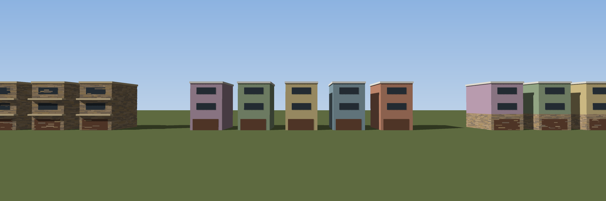
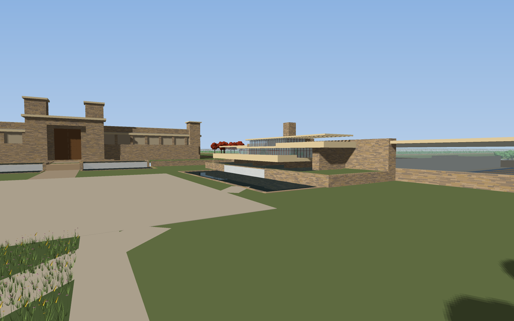
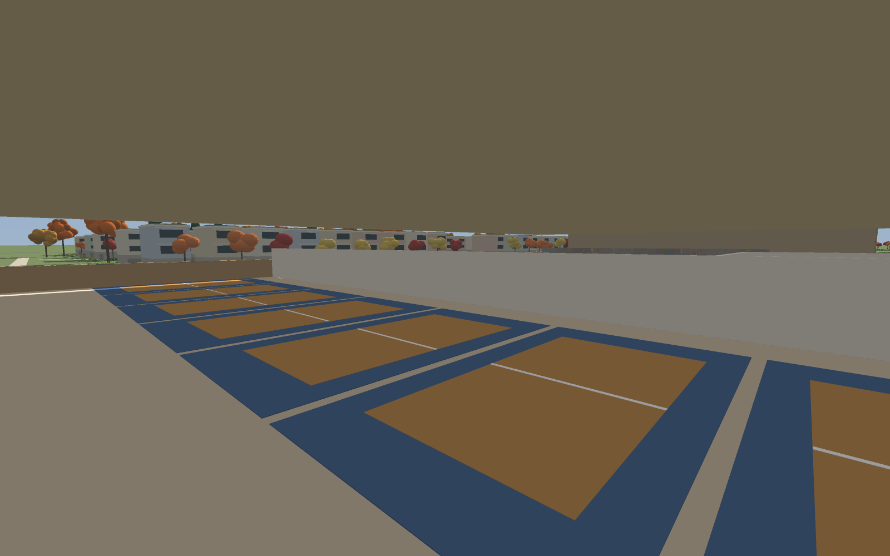
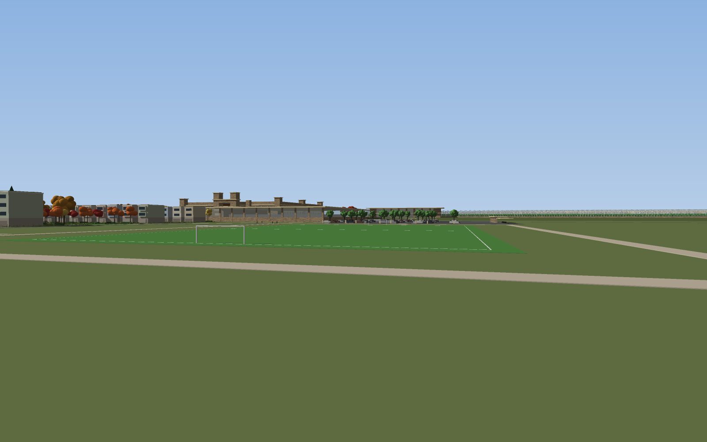
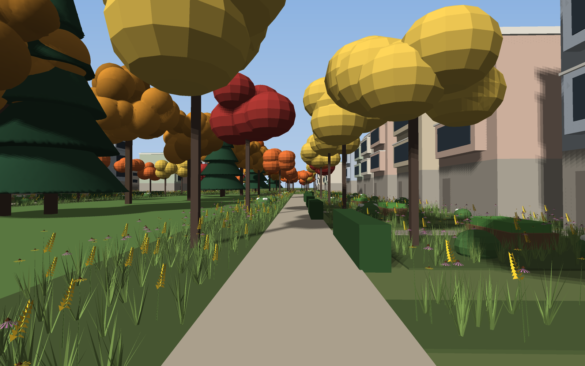
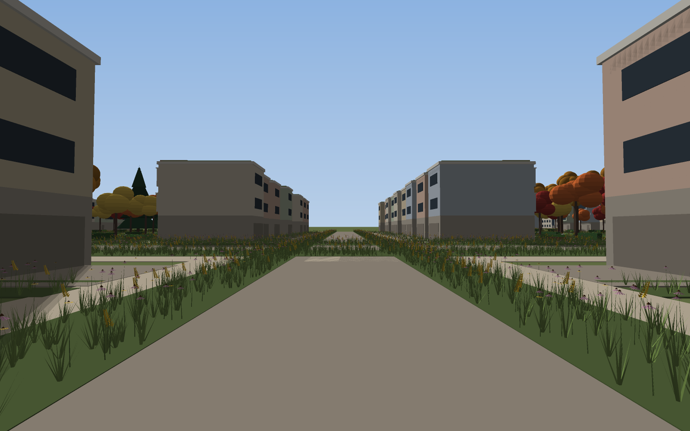

# Pass 3e: the neighbourhood at the campus edge

Jon, after seeing the winter garden and the food houses: "personally id wanna live by this place ...
id be thankful for the data center. not be angry that its there." This pass designs phase 1 of a
neighbourhood next to the campus and checks it. D11 in [PLAN.md](../PLAN.md) has Jon's brief and the
steers. Phase 1 has:

- 120 townhouses, each over its own two-car garage-workshop, with no shared walls;
- a public street from the town straight to a square;
- the greenhouse's entrance with a vegan food court and a market section that grows to order;
- a community center with an ice rink, a roller hockey floor, a two-court gym and a shared
  makerspace;
- one heated grass field with a walking loop.

`uv run brownfield village` (`src/brownfield/village.py`, `params/village.yaml`; output
`out/pass3/village.md`, and `out/pass3/village.json`, which forge `garden` draws from).

## The answer

- **The data center can heat all of it, easily.** The whole neighbourhood takes 10.6 GWh a year,
  7.4 MW at its peak, and the module's spare heat never runs short.
  - The heated field and the greenhouse's market section take more than the 120 homes do.
  - The ice rink heats itself from its own refrigeration and passes its surplus on.
  - The heated walks (D14) take about 2 GWh a year, keeping the walks snow-free all winter: 280 W/m2 at a design
    storm. Working systems run on 25-38 C water, so the loop's 40-50 C is ample. Holland, Michigan's
    sidewalks have run on its power plant's waste heat since 1988.
  - The tomato houses (pass 3d) shrink from 43.5 to 40 ha to make room.
- **It is quiet enough to sleep beside.** The homes start 150 m from the hall. Up to two storeys
  over the garage stay at or under the 40 dB(A) night guideline there with fans 3 dB quieter than
  pass 2's, an ordinary catalogue choice. With pass 2's fans they're 1.4-3.0 dB over. From about
  245 m out, any home is under the guideline whatever the fans.
- **Everything is a short walk.** Every door is within about 5 minutes of the square, 6 of the
  winter garden and 7 of the fields.
- **The loop beats a heat pump in each home, if the operator pays for the pipes.** Over 20 years a
  home's heat costs:
  - $23,000 on the loop when the network is paid for under the benefits agreement;
  - $34,000 when the home pays its share of the network;
  - $32,000 for its own heat pump;
  - $27,000 for a gas furnace.

  Running costs on the loop are about $315 a year, against $1,282 for the heat pump. So who pays for
  the network decides the price.
- **A townhouse costs more than local incomes reach.** It is $284,000 to build, about $441,000 as a
  price with land, fees and profit. A household on the area's median income ($83,800) can pay about
  $360,000. The gap is about $82,000 a home: for the benefits agreement, a co-op, or a cheaper
  design to close.
- **The shared places cost about $61 million to build,** most of it the rink ($25M) and the
  community center ($28M, now with indoor pickleball and golf simulators).
  - A 5% share of the campus's county and township property tax gives a trust $1.4 million a year.
  - A won assessment appeal could cut that to $0.14 million.
  - So they have to be built from an endowment paid up front, with the yearly share for running
    them.
- **Sewage, not heat, limits growth.**
  - The module's spare heat could carry about 7,500 townhouses if the tomato houses gave way.
  - Homer City's sewage plant has average headroom for about 1,350 homes, and a wet month has
    already reached its rating (DEP consent order since 2022).
  - A town beyond phases 1-2 needs a new plant or the leaks into the sewers fixed.

## The townhouses

Narrow houses with an air gap between them, so one household's noise never reaches another's sleep.
Each stands over its own two-car garage that doubles as a workshop, with two storeys above (three
further back). Three ways to build them:

| Variant | Living floor | Home's heat a year | Per m2 | Garage at 10 C | Hot water | Design load | Water needed |
|---|---|---|---|---|---|---|---|
| Detached, 3 m gap (side windows allowed) | 134 m2 | 12.8 MWh | 95 kWh | 2.2 MWh | 3.0 MWh | 8.8 kW | 31 C |
| Detached, 1 m gap (blank, fire-rated sides) | 145 m2 | 12.0 MWh | 83 kWh | 2.2 MWh | 3.0 MWh | 8.5 kW | 30 C |
| Twin walls with an air gap, mid-row | 145 m2 | 8.3 MWh | 57 kWh | 2.2 MWh | 3.0 MWh | 6.9 kW | 28 C |

- **Heat:** every variant lies between pass 3's flat (51 kWh/m2) and its detached house (106).
- **Water temperature:** each home needs water at about 30 C on the coldest day; the data center
  sends 50 C.
- **Sound between homes:**
  - a single stud wall rates STC 36;
  - twin walls with an air gap rate 57-60, against the code's 50;
  - separate houses share no wall at all.
- **Side windows:** fire rules allow them only where houses are about 3 m apart (IRC R302.1).
- **Who owns the gap:** every metre of it belongs to one home, with a recorded easement for its
  neighbour, so no strip belongs to nobody.

How they look is still open. The drawings elsewhere show plain massing; the study above shows three
looks to choose from:
- **Left:** a sandstone garage storey with painted bays above.
- **Middle:** San Francisco, painted top to bottom, each house its own colour.
- **Right:** the campus's stone with ochre bands.

## The plan

- **The homes' setback.** The homes start 150 m from the hall. Between them and the garden is the
  band where people don't sleep: the square, the food hall, the community center and the
  glasshouse. Busy uses in the louder band, bedrooms beyond it, is ordinary planning for noise.
- **Gardens, not lawns** (Jon: "some sort of green/property for the townhome"). Each lot has:
  - native meadow planting in front (grasses, goldenrod, coneflower), with a small rain garden that
    takes the roof's water;
  - planting and raised kitchen-garden beds behind;
  - the strip beside the house planted;
  - on the roof, a sedum green roof with a private deck at the back, looking north over the square
    to the winter garden.

  Nothing deep-rooted stands near a foundation (Jon's rule since pass 3c). The new homes send their
  rain to rain gardens and street swales, not to the sewers.
- **Big trees on greens between the rows** (Jon: "neighborhoods with big trees"). Between each pair
  of back-to-back rows runs a 30 m green with a path to the square, as at Radburn, New Jersey
  (1929) and in Savannah's squares.
  - Its big trees stand on the middle, about 24 m from the nearest house. That is enough for
    sugar maple, black cherry and hemlock under the root setbacks the arboretum uses (up to 0.75
    of mature height).
  - Oaks, at up to 1.25 times their height, would need greens about 40 m wide, or deeper
    foundations on a checked soil.
  - The houses keep their own planting and no tree stands near a foundation.
- **Front doors on the greens, garages on the lanes** (Jon's reference: a walk between townhouses
  lined with small trees and clipped hedges). Each home's front door, bay windows and front garden
  face the green, and its garage-workshop opens onto the lane behind. Radburn's plan did the same:
  living rooms to the park, cars to the lane. Each walk is lined by:
  - small native trees: serviceberry, eastern redbud, flowering dogwood, ~9 m at maturity, low
    water demand. They stand ~7 m from the houses, inside the root rule for a tree that size
    (0.5-0.75 of its height).
  - clipped inkberry hedges (a native in place of boxwood);
  - smooth hydrangea and native planting.
- **The planting** is modelled plant by plant in the drawings: clumps of grass blades, purple
  coneflowers, black-eyed Susans and goldenrod plumes.
- **Living streets.** Each street is a 5.5 m shared lane with planted swales and walks on either
  side, in place of 15 m of asphalt. Houses step slightly in and out of line, and the rows beyond
  ~245 m go a storey higher.
- **One greenhouse, and the food court at its door** (Jon: "lets just have 1 big greenhouse ... the
  vegan food call can be at the front of the entrance"). The greenhouse's head house sits on the
  corner nearest the town, a walk from the square, with the food court inside its front door, like
  the food court at a Costco.
  - Just inside is the market section: about 0.75 ha of greens, herbs and strawberries. People's
    orders steer what's planted there, and townspeople buy straight from it.
  - The rest of the greenhouse grows tomatoes.
- **The community center** holds:
  - the ice rink;
  - the roller hockey floor;
  - a two-court gym;
  - eight dedicated indoor pickleball courts (Jon: "people who play pickleball love pickleball");
  - golf simulator bays on a mezzanine;
  - the makerspace.
- **One field, used hard.** The one real-grass field is soccer-sized and heated, and lined for youth
  and flag football and lacrosse too, with a walking and running loop round it. A second field, a
  dome or an indoor field house wait for the trust's booking calendar to show winter demand.
- **The streets.** A public spine street runs from the town straight to the square, lined by the
  new homes, so townspeople reach the square through the neighbourhood rather than around it. There
  are no gates or private roads.
- **The fields** sit on a parcel marked as the capped coal ash site. Grass fields are a common
  reuse of closed landfills: Chisman Creek, Virginia, has played soccer and softball on capped ash
  since 1991-92. On a cap there are no deep roots and nothing built, subject to DEP's closure terms
  for 30 years of post-closure care. The real ash site's outline isn't in this model.

## Heat by month

GWh. The module's spare heat after the town network; the neighbourhood takes its share first, then
the tomato houses take theirs.

| Month | Spare | Homes | Shared buildings | Field | Heated walks | Market section | Tomato houses | Left to the air |
|---|---|---|---|---|---|---|---|---|
| Jan | 40.8 | 0.33 | 0.06 | 0.25 | 0.33 | 0.81 | 26.9 | 12.1 |
| Feb | 34.9 | 0.36 | 0.07 | 0.29 | 0.69 | 0.77 | 24.9 | 7.8 |
| Mar | 40.7 | 0.33 | 0.06 | 0.25 | 0.33 | 0.71 | 24.8 | 14.2 |
| Apr | 44.7 | 0.15 | 0.01 | 0.08 | 0.03 | 0.32 | 11.8 | 32.3 |
| May | 48.0 | 0.10 | 0.04 | 0.03 | 0.00 | 0.20 | 7.0 | 40.6 |
| Jun | 48.0 | 0.05 | 0.01 | 0.00 | 0.00 | 0.06 | 1.8 | 46.0 |
| Jul | 49.8 | 0.04 | 0.00 | 0.00 | 0.00 | 0.01 | 0.1 | 49.6 |
| Aug | 49.8 | 0.04 | 0.00 | 0.00 | 0.00 | 0.02 | 0.3 | 49.4 |
| Sep | 47.5 | 0.06 | 0.02 | 0.01 | 0.00 | 0.15 | 3.4 | 43.9 |
| Oct | 47.9 | 0.10 | 0.00 | 0.04 | 0.00 | 0.23 | 6.6 | 40.9 |
| Nov | 42.2 | 0.23 | 0.03 | 0.15 | 0.10 | 0.55 | 18.5 | 22.6 |
| Dec | 39.9 | 0.36 | 0.07 | 0.28 | 0.45 | 0.88 | 29.5 | 8.4 |

- **The fields** are kept growing (root zone 13 C) at up to 90 W/m2. That's about 195 kWh/m2 over a
  winter, a figure from a European stadium case (low confidence).
- **The rink** heats itself from its refrigeration. CO2 rinks meet 88-100% of their own heat and
  export 80-100 kW, credited here to the community center from October to April.

## Who runs it, and who pays

D11 records five findings from real cases, which shaped this design:
- what makes a new neighbourhood mix with a town;
- how shared places last;
- who should own the heat loop;
- how a construction surge hits a town;
- whether a benefits agreement holds.

In short:
- **The shared places:**
  - built from an endowment paid up front under the benefits agreement;
  - run by a trust the operator funds but doesn't control, with renters, owners and townspeople on
    its board;
  - kept running by a set share of the campus's property tax the operator can't switch off.
- **The heat loop:** owned by a customer co-op or a town authority.
  - Prices are set at cost and published every year.
  - The network owns backup that can heat every home with the data center off.
- **Phase 1 opens before the AWS construction peak,** with first option for current Homer City and
  Indiana County renters.

| To build | USD |
|---|---|
| ice rink (one sheet) | $24.7M |
| community center (courts, roller hockey, indoor pickleball, golf simulators, gym, makerspace) | $28.0M |
| food court at the greenhouse's entrance | $5.5M |
| makerspace tools | $0.1M |
| one heated grass field and a walking loop | $0.8M |
| market section inside the greenhouse | $2.0M |
| **In all** | **$61.1M** |

The campus's county and township tax is about $28.3M a year. Its school tax, $67.7M more, can't pay
for these. With a 5% share the trust gets:

| Case | Trust a year |
|---|---|
| As assessed | $1.41M |
| After a won appeal cutting the assessment 24% | $1.08M |
| After a 90% cut | $0.14M |

## How far it could grow

Jon: "plan for a city to develop around it." The master plan keeps land and the warm main's route
for later phases. What binds first:

- **Heat:** room for about 7,500 townhouses in all but the coldest 1% of hours, if the tomato houses
  gave way.
- **Sewage: the first limit.**
  - The plant is rated 0.65 million gallons a day and averages about 0.41.
  - At 182 gallons a day per customer, that's average room for about 1,350 homes.
  - A wet month already reached the rating.
- **Schools:** Homer-Center has 766 pupils, about 60 a grade; its capacity wasn't found.
- **People:**
  - Pass 4's jobs bring about 121 renter households near the campus.
  - Programmes that pay people to move for a place work at a modest scale. Tulsa Remote has brought
    3,972 since 2018 at $10,000 each, 64% of whom wouldn't have come without the money. Ascend WV
    has brought about 700 since 2021.
  - Cheap fresh food alone moves few people: food is 13% of US household spending, housing 34%
    (BLS 2025).

## What we don't know

- **The townhouses' look:** Jon's to choose (the facade study).
- **The cost of a home:**
  - the construction rate is a national survey of 41 builders;
  - the construction share of price (64%) is from NAHB's 2024 survey and still to confirm;
  - there's no Pennsylvania townhouse discount.
- **The shared places' running costs:**
  - the rink's energy is known (~1,040 MWh a year for a single sheet);
  - staff and upkeep aren't modelled;
  - the shared buildings' heat use (100 kWh/m2) is a placeholder.
- **Heated grass:** a field at 195 kWh/m2 comes from one stadium case.
- **The ash site:** its real outline, and whether DEP's closure terms allow fields there.
- **Growth limits:**
  - the water plant's capacity and the school district's capacity weren't found;
  - the sewage plant's wet-weather problem needs its own study.
- **Behaviour:** whether newcomers and townspeople mix, and whether the trust and the benefits
  agreement hold up, are design choices backed by real cases, not tested here.
- **Placeholders:**
  - the garage door's U-value and the garage's set point;
  - the glazing shares;
  - the food hall's size;
  - the trust's share of tax;
  - the down payment.
