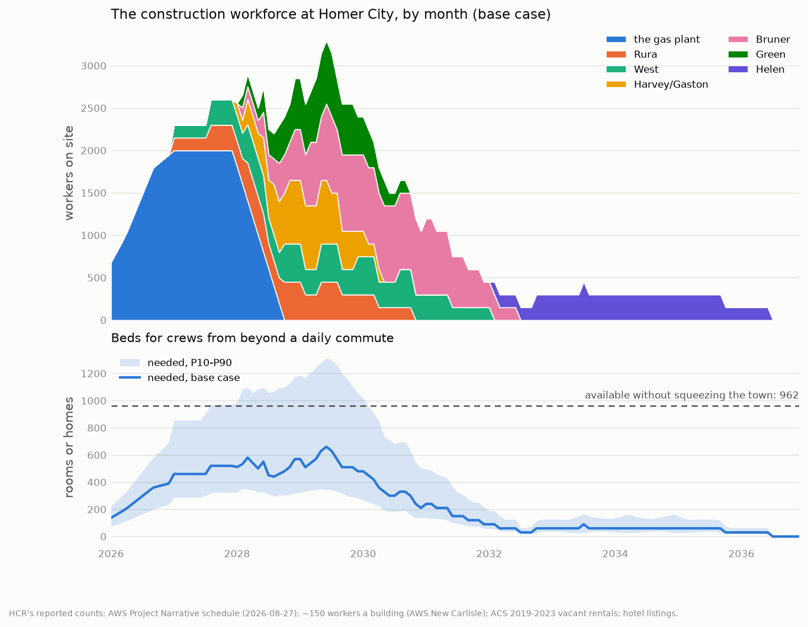

# The construction workforce, 2026-2036

The developers' "10,000+ construction jobs" is a total over the years, not a head count. The towns
need to know how many people are on site at once, when, where they sleep and how they get there.
They'll carry it for a decade, long before the permanent jobs arrive.

`uv run brownfield workforce` (`src/brownfield/workforce.py`, `params/workforce.yaml`) writes
`out/pass4/workforce.md` and the chart below.

## The answer

- **The peak is ~3,300 workers on site, in mid-2029** (2,900-5,300 across the uncertain inputs).
  - **The gas plant:** its crews (~2,000 through 2027, by HCR's own counts) are gone by late 2028.
  - **AWS:** five of its sites overlap from 2028 to 2030.
  - **The tail:** Helen keeps ~300 on site to 2036.
  - **In all:** about 12,900 worker-years over 2026-2036, in line with the developers' "10,000+
    jobs".

  | Year | 2026 | 2027 | 2028 | 2029 | 2030 | 2031 | 2032-35 | 2036 |
  |---|---|---|---|---|---|---|---|---|
  | Average on site | 1,453 | 2,446 | 2,577 | 2,750 | 1,588 | 775 | 250-312 | 68 |

- **The region can mostly staff it.** The peak is 6.4% of the 51,731 private construction jobs in
  the counties within a daily commute; Allegheny alone has 30,291. The gas plant reports 95% of its
  craft workforce "from the local area".
  - **The base case** assumes 30% from beyond a daily commute, since AWS's peak is mostly
    electricians and nearly double the gas plant's. That share is the least certain number here.
- **Beds: Indiana's empty rentals can take most crews, but not in the worst years.**
  - **Need:** at 30% from away and 1.5 to a room, the peak needs **~660 rooms or homes**.
  - **Supply:** without squeezing the town's own renters there are **962**:
    - 687 of Indiana County's 1,455 vacant rentals. The county's rental vacancy is 13.3%, against
      ~7% for a balanced market and 4.9% statewide. They sit mostly in Indiana borough (622) and
      White Township (539), the university town about 12 km north (IUP had 9,081 students in fall
      2024). Why so many stand empty, and in what condition, needs a landlord survey.
    - About 275 hotel rooms.
  - **The uncertainty:** across the uncertain inputs the need runs short in **32% of draws**, by up
    to ~370 at P90, for about 16 months round 2029.
- **The pinch is next to the site, not in Indiana.** Homer City borough has 227 renter households
  and no vacant rentals; Black Lick Township has none either; Center Township has 16.
  - **The risk:** crews on $110-a-night lodging allowances (the federal rate here) outbid the
    towns' renters, at a median rent of $699, for the few homes that come up.
  - **The answer:** steer crews to Indiana's empty rentals before they find Homer City's.
- **US 119 has the room; the gates don't.**
  - **The highway:** the morning shift puts ~1,600 vehicles on US 119 in the hour before 7:00, on
    top of its own ~500. That's 0.55 of two lanes' capacity (0.77 at P90; over capacity in 1% of
    draws).
  - **The gates:** 1,600 vehicles an hour turning in at one or two site gates is the real queue.
    That's for PennDOT's highway occupancy permit and the contractors' traffic plan, not the
    highway.
- **A correction to my earlier steer: don't count on crews to pay for the new flats.** The idea was
  to build the permanent flats first and lease them to crews during the peak, at lodging-allowance
  rents, to pay down their funding gap ($185,624 a two-bed flat).
  - **Why it fails:** with 1,455 vacant rentals at a median of ~$806 a few kilometres away, crews
    won't pay much above market for a new flat. The flats should be built for the people who will
    live in them (D16-D18).

**What the towns should ask for in the community benefits agreement:**
1. **A crew housing plan before construction:** contractors and AWS master-lease vacant rentals and
   hotel blocks in Indiana borough and White Township, which also brings those landlords income.
   Plus a reporting line on where crews stay.
2. **Protection for the towns next to the site:** notice and relocation help if a landlord in Homer
   City, Center or Black Lick re-lets to crews. Plus a rental registry so the townships can see it
   happening.
3. **Park-and-ride from Indiana and Blairsville,** with buses to the gates, and staggered shift
   starts across the sites. That's fewer cars at the gates and a share of the crews kept in the
   towns that have room for them.
4. **A trigger:** if the peak runs past ~4,500 on site (the high end), a temporary crew camp on the
   campus's own land, not the towns' rentals.

## How it was done

- **The gas plant** follows HCR's reported counts:
  - more than 1,000 (2026-03-26);
  - more than 1,800 (2026-09-04);
  - "approximately 2,000 total workers by year-end".

  It holds through 2027 and winds down to none by late 2028, after first power, which is targeted
  for early 2028.
- **AWS's sites** follow the filed schedule (Project Narrative, 2026-08-27, p. 2) and the buildings
  per site from the master plan (D17).
  - **Timing:** each site's buildings start evenly across its window, the last finishing at its
    completion date. Each is on site for 1.5 years with ~150 workers.
  - **The analog:** AWS's New Carlisle campus had more than 2,000 workers a day with about 14
    buildings under construction.
- **The region's trades:** private construction employment (NAICS 23, 2024 average, BLS QCEW) in
  the counties whose centre is within 80 km of the plant.
- **Beds:**
  - the share from away and the sharing (judgement, wide ranges);
  - the hotel rooms of Indiana's named hotels from listings (no county total is published), half
    of them holdable by crews;
  - the vacant rentals above a balanced market's ~7% (HUD's market analyses: balanced markets sit
    at ~6-8%) from ACS 2019-2023.
- **Traffic:**
  - PennDOT's count on the US 119 carriageway nearest the plant (5,554 a day);
  - the Highway Capacity Manual's peak-hour share (0.09) and multilane capacity (1,900 an hour a
    lane);
  - ~1.15 workers a vehicle (NHTS 2017, a little above its ~1.1 for work trips).
- **Uncertainty:** 2,000 draws from the triangular ranges of twelve inputs.

## What we don't know

- **AWS's own construction workforce plan.** AWS hasn't published one; its contractors will have
  one, and the county could ask for it with the final plan for each phase.
- **The share of crews from away.** This decides the beds. A survey of the gas plant's crews (where
  they live, how far they drive) would set it from Homer City's own experience, not analogs.
- **Workers per building.** The figure here comes from one AWS campus. Labour is heavier during
  electrical fit-out, and that is when the peak could run higher.
- **Where the vacant rentals really are, and their condition.** ACS's 5-year estimates (2019-2023)
  are averages with wide margins at the borough level. A landlord survey in Indiana would firm
  them up.
- **The site gates.** The traffic plan, the gates' locations and their turning capacity are the
  contractors' and PennDOT's. This only shows the highway has room.
- **Overlap with HCR's other work** (water treatment, substations, the old plant's demolition) and
  with other regional projects competing for the same electricians.
